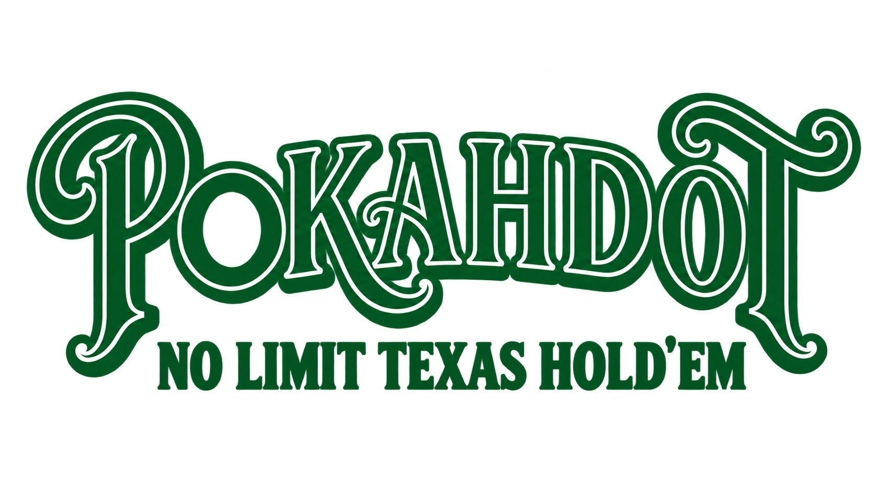

# 

The game will usually be available through [GitHub Pages](https://rofferdal.github.io/pokahdot/).

Pokahdot is a poker game built with [Godot](https://godotengine.org/) 4. The
rules live in a shared core (`scripts/core/`), so the same game can be played
through either the graphical interface or the terminal.

The project is under development. Active work is indexed in
[docs/README.md](docs/README.md).

## Requirements

- Godot **4.7.2** (GDScript, Compatibility renderer)
- The Godot binary available as `godot` in `PATH`, or the full editor path

## Start the graphical application (GUI)

1. Open the `pokahdot` folder in the Godot editor (**Import** / **Open**).
2. Press **Play Project** (F5). The startup screen is prefilled with 6 participants,
   1000 chips, and 5/10 blinds. Select **Start tournament** without editing to
   use those defaults, or change any value before starting.
3. The form validates whole-number input and the tournament constraints inline.
   A match is created only after all values are valid.
   Small-phone layouts support 2–7 players; tablet, small-desktop, desktop,
   CLI, and core configuration retain 2–9 support. Touch presses open the
   in-canvas number pad, while pointer focus leaves ordinary physical-keyboard
   entry available regardless of layout size.
4. **Use legacy heuristic models** is unchecked by default. Leave it unchecked
   to select only strategic `StrategyDecisionModel` profiles. Select it to
   include legacy heuristic profiles; this choice resets when returning to the
   startup screen.

From a terminal with the repository root as the working directory:

```bash
godot --path .
```

On macOS, if Godot is not in `PATH`:

```bash
/Applications/Godot.app/Contents/MacOS/Godot --path .
```

The GUI normalizes native display scale and actual Web canvas CSS geometry
through one viewport adapter. Startup, table and popups share safe-area bounds;
container/content minimums guide responsive fit. The replacement components and
presentation requirements remain tracked in the [GUI backlog](docs/RestructureGuiTasks.md).
Table copy, card visibility models and action availability now use pure
presentation models. Normal launch selects the reference table; the replacement
controller is available for review with `godot --path . -- --replacement-gui`.
Startup creates one selected table and adopts the existing validated match.
Reusable action-button and input-field scenes are implemented for the replacement;
their shared-control design is user-accepted. Reusable cards and the center board
are user-accepted. Full seat and human panels are provisionally user-accepted. Phone tokens, action
controls, event history and in-canvas overlays/keypads are implemented and verified;
opponents now share one fixed corner layout and the event-history box resizes
with its allocation. The keypad distinguishes backspace from Cancel, aligns
landscape rows and displays the Pot amount. Component galleries, opponent seats,
history scaling, menu and summary designs are user-accepted. The compact keypad
header is user-accepted. Phase 4 component design review is complete. The RG-50 seat-ring container and 2–9-seat
templates now place complete component footprints with reserved center/lower
regions. The human sits below neighbouring bots with an aligned action rail;
six/nine-seat placement and reconciled interiors are user-accepted. Bot amount
columns reserve seven digits; both human/bot pairs sit lower right. The RG-51 wide
composition is verified, including adaptive history docking and the embossed
logo. RG-52 phone composition and the RG-53 session/controller are implemented
in the opt-in path, with all revised Phase 5 designs user-accepted and final
verification passing (1,102 tests). Work stops before RG-60 as requested.
The reference remains
the default until RG-54. At 390×844 the current ordinary phone fixtures fit two
through five players; six/seven need more height. Guidance preserves the match
and retains menu/Quit access.

## Start headless (terminal)

Run the CLI entry point without a window:

```bash
godot --headless --path . --script res://scripts/cli/cli_app.gd
```

On macOS without `godot` in `PATH`:

```bash
/Applications/Godot.app/Contents/MacOS/Godot --headless --path . --script res://scripts/cli/cli_app.gd
```

Press Enter to start immediately, or type `configure` to edit setup. Options
after `--` include `--help`, `--configure`, `--players`, `--stack`,
`--small-blind`, `--big-blind`, and `--seed`. Startup prints the effective seed
and reproduction options for the actual match. Invalid setup fields can be
corrected without reentering valid edits.

The terminal interface supports a complete tournament with poker actions
including `potbet` and `potraise`, compact updates, `state` for the complete
recipient-safe snapshot, and `history` for the current hand's public actions.
Between hands, only Enter or `continue` deals again; `help`, `quit`, and `exit`
are available during play. See the [CLI guide](devdocs/how-to/running-and-testing.md#launch-the-interactive-cli)
for reproducible transcript commands. Game rules remain in `scripts/core/`.

## Blind levels and Pot wager

The selected blinds are the first level's blinds. A level that begins with five
or more active players lasts twice that starting player count in completed
hands; a level that begins with fewer than five players lasts 10 completed
hands. Startup stacks and blinds are positive integers capped at 1,000,000. An
increase applies to the next hand. The next big blind is 125% of the previous
big blind, rounded upward to an even integer, and the small blind is half of it
(for example, 5/10 becomes 7/14, then 9/18). Growth saturates at
500,000/1,000,000 while level timing continues. The CLI and table show the
current blinds, level, completed hands, and hands remaining in the level.

Minimum full raises use the previous full betting increment on that street.
With BB 10, raising 10→30 makes the next minimum 50; raising 30→60 makes it 90.
An opening postflop bet of 40 requires a raise to at least 80. Short all-ins
preserve the increment and do not cumulatively reopen closed raise rights.
The increment resets on each street. GUI and CLI display the core's current
legal totals; see the [betting rules](docs/ProjectDescription.md#45-actions-no-limit).

When it is a legal bet or raise and the hero can cover it, the GUI's **Pot
bet**/**Pot raise** control and the CLI's `potbet`/`potraise` command submit an
exact pot-sized target total through the normal wager-validation path. With pot
`P`, existing hero street wager `H`, and call amount `C`, the product target is
`T = H + P`. The action adds exactly `P` chips and leaves a pot of `2P`; when a
call is due, the remaining part of that contribution is the raise increment.
The visible shortcut amount remains `P`; the internal total remains `H + P`.
The shortcut is unavailable when the exact target is outside the legal
minimum/maximum range; **All-in** and free wager entry remain separate controls.
This is a No Limit convenience preset, not a Pot Limit game mode: the
conventional Pot Limit post-call raise formula is intentionally not used for
this product shortcut.

The GUI reflows large chip values while retaining every digit. On compact
tablet and small-desktop tables with large values, **Bet**/**Raise** opens the
number pad for free entry; **Min**, **Pot**, and **All-in** remain available on
the table. Phone layouts also expose wager presets in the number pad.

### Bot roster selection

Standard GUI and CLI games select strategic `StrategyDecisionModel` profiles
only. To include legacy heuristic models in an interactive CLI game, pass this
flag after Godot's `--` argument separator:

```bash
godot --headless --path . --script res://scripts/cli/cli_app.gd -- --use-legacy-models
```

When legacy models are enabled, `ceil(bot_count / 2)` bot seats receive legacy
heuristic profiles and the remaining seats receive strategic profiles. The
selection is deterministic for a fixed tournament seed; diagnostics state
whether legacy models are included and list every selected model and profile
ID. Neither option exposes opponent hole cards.

## Deterministic simulation and bot-profile workflow

The non-interactive simulation command evaluates bot-only tournaments. It is
separate from the interactive CLI and never prompts for human input. Run every
command from the repository root:

```bash
godot --headless --path . --script res://scripts/simulation/simulation_cli_app.gd -- \
  help
```

Simulation manifests are schema-2 JSON documents with a batch ID, seed start,
immutable profile snapshots, regimes, matchups, and named evaluation plans.
Every matchup must provide exactly the number of profiles required by its
regime. The manifest is the source of profile identity for an evaluation; it
does not read or mutate the playable product roster.

To establish a benchmark for the presently playable roster, export a baseline
manifest. The command atomically writes immutable profile snapshots; it does
not alter the roster. Defaults use the `curated_v2`-derived batch ID, seed
`71001`, 100bb 5/10 tables, and 2520 balanced cyclic tournaments. The current
18-profile catalog is covered by deterministic nine-seat matchups without
raising the product table-size limit.

```bash
godot --headless --path . --script res://scripts/simulation/simulation_cli_app.gd -- \
  export-roster-manifest --output artifacts/curated_roster_baseline.json \
  --batch-id curated_baseline_2026 --seed 72001 --tournament-count 2520
```

`--overwrite` is required to replace an existing export. `--regime-preset
standard` explicitly selects the current 100bb baseline; no other preset is
accepted. Validate the exported file unchanged before running it.

Validate a manifest before starting a tournament. This prints the normalized
manifest and complete deterministic plan without creating an artifact:

```bash
godot --headless --path . --script res://scripts/simulation/simulation_cli_app.gd -- \
  validate --config path/to/manifest.json --format json
```

Run a batch by choosing a new output path. `run` writes the complete report
atomically. Both formats print a compact completion summary to stdout and
progress counts, elapsed time and throughput to stderr.
Application failures use stderr. See the authoritative
[stream and replay contract](docs/Simulation_And_Evolutionary_Bot_Strategy.md#44-stdout-stderr-and---output). Existing outputs are protected; use `--overwrite` only
when intentionally regenerating the same artifact.

```bash
godot --headless --path . --script res://scripts/simulation/simulation_cli_app.gd -- \
  run --config path/to/manifest.json --output artifacts/batch_report.json \
  --trace sampled --trace-sample 5 --format json
```

For parallel execution, give every worker the same manifest and a distinct
`--shard INDEX/COUNT`, such as `0/4`, `1/4`, `2/4`, and `3/4`. Keep all shard
reports: fitness evaluation requires the complete, non-overlapping set from
one manifest. A dry run verifies the selected shard without playing:

```bash
godot --headless --path . --script res://scripts/simulation/simulation_cli_app.gd -- \
  run --config path/to/manifest.json --shard 2/4 --dry-run --format json
```

Runs checkpoint each completed tournament under `OUTPUT.checkpoint` by default.
After interruption, repeat the same command with `--resume`; use `--checkpoint
DIR` to select a different directory. Resume requires the same manifest, source
provenance, shard and trace settings. `--overwrite` replaces reports only and
never resets checkpoints. Execution streams results with bounded memory; see
the [checkpoint and resume contract](docs/Simulation_And_Evolutionary_Bot_Strategy.md#422-checkpointed-execution-and-resume).

Reports use schema 4 and command v6. They retain the exact manifest/checksum,
roster provenance, and executable provenance: Git revision, executable-source
dirty fingerprint, Godot version, and algorithm versions. Fitness rejects
shards with different provenance. Replay reports outcome and provenance
mismatches separately. Older reports remain immutable historical artifacts and
must be rerun for current promotion use.
Manifest seeds and their complete planned range must fit the
[lossless JSON seed contract](docs/Simulation_And_Evolutionary_Bot_Strategy.md#21-batch-architecture-and-sharding).

```bash
godot --headless --path . --script res://scripts/simulation/simulation_cli_app.gd -- \
  inspect --report artifacts/batch_report.json --format text

godot --headless --path . --script res://scripts/simulation/simulation_cli_app.gd -- \
  replay --report artifacts/batch_report.json --tournament-index 17 --format json
```

Keep manifests, every report shard, replay outputs, code revision, and the
command output together in durable storage. Never edit a completed report or
reuse a filename for a different run. The checked-in
[`examples/simulation/milestone6`](examples/simulation/milestone6) pair is a
small three-profile, three-seat smoke batch; it demonstrates validation,
cyclic rotation, inspection, and replay. It is not promotion evidence.

Simulation progress uses stderr in both formats; stdout contains the completion
summary. Replay accepts `--trace sampled --trace-sample 100` for bounded safe
traces in its optional output artifact. See the [run guide](devdocs/how-to/running-and-testing.md#headless-batch-simulation-runner)
for captured-stream and replay commands.

### External profile evolution and reviewed promotion

`tools/profile-evolution` is a separate Python workflow that writes strict,
checksummed JSON artifacts. It never writes the playable roster. Start from
bounded strategy genes, then create a deterministic generation:

```bash
tools/profile-evolution init-generation \
  --bounds examples/profile_evolution/milestone5/bounds.json \
  --population-size 20 --seed 7001 --output artifacts/generation_0.json
```

For selected candidates across generations, use
[`prepare-experiment` and `compare-experiment`](devdocs/how-to/preparing-bot-experiments.md)
to generate a common evaluation cohort and independent confirmation manifests,
preview commands without writes, and rank compatible reports. Comparison
preserves original lineage and prepares an evaluated registry; consolidated
promotion decisions remain with an independent reviewer.

Build a simulation manifest that contains the candidate snapshots from that
generation plus the required baselines. Run every planned shard with the
simulation command above, then evaluate and select only the complete report
set:

```bash
tools/profile-evolution evaluate-fitness \
  --generation artifacts/generation_0.json \
  --report artifacts/evaluation_shard_0.json \
  --report artifacts/evaluation_shard_1.json \
  --output artifacts/fitness_0.json

tools/profile-evolution select --fitness artifacts/fitness_0.json \
  --elite-fraction 0.15 --output artifacts/selection_0.json

tools/profile-evolution crossover --selection artifacts/selection_0.json \
  --seed 7002 --target-count 20 --output artifacts/crossover_1.json

tools/profile-evolution mutate --input artifacts/crossover_1.json \
  --policy examples/profile_evolution/milestone5/mutation_policy.json \
  --seed 7003 --output artifacts/generation_1.json
```

Build and retain lineage before confirmation. A promotion candidate needs
independent mirrored and mixed-table reports against declared legacy bots and
historical champions. A batch win, a single narrow matchup, an invalid-action
fallback, or insufficient uncertainty/diversity evidence cannot promote a
profile. Fitness plan minimums classify exploratory results only. The fixed
`promotion_evidence_v1` gate independently requires at least 300 tournaments
per matchup, at least 100 candidate observations in every seat, and a positive
lower 95% confidence bound for the paired composite advantage over every
declared benchmark in that matchup. The effective minimum is
`max(300, 100 * player_count)` tournaments per matchup; see the
[confirmation contract](docs/Simulation_And_Evolutionary_Bot_Strategy.md#5-external-profile-evolution-tool).

```bash
tools/profile-evolution build-lineage --artifact artifacts/generation_0.json \
  --artifact artifacts/fitness_0.json --artifact artifacts/selection_0.json \
  --artifact artifacts/generation_1.json --output artifacts/lineage.json

tools/profile-evolution confirm-candidate --registry artifacts/lineage.json \
  --candidate-id candidate_id --legacy-id random_default \
  --legacy-id tight_passive_default --legacy-id loose_aggressive_default \
  --historical-champion-id champion_id \
  --mirrored-report artifacts/mirrored_report.json \
  --mixed-report artifacts/mixed_report.json --output artifacts/confirmation.json
```

An independent reviewer handles the complete proposed candidate set in one
editable plan. Each candidate receives exactly one `approve` or `reject`
decision, after which the plan is finalized into one immutable review artifact
bound to every exact eligible confirmation. The plan compares every candidate
pair with separate genetic-distance and measured VPIP/PFR/action-rate
evidence; those comparisons inform but never replace the human decisions.
Publication creates a new versioned `.tres` file for an approved candidate and
refuses to overwrite an existing one. It still does not activate the profile:
roster membership is a
separate reviewed source change that must retain the legacy personalities.

```bash
tools/profile-evolution prepare-promotion-review \
  --confirmation artifacts/confirmation.json \
  --reviewer-id reviewer_id \
  --output artifacts/promotion_review_plan.json

# In the plan, change each decision from "pending" to "approve" or "reject".
tools/profile-evolution finalize-promotion-review \
  --plan artifacts/promotion_review_plan.json \
  --confirmation artifacts/confirmation.json \
  --output artifacts/promotion_review_batch.json

tools/profile-evolution publish-profile --confirmation artifacts/confirmation.json \
  --review artifacts/promotion_review_batch.json --version v1 \
  --display-name "Candidate v1" --project-root .
```

Repeat `--confirmation` in both review commands for additional candidates.
The editable plan also has optional `display_name` and `review_note` fields.
Do not alter candidate or confirmation fields, checksummed artifacts,
overwrite published profiles, or
treat an approval as permission to change `PlayableBotRoster` automatically.
Publication also creates an adjacent no-clobber `.provenance.json` sidecar that
binds the profile ID and exact Resource hash to confirmation and review checksums.
Checksums establish content integrity, not reviewer identity or independence.

## Development checks

Install the pinned development tools in a local virtual environment:

```bash
python3 -m venv .venv
.venv/bin/python -m pip install -r requirements-dev.txt
```

Run the GDScript linter and verify formatting without modifying files:

```bash
.venv/bin/gdlint scripts tests
.venv/bin/gdformat --check scripts tests
```

Run the Godot tests headlessly:

```bash
godot --headless --path . -s addons/gut/gut_cmdln.gd
```

For GUI layout work, start with the rendering-enabled capture smoke test:

```bash
make gui-visual-capture-smoke
```

The invariant gate, dirty-tree development capture, and clean candidate
capture have different evidence semantics. Follow
[`docs/GUI_VISUAL_TESTING.md`](docs/GUI_VISUAL_TESTING.md) and use
[`docs/templates/GUI_DEFECT.md`](docs/templates/GUI_DEFECT.md) for every GUI
defect. The complete command reference is also available in
[`devdocs/how-to/running-and-testing.md`](devdocs/how-to/running-and-testing.md).
`make check gui-current-invariant-gate` runs the complete headless suite and
the historical, phone, iPad, and desktop layout matrices during development.
`check` also compares the step-80 GUI policy/fit characterization with its
reviewed reference registry; recorded defects remain open. Use
`make gui-layout-sweep` for the additional step-20 diagnostic samples.
Pull requests run the same checks through `release-candidate-gate` on a clean
proposed merge, using Godot 4.7.2, without deployment. Failures appear in the
**Checks and current layouts** status; **Exported Web input** separately tests
real browser input against an isolated release export. Maintainers can require
both statuses in branch protection. `make web-release` creates a local export. Every successful push
to `main` automatically validates and deploys that commit to GitHub Pages; follow
[`docs/OPTIONAL_WEB_SETUP.md`](docs/OPTIONAL_WEB_SETUP.md).

## Local Wi-Fi testing

Build and serve the production game from your working tree before merging or
deploying. Follow [Build and serve the latest game over local Wi-Fi](devdocs/how-to/local-wifi-web-testing.md)
for first-time HTTPS setup and device trust. If the LAN server is already
running, save your files and rebuild from another terminal:

```bash
make GODOT=/Applications/Godot.app/Contents/MacOS/Godot web-lan-rebuild && make web-lan-status
```

Reopen the HTTPS root URL from devices on the same Wi-Fi to select the new
export; starting a second server is unnecessary. Compare the build ID in the
resulting `/builds/<build-id>/index.html` URL with `make web-lan-status`.
Godot can reset the stamped tab title after startup, so use the URL to identify
the running build. Stop with Ctrl+C or
`make web-lan-stop`. Outputs and certificates stay under ignored `localtmp/`.
The completed server workflow is recorded in [LanTestTasks.md](docs/arkiv/LanTestTasks.md).
GUI/device review and demonstrated browser defects are recorded in
[AstraSuggestionTasks.md](docs/arkiv/AstraSuggestionTasks.md#gui-05-browser-capture-review)
and the archived [phone review](docs/arkiv/OptimizingPhoneGuiTasks.md).

## GUI action pace

The shared transparent Pokahdot logo appears above the Start form and as a
subtle embossed mark beneath table content. The Start form adapts its optional
header content without scrolling or shrinking essential controls. The active
[GUI replacement backlog](docs/RestructureGuiTasks.md) records current visual
reviews, including the accepted phone-portrait redesign: two opponent seats per
row, a centered top seat for odd opponent counts, and the community group above
the human controls. These reviewed increments precede the remaining component
and layout replacement work.

The GUI waits two seconds after rendering each player action and each flop,
turn, or river reveal, then five seconds after a completed hand. Opening a
table overlay holds advancement until it closes, so hand summaries remain
readable. Non-phone seat-status bands show showdown hands or `Winner` for fold
wins. On phones, completed-hand feedback names the winners while keeping cards
visible; **Pots** opens exact main/split/side-pot awards directly. During play,
the same button remains **More**. Overlays block underlying actions, contain keyboard
focus, and offer Close/Cancel. Tournament Quit stays outside numeric entry;
cancel/close the keypad before using table/menu Quit. Keypad Cancel preserves the original
text exactly; only Done commits.

Edit `resources/gui_action_timing_config.tres` in Godot to change
`default_pause_seconds`, add a `pause_seconds_by_seat` entry for a bot seat
(for example, seat `1`), or change `showdown_pause_seconds`. Set a value to
`0.0` for immediate progression during development.

## Directory structure

```
pokahdot/
├── scenes/                 # Graphical UI (.tscn)
├── scripts/
│   ├── core/               # Game logic without UI
│   ├── gui/                # Scripts for Control nodes
│   └── cli/                # Terminal UI (headless)
├── resources/              # Custom Resources, such as card data (.tres)
└── assets/                 # Sprites, fonts, and sounds
```

GUI automated coverage and manual device acceptance are listed separately in
the [visual evidence contract](docs/GUI_VISUAL_TESTING.md#current-support-and-acceptance).
Physical-phone acceptance limitations remain recorded in the archived phone
review; the reference phone landscape remains diagnostic. The replacement
backlog targets responsive portrait and landscape phone/tablet layouts.
