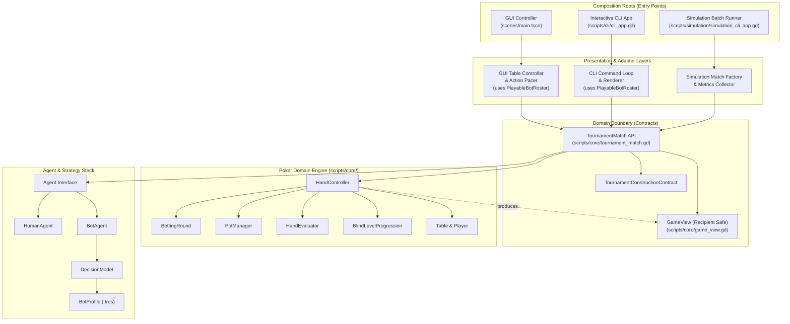
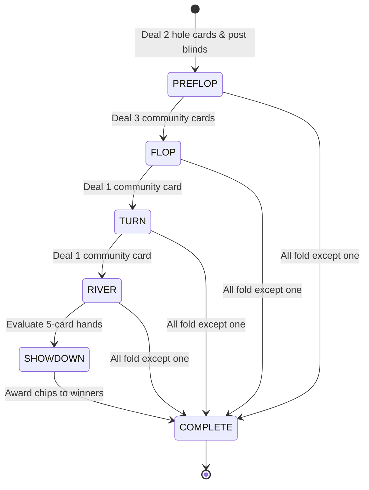
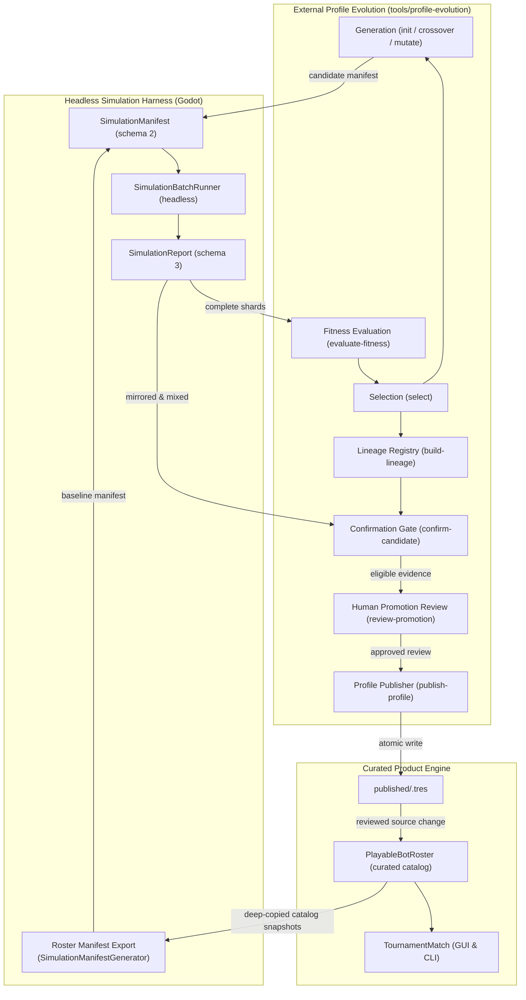

# Architecture Reference: Pokahdot System Design

This document provides an instructive reference to the architecture and structural design of Pokahdot. It is written to give developers an intuitive, clear understanding of how the components fit together, where boundaries lie, and how data flows through the system.

---

## 1. High-Level Architectural Pattern: Hexagonal / Ports & Adapters

Pokahdot follows a layered, hexagonal (ports and adapters) architecture. The poker domain core sits at the center, shielded from external systems, input mechanisms, and display frameworks.



### Key Architectural Rule: Dependency Direction
**All dependencies point inward.**
- `scripts/core/` depends **only** on core Godot types (`RefCounted`, `Resource`, `RandomNumberGenerator`).
- `scripts/core/` has **zero dependencies** on `Control`, `SceneTree`, UI components, or standard I/O (`stdin`/`stdout`).
- Presentation layers (`scripts/gui/`, `scripts/cli/`) and simulation (`scripts/simulation/`) depend on `scripts/core/`, never the other way around.

---

## 2. The Three Composition Roots

A "composition root" is the place where configuration is loaded, dependencies are instantiated, and the game loop is wired together. Pokahdot has three distinct composition roots:

| Root | Entry Point | Contract | Purpose |
| :--- | :--- | :--- | :--- |
| **GUI Root** | `scenes/main.tscn`<br>`startup_config_controller.gd` | `TournamentConstructionContract.product()` | Graphical player game with interactive table, cards, avatars, and visual action pacing. Uses `GuiMatchFactory` and `PlayableBotRoster`. |
| **Interactive CLI** | `scripts/cli/cli_app.gd` | `TournamentConstructionContract.product()` | Terminal-based game with text prompts, ASCII/Unicode cards, and standard input/output. Uses `CliMatchFactory` and `PlayableBotRoster`. |
| **Simulation CLI** | `scripts/simulation/simulation_cli_app.gd` | `TournamentConstructionContract.simulation()` | Non-interactive, high-throughput headless runner for testing bot parameters across thousands of tournaments. Uses `SimulationMatchFactory`. |

### The Composition Contract (`TournamentConstructionContract`)
To prevent accidental creation of all-bot games in the product (or human waits in simulation), `TournamentMatch` requires a contract:
- `TournamentConstructionContract.product()`: Requires **exactly one** `HumanAgent`. Used by GUI and Interactive CLI.
- `TournamentConstructionContract.simulation()`: Requires **zero** `HumanAgent` instances (all seats must be bots). Used exclusively by simulation.

---

## 3. Core Engine Subsystems

### 3.1 Tournament Lifecycle (`TournamentMatch`)
`TournamentMatch` coordinates the overall single-table tournament across multiple hands.

```text
       NOT_STARTED
            │ start()
            ▼
         RUNNING ◄──────────────┐
            │                   │ Hand finished,
            │ advance_...()     │ next hand starts
            ▼                   │
     HandController (Active) ───┘
            │
            ├─ All but 1 player busted ──► FINISHED (Reason: winner)
            └─ Human requests quit ──────► FINISHED (Reason: player_quit)
```

- **States**: `NOT_STARTED`, `RUNNING`, `FINISHED`.
- **Primary Methods**:
  - `start() -> StepResult`: Initializes table, sets button, and launches Hand #1.
  - `advance_until_blocked() -> StepResult`: Advances until user input is required or hand finishes.
  - `advance_one_action() -> StepResult`: Steps one single poker action (useful for GUI pacing and animations).
  - `submit_human_action(action) -> StepResult`: Submits the human move and continues execution.
  - `request_quit() -> StepResult`: Terminates the tournament immediately without declaring a winner.

### 3.2 Hand Progression (`HandController`)
`HandController` manages a single poker hand through its distinct phases:



At each street:
1. `BettingRound` is created to collect wagers.
2. If only one player remains (all others fold), that player wins the pot uncontested.
3. If multiple players remain after the River, `HandEvaluator` compares hands at `SHOWDOWN`.
4. `PotManager` resolves all main and side pots and credits players' stacks.

### 3.3 Wagering Rules (`BettingRound`)
`BettingRound` enforces No Limit Hold'em rules:
- **Target Totals**: Wagers are specified as the **target total commitment** for the current street.
  - If big blind is 10 and player raises to 30, the amount is `30` (not +20).
- **Minimum Raise**: A full raise must reach at least `current_bet + big_blind`.
- **Under-raises (All-in)**: An all-in bet below the minimum raise is legal, but does **not reopen the betting** for players who already faced and matched the previous full wager.
- **Raise Rights**: Tracks which seats still have the option to reopen raising on this street.

### 3.4 Pot Management & Side Pots (`PotManager`)
`PotManager` records each player's chip contributions across the hand.
- At settlement, it decomposes total contributions into stacked `PotLayer` instances (Main Pot, Side Pot 1, Side Pot 2...).
- Each `PotLayer` maintains a list of eligible seat indices.
- Odd chip rule: Remainder chips from integer division split pots are awarded to the first eligible seat clockwise from the dealer button.

### 3.5 Hand Evaluation (`HandEvaluator`)
A pure, stateless algorithmic evaluator:
- Takes 5 to 7 `CardData` instances.
- Generates all $\binom{n}{5}$ combinations (21 combinations for 7 cards).
- Returns a strongly typed `HandRank` containing rank category (Flush, Full House, Pair, etc.) and tiebreaking kickers.
- Implements `compare_to(other: HandRank) -> int` returning `> 0`, `< 0`, or `0`.

---

## 4. Information Security & The `GameView` Boundary

In poker software, preventing bots or UI layers from accessing hidden cards is critical. Pokahdot achieves this via the **GameView boundary**:

```text
Table / HandController (Internal State)
   ├── Player 0 (Hero): [ A♠, K♠ ]
   ├── Player 1 (Bot):  [ 7♥, 2♦ ]  <-- SECRET
   └── Player 2 (Bot):  [ Q♣, Q♦ ]  <-- SECRET
            │
            │ get_view_for(seat: 0)
            ▼
GameView for Seat 0
   ├── hero_seat: 0
   ├── hero_hole_cards: [ A♠, K♠ ]
   ├── revealed_hole_cards: {} (empty until showdown!)
   ├── community_cards: [ 10♠, J♠, 4♦ ] (public)
   └── legal_actions: [ FOLD, CALL, RAISE, ALL_IN ]
```

- When `get_view_for(seat)` is called, a fresh `GameView` snapshot is generated.
- `hero_hole_cards` contains cards **only** for the requesting seat.
- Opponent hole cards are **never present** in the view until `SHOWDOWN` is reached.
- Presentation layers and bots interact solely with `GameView`.

---

## 5. The Bot Decision Hierarchy

Automated players are structured in three decoupled tiers:

```text
┌────────────────────────────────────────────────────────┐
│ Agent (scripts/core/agents/agent.gd)                   │
│ Defines choose_action(view) and observe(record)        │
└──────────────────────────┬─────────────────────────────┘
                           ▲
          ┌────────────────┴────────────────┐
          │                                 │
┌─────────┴───────────────┐     ┌───────────┴────────────┐
│ HumanAgent              │     │ BotAgent               │
│ Passive stub; action    │     │ Delegates to private   │
│ supplied by UI/CLI loop │     │ DecisionModel          │
└─────────────────────────┘     └───────────┬────────────┘
                                            │ uses
                                            ▼
                                ┌────────────────────────┐
                                │ DecisionModel          │
                                │ Algorithmic strategy   │
                                └───────────┬────────────┘
                                            │ configured by
                                            ▼
                                ┌────────────────────────┐
                                │ BotProfile (.tres)     │
                                │ Numerical parameters   │
                                └────────────────────────┘
```

1. **`Agent`**: Minimal interface (`choose_action(GameView) -> PlayerAction`).
2. **`BotAgent`**: Wraps a `DecisionModel` and records decision history/traces for test and simulation measurement.
3. **`DecisionModel`**: The actual algorithm. Built-in models include:
   - `RandomDecisionModel`: Baseline random actions.
   - `TightPassiveDecisionModel`: Only continues with strong hands, checks/calls.
   - `LooseAggressiveDecisionModel`: Plays many hands with frequent raises.
   - `StrategyDecisionModel`: Parameterized, threshold-based continuation and bluffing logic.
4. **`BotProfile`**: A Godot `Resource` containing tunable parameters (`DecisionModelParameters`). Allows tweaking bot personalities in the inspector without writing code.

---

## 6. Deterministic Pseudo-Random Generation (`RngStreams`)

To make games 100% reproducible for unit tests, debugging, and simulation replays, Pokahdot uses **named, independent RNG streams** managed by `RngStreamFactory`:

```text
Tournament Seed (e.g. 1337)
   │
   ├── "deck"                 ──► RNG for shuffling cards
   ├── "initial_button"       ──► RNG for starting dealer button
   ├── "bot_seat_0"           ──► RNG for Seat 0 bot decisions
   ├── "bot_seat_1"           ──► RNG for Seat 1 bot decisions
   └── ...
```

### Why Independent Streams Matter
If a single shared RNG were used, a bot taking an extra random roll would shift the cards dealt on the Flop! By giving the deck, the dealer button, and each bot seat their own deterministic sub-stream, actions in one domain never perturb card dealing in another.

---

## 7. Simulation and External Profile-Evolution Subsystem

Pokahdot implements a decoupled, evidence-based bot evaluation and evolutionary architecture:



### 1. The Headless Simulation Engine (`scripts/simulation/`)
- **Manifests (`SimulationManifest`, Schema 2)**: Immutable, JSON-configured batches specifying bot profile snapshots, tournament regimes, cyclic seat rotation, and matchups.
- **Runner (`SimulationBatchRunner`)**: High-throughput headless execution enforcing zero-human composition contracts.
- **Reports (`SimulationReport`, Schema 3)**: Checksummed artifacts containing exact manifest snapshots, deterministic roster provenance, ordered `selected_profile_ids` per tournament, outcomes, and recipient-safe traces.
- **Roster export (`SimulationManifestGenerator`)**: Builds a validated schema-2 baseline from `PlayableBotRoster` without CLI, filesystem, or terminal dependencies. Its standard preset uses 100bb play (1000 chips, 5/10 blinds) and cyclic seats. Catalogs through nine profiles use one `active_roster` matchup; larger catalogs use deterministic pair-covering nine-seat matchups with equal appearances and aggregate seat balance. The CLI adapter serializes the returned manifest atomically through `export-roster-manifest`.

### 2. External Evolution & Promotion (`tools/profile-evolution`)
- **Decoupled Python Tool**: Keeps evolutionary genetics, lineage registries, and confirmation gates outside the game runtime.
- **Immutable Checksummed Envelopes**: All artifacts carry `schema_version`, `type`, `tool_version`, `payload`, and a SHA-256 canonical checksum.
- **Automated Promotion Gates (`confirm-candidate`)**: Verifies lineage ancestry, dual independent regimes (mirrored & mixed), non-overlapping seeds, zero invalid actions, and behavioral diversity (L1 distance $\ge 10$).
- **Human Review Barrier (`review-promotion`)**: An independent reviewer must explicitly approve the eligible confirmation artifact.
- **Publication Boundary (`publish-profile`)**: Writes new versioned `.tres` files to `resources/bot_profiles/published/` via atomic no-clobber creation.

### 3. Curated In-Game Catalog (`PlayableBotRoster`)
- **Shared by GUI and CLI**: Centralizes in-game bot selection and creation.
- **Model-family selection**: Registered `StrategyDecisionModel` profiles are strategic; every other registered model is a legacy heuristic. Standard play selects only strategic profiles. When `use_legacy_models` is enabled, `ceil(bot_count / 2)` seats receive legacy profiles and the rest strategic profiles.
- **Strategic Capacity**: Product roster validation permits at most 25 profiles whose registered model is a `StrategyDecisionModel`; other model types do not consume that capacity. This is an in-game catalog constraint only: simulation manifests and profile-evolution candidate sets remain uncapped.
- **Deep-Copy Isolation**: Ensures live tournaments receive fresh duplicate copies and cannot mutate shared resource definitions.
- **Evaluation bridge**: `get_catalog_profiles()` returns independent copies for roster-manifest generation. Exported baselines remain valid when later catalog edits change profiles or membership.

---

## 8. Architectural Checklist for Developers

When modifying or extending Pokahdot, keep these rules in mind:

- [ ] **No UI in Core**: Never import or reference `Control`, `Node`, `SceneTree`, `print()`, or `OS` inside `scripts/core/`.
- [ ] **Always Use `GameView`**: Agents and presentation code must only read state through `GameView`.
- [ ] **Target Total Wagers**: When constructing `PlayerAction.bet_to(n)` or `PlayerAction.raise_to(n)`, `n` is the total street wager.
- [ ] **Immutable Configs**: Use `TournamentConfig` for UI/editor defaults, but always pass `ResolvedTournamentConfig` to live matches.
- [ ] **Catalog Invariance**: Never remove required legacy profiles from `PlayableBotRoster`.
- [ ] **Reviewed Promotion**: Never publish bot profiles without verified confirmation and reviewer approval artifacts.
- [ ] **Strong Typing**: Write typed GDScript (`var stack: int = 1000`, `func get_name() -> StringName:`).
