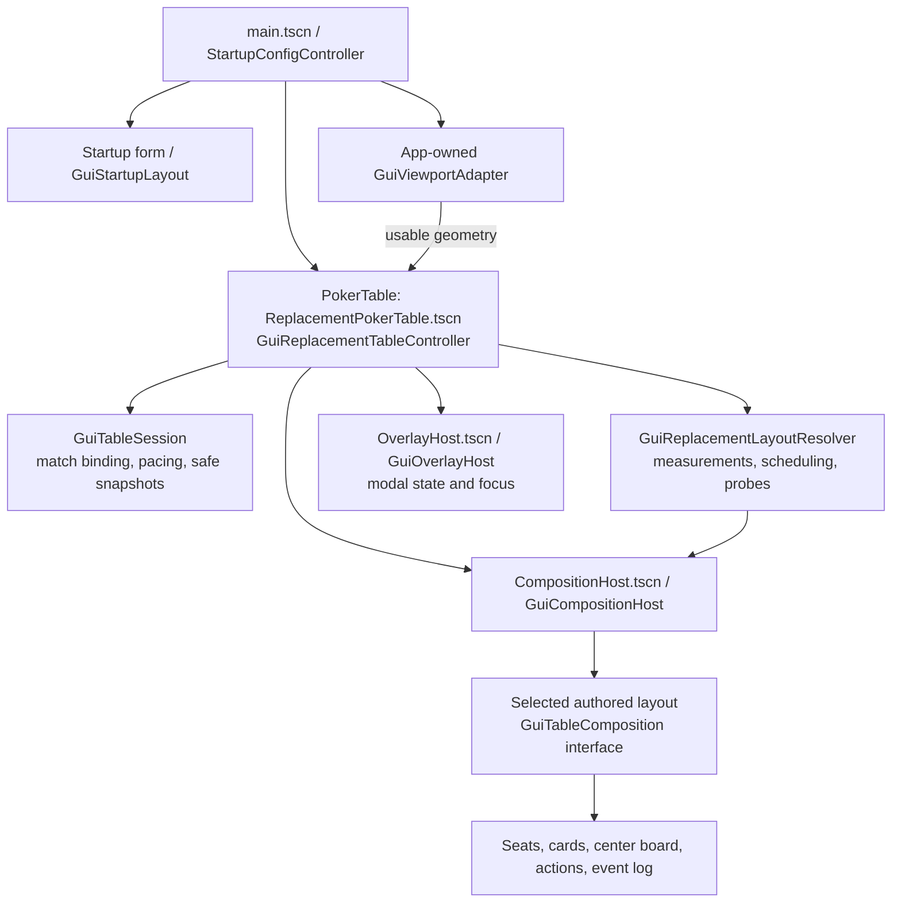
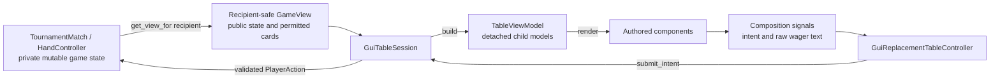
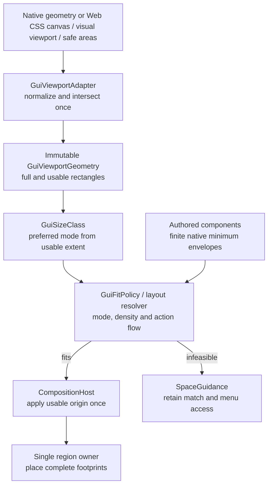

# GUI composition

The GUI uses authored Godot `Control` scenes, reusable presentation components
and one owner for each specialized layout region. It targets Godot 4.x in
Compatibility mode with typed GDScript. Game rules stay in `scripts/core/`.

The [GUI product requirements](../../docs/ProjectDescription.md#71-gui) own
visual behavior, and the [GUI adapter architecture](../../docs/ARCHITECTURE.md#gui-adapter)
owns implementation decisions. This guide describes current source behavior;
it does not certify visual or physical-device acceptance. Review status remains
in the [GUI backlog](../../docs/RestructureGuiTasks.md), and evidence requirements
in [GUI Visual Testing](../../docs/GUI_VISUAL_TESTING.md).

## Scene and state ownership

[`scenes/main.tscn`](../../scenes/main.tscn) uses
[`StartupConfigController`](../../scripts/gui/startup_config_controller.gd).
Its `_enter_tree()` creates exactly one `ReplacementPokerTable.tscn` instance,
named `PokerTable`, initially hidden. Validated startup constructs and binds a
tournament; invalid input leaves startup visible without starting a hand.
`GuiStartupLayout` adapts the form, yielding optional logo/copy allocation
before essential controls, without scrolling or reducing their text/target floors.

`GuiTableSession` is a non-scene adapter object. It owns recipient-safe binding,
action delegation and timed advancement. `GuiReplacementTableController` keeps
the session, input state and overlay host outside the replaceable composition
subtree. A mode change may replace that subtree without recreating the match
or losing raw wager drafts. Refreshes of the same roster preserve keyed seat
controls; resize alone must not rebuild them. Names and avatars remain assigned
to core seat IDs for the tournament, independently of their displayed position.

`GuiOverlayHost` owns in-canvas menu, log, seat detail, summary, numeric entry
and confirmation presentation. One active modal blocks underlying actions,
contains keyboard focus and holds automatic advancement until close. Focus
returns to an appropriate surviving control after composition changes. Engine
Back/Escape handling does not intercept browser navigation as a table action.

## Data and input flow

[`TableViewModel`](../../scripts/gui/view_models/table_view_model.gd) builds
seat, center, action, summary and history models from `GameView` plus stable
presentation assignments and public action records. It retains no nodes,
`CardData` or `GameView`. Card models encode face, back or empty presentation;
components cannot discover hidden cards. Folded opponents remain hidden even
at showdown, and fold wins do not reveal opponents. The GUI must not query
`Player`, `Table` or other mutable internals to enrich its presentation.

[`GuiTableComposition`](../../scripts/gui/layout/gui_table_composition.gd)
defines `render()`, draft/keypad access, measured fit candidates and semantic
layout snapshots. Its signals include `action_requested`, `wager_edited`,
`wager_submitted`, `entry_requested`, `menu_requested` and `seat_detail_requested`.
The controller connects them to the session/overlay boundary. Components emit
intent; they do not adjust chips, select legal actions or advance the engine.

The session translates `minimum`, `pot`, `wager`, `all_in` and other intents
into existing core actions. GUI pacing uses
`submit_human_action_without_advance()` before subsequent discrete advancement.
The Pot shortcut uses the bound snapshot's pre-action contribution `P` and
target street total `H + P`, for existing hero wager `H`; normal core validation
still applies. Never recalculate poker rules inside a layout or button script.

## Authored compositions and reusable components

The controller registers four scenes with `GuiCompositionHost`:

| Preferred mode | Authored scene | Composition and region owner |
| --- | --- | --- |
| `WIDE` | [WideTableLayout.tscn](../../scenes/gui/layouts/WideTableLayout.tscn) | Desktop seat ring with full panels, center board, actions and docked log when feasible. |
| `WIDE_COMPACT` | [TabletTableLayout.tscn](../../scenes/gui/layouts/TabletTableLayout.tscn) | `GuiPhoneTableLayout` with tablet configuration; `GuiPhoneLandscapeContainer` applies `GuiTabletTablePlan` in both orientations. |
| `PHONE` | [PhoneTableLayout.tscn](../../scenes/gui/layouts/PhoneTableLayout.tscn) | `GuiPhoneTableLayout`, portrait seat rows, center group and separate human/action area. |
| `PHONE_LANDSCAPE` | [PhoneLandscapeLayout.tscn](../../scenes/gui/layouts/PhoneLandscapeLayout.tscn) | Phone host with landscape configuration and `GuiPhoneLandscapeContainer`/phone plans. |

The tablet's internal `landscape_mode` flag selects its shared direct-layout
branch; it does not restrict tablet support to landscape orientation.

Reusable scenes live in [`scenes/gui/components/`](../../scenes/gui/components/)
with scripts in [`scripts/gui/components/`](../../scripts/gui/components/):

| Component family | Responsibility |
| --- | --- |
| `SeatPanel`, `HeroPanel` | Full seat frame, avatar, name/stack, roles, hole cards and permanently reserved status band. |
| `SeatToken`, `LandscapeSeatToken`, `TabletSeatToken` | Compact variants sharing presentation binding; tablet tokens retain avatars, phone tokens omit them. |
| `PlayingCard`, `CardFace`, `CardBack`, `CardRow`, `HoleCards` | Aspect-preserving slots and detached card presentation; empty/back/face states remain explicit. |
| `CenterBoard`, `CompactCenterBoard` | Community cards, Pot/Wager and blind/level copy; the compact authored aspect frame sizes all five slots together. |
| `ActionBar`, `ActionButton`, `InputField` | Legal-action presentation, complete wager units and shared button/field styles. |
| `NumericKeypad`, `OverlayHost` | Transactional numeric entry and persistent modal presentation. |
| `EventLog`, `HeroActionSummary`, `SpaceGuidance` | Recipient-safe history/feedback and guidance for infeasible space. |
| `BrandLogo` | Passive aspect-preserving branding; the felt material sits behind content and never owns input or fit constraints. |

[`resources/gui_theme.tres`](../../resources/gui_theme.tres) owns static styles;
`GuiTypography` provides density-aware typography. Avoid duplicating palette,
input behavior or layout policy inside every component.

## Viewport classification and measured fit

[`GuiViewportAdapter`](../../scripts/gui/platform/gui_viewport_adapter.gd)
is the only platform geometry boundary. Web fit uses the actual CSS canvas,
visual viewport and safe-area intersection; native scale normalization is
separate. Fixtures inject local geometry without changing the process window.
The Web probe also compares current metrics each frame: a late visual-viewport
change after a rotation notification must still invalidate stale geometry.
Do not subtract browser chrome twice, classify from physical device pixels,
or choose phone composition merely because touch input is available.

[`GuiSizeClass`](../../scripts/gui/layout/gui_size_class.gd) owns thresholds
and preferred mode. [`GuiFitPolicy`](../../scripts/gui/layout/gui_fit_policy.gd)
uses measured complete content minima to resolve an available composition.
The resolver invalidates geometry-dependent measurements when bounds change.
Guidance does not truncate a roster or reduce type below the product floor;
the phone startup range is 2–7, while core/CLI/tablet/desktop support 2–9.

Use Containers, anchors and responsive margins by default. A specialized
Container or region owner may assign explicit rectangles, but a second
Container must not compete for the same children. Measurement, application
and semantic snapshots must agree on complete footprints, including blank
reserved status space and wrapped text. Do not fix fit with overlapping
regions, stale minimum caches, ellipsized chip amounts or global scaling.

## Current responsive rules

- Bots form mirrored left/right pairs, with one centered apex for odd counts.
  No actual horizontal band has three bots except the top row of short phone
  landscape when the ordinary arrangement cannot fit. The human has its own
  centered bottom row and comparable proportions. A side action rail reserves
  equal empty width opposite it so it cannot displace the human.
- Tablet seats and community areas grow within measured budgets. The tablet
  plan tries side actions, then actions below with a shared center corridor,
  then a stacked board/human/action arrangement for narrower allocations.
  Community slots match the human visual panel width and center on both axes
  of the usable table where possible; the closest clear vertical band is used
  when other footprints block exact centering. Pot/Wager and blind/level text
  sit directly below. Side actions align to the human panel's visual bottom
  where complete neighboring seat/status footprints permit.
- Every seat reserves its status band, including when blank. Live action text
  clears per street; two-line showdown results do not move neighboring areas.
  Winning results use bold yellow emphasis; a fold win reads exactly `Winner`.
- Hole cards anchor at the lower right and grow toward two-thirds of the
  visual seat box's height, excluding its reserved status band. Tablet and
  phone-landscape tokens
  use `GuiSeatCardsColumn`, which owns the marker/pair rectangles and bounds
  growth by available width and marker clearance while keeping intrinsic
  minima independent of the allocation. D/SB/BB remain above at the upper
  right. Tablet avatars remain visible in both orientations, with
  stable assignments and grayscale folded/busted presentation.
- Visible avatars must anchor at the upper left and scale toward half the
  visual seat box's height, excluding its status band, with aspect preserved.
  This applies to human and bot seats. `GuiSeatContentRow` owns the avatar and
  sibling-column rectangles in tablet and full-seat scenes. Its minimum comes
  from intrinsic content measurements; its allocation scales the avatar while
  retaining room for copy/cards and recovering after shrink. Full panels fill
  their vertical allocation. Earlier 48/64/80 px minima are historical samples.
- Phone portrait uses edge-to-edge felt and community cards above the human
  controls. Cards keep their aspect and readable rank/suit ink; short phone
  landscape uses horizontal rank/suit presentation for hole cards and taller
  vertical presentation for community cards. Portrait phone winner stars share
  the stack row so a long winner name does not widen both opponent columns at
  settlement. Seat copy has an 18 px
  logical/CSS floor, card glyphs and other functional text 20 px, log body
  18 px, and interactive targets at least 48 × 48.
- The action bar measures complete units and chooses one or two rows. Show
  Min/Pot inline when the complete table/action allocation fits; retain wager
  entry when it does not. Keypad versus keyboard selection is independent of
  layout classification and inline preset availability. Hidden docked history
  remains reachable through Log. The More/Pots control opens the menu, whose
  Pots / Summary entry is enabled when completed-hand awards are available;
  compact controls use an ellipsis with a More / Pots accessibility name.
  Status height uses the available human-aligned column independently of
  button packing: a lone More button during a bot turn must not create extra
  wrapped status lines and make the table require more height.
- Numeric entry is a transaction: Cancel preserves the original raw field
  exactly, including invalid text/whitespace; Done commits for adapter
  validation. The keypad keeps its three-column digit grid and visible bounds.
  Quit is reached after closing numeric entry and requires confirmation.
- On supported Web phone startup, the valid Start gesture calls
  [`GuiBrowserFullscreen`](../../scripts/gui/gui_browser_fullscreen.gd).
  The helper requests document fullscreen with hidden navigation UI and a
  WebKit fallback; rejection is handled without blocking browser play. The
  menu offers a retry when supported. It does not lock orientation. Rotation,
  fullscreen and browser resizing preserve the match, assignments and drafts.

## Extending and verifying the GUI

1. Read the product/architecture contracts and select the owning component or
   region. Add presentation values to detached models, not private core reads.
2. Author stable scene parents and reusable styles. For a new composition,
   implement `GuiTableComposition` and register its scene at the controller
   boundary; keep classification thresholds in `GuiSizeClass`.
3. Update measured fit envelopes and layout snapshots with the same complete
   footprints used for placement. Cover odd/even counts, long values, blank
   and two-line status bands, safe areas, resize and orientation changes.
4. Test behavior at the appropriate boundary: pure view models; component
   minima/ink; composition/controller lifetime; exported Web input and layout.
   Useful regressions include
   [browser corrections](../../tests/unit/test_gui_browser_corrections.gd),
   [composition host](../../tests/unit/test_gui_composition_host.gd) and
   [replacement lifetimes](../../tests/unit/test_gui_replacement_lifetimes.gd).
5. Run `make check gui-current-invariant-gate` for implementation changes and
   follow the [running/testing guide](../how-to/running-and-testing.md) for
   capture and exported-browser commands. Documentation changes use
   `make docs-check`. Put generated evidence under ignored `localtmp/`.

Automated geometry/input checks, rendered previews, visual approval and
physical-device acceptance are distinct evidence. Historical reference scenes
and their frozen registry are retired evidence, not current layout policy.
Use the [local Wi-Fi guide](../how-to/local-wifi-web-testing.md) for actual
device review, and record results against the exact build and active backlog.
