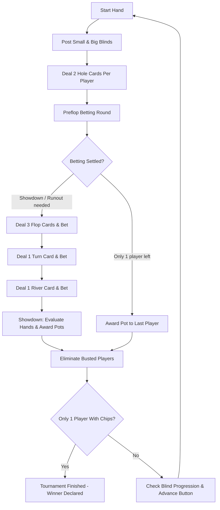

# Tutorial: Understanding Pokahdot

Welcome to Pokahdot! This tutorial is designed for new developers joining the project. By following this guide, you will understand the architecture, core mental models, and the day-to-day mechanics of how the game runs.

---

## 1. What is Pokahdot?

Pokahdot is a **single-table No Limit Texas Hold'em tournament** game built in Godot 4 using GDScript. 
Unlike cash games, players cannot reload chips. Play continues hand after hand until only one player holds all the chips.

The most important architectural feature of Pokahdot is:
> **One core engine powers three separate presentation front-ends:**
> 1. A graphical interface (`scenes/`, `scripts/gui/`)
> 2. An interactive terminal CLI (`scripts/cli/`)
> 3. A high-throughput, non-interactive simulation runner (`scripts/simulation/`)

To make this possible, the core engine (`scripts/core/`) **never** imports `Control` nodes, never talks to the `SceneTree`, and never prints to stdout or reads from stdin.

```text
       +-------------------+  +-------------------+  +-----------------------+
       |   Graphical UI    |  |  Interactive CLI  |  |  Batch Simulation CLI |
       |  (scenes/, gui/)  |  |  (scripts/cli/)   |  | (scripts/simulation/) |
       +---------+---------+  +---------+---------+  +-----------+-----------+
                 |                      |                        |
                 +----------------------+------------------------+
                                        | drives
                                        v
                       +---------------------------------+
                       |        TournamentMatch          |
                       |       (scripts/core/)           |
                       +---------------------------------+
```

---

## 2. The Mental Model: Core Concepts

Before looking at code, let's establish four fundamental concepts:

1. **Deterministic Step Machine**: The game does not run on a background thread or wait on async coroutines (`await`). Instead, it is a synchronous state machine stepped forward via `advance_until_blocked()`. When a human needs to act, it yields with status `WAITING_FOR_HUMAN`.
2. **Information Hiding via `GameView`**: Neither the GUI nor bot agents ever hold references to private opponent cards. The game core produces a custom, read-only `GameView` for each seat, masking all hole cards except the player's own.
3. **Target-Total Wagers**: When betting or raising, amounts represent the **total street contribution**, not the incremental chips added. For example, if big blind is 10 and you raise to 30, your target total wager is 30.
4. **Deterministic Pseudo-Random Streams**: All randomness (shuffling decks, seating buttons, bot decisions) is derived from seeded, named `RandomNumberGenerator` streams so any match can be replayed identically.

---

## 3. Walking Through the Lifetime of a Match

Let's follow the lifecycle of a tournament from startup to the final hand.

### Step 1: Configuration Resolution
A tournament begins with configuration. The game provides defaults in `resources/default_tournament_config.tres` (6 players, 1000 starting chips, 5/10 blinds).

A front-end collects optional player inputs into `StartupOverrides` and resolves them with `ConfigResolver`:

```gdscript
var resolver := ConfigResolver.new()
var resolution: ConfigResolution = resolver.resolve(defaults, overrides)

if not resolution.is_ok():
    print("Invalid config: ", resolution.errors)
    return

var config: ResolvedTournamentConfig = resolution.config
```

`ResolvedTournamentConfig` is immutable. Live game logic never touches editable `.tres` files directly.

### Step 2: Instantiating the Match
Each seat receives an `Agent`:
- Exactly one `HumanAgent` (in GUI or CLI play).
- `BotAgent` instances for the remaining seats, selected deterministically from the curated catalog via [`PlayableBotRoster`](../../scripts/core/agents/playable_bot_roster.gd).

The composition root ([`CliMatchFactory`](../../scripts/cli/cli_match_factory.gd) or [`GuiMatchFactory`](../../scripts/gui/gui_match_factory.gd)) selects deep copies of profiles from `PlayableBotRoster`, injects independent RNG streams, and constructs `TournamentMatch`:

```gdscript
# Composition root (CLI or GUI match factory):
var factory := CliMatchFactory.new()
var match: TournamentMatch = factory.create(config)
```

Under the hood, `PlayableBotRoster.select()` exhausts each requested model family before reusing a profile, and `roster.create_bot()` instantiates each `BotAgent` with its seat-specific RNG stream.

### Step 3: Starting the Match
Calling `match.start()` sets up the `Table`, creates players with starting stacks, chooses a random button seat, and starts Hand #1:

```gdscript
var result: StepResult = match.start()
```

---

## 4. How a Hand Runs (The Hand Loop)

Inside `TournamentMatch`, each individual hand is managed by a `HandController`. Here is how a hand unfolds:



### Stepping the Game Forward
Notice how the game progresses. In `scripts/cli/cli_command_loop.gd`, the loop advances until input is needed:

```gdscript
var result: StepResult = match.advance_until_blocked()

match result.status:
    StepResult.Status.WAITING_FOR_HUMAN:
        # It is the human's turn! Present options and await input.
        var action: PlayerAction = read_user_action()
        result = match.submit_human_action(action)

    StepResult.Status.HAND_COMPLETED:
        # Hand finished; chips awarded. Advance to next hand.
        result = match.advance_until_blocked()

    StepResult.Status.TOURNAMENT_FINISHED:
        print("Tournament over! Winner: Seat ", match.winner_seat)
```

Why is this designed this way?
Because Godot's UI runs on the main thread! By yielding control with `WAITING_FOR_HUMAN`, Godot can process input, draw animations, and respond to window events without freezing.

---

## 5. Security & Information Hiding: `GameView`

How do bots and the UI see the table?
They **never** access the internal `Table` or `HandController` directly.

Instead, before any agent acts or the UI redraws, the engine constructs a recipient-specific `GameView`:

```gdscript
var view: GameView = match.get_view_for(seat_index)
```

Inside `GameView`:
- `view.hero_hole_cards`: Displays hole cards **only** if `seat == hero_seat`.
- `view.community_cards`: Public community board cards (Flop, Turn, River).
- `view.legal_actions`: Array of permitted action types (`CHECK`, `CALL`, `RAISE`, `FOLD`, etc.).
- `view.call_amount`, `view.minimum_wager_total`, `view.maximum_wager_total`: Pre-calculated limits for the current street.

Other seats' hole cards remain completely hidden until showdown! Even if a malicious bot attempts to inspect memory or properties, the `GameView` simply does not contain opponents' cards.

---

## 6. How Bot Decisions Work

Bot decision-making is cleanly separated into three modular layers:

```text
+-------------------------------------------------------+
|                       BotAgent                        |
|  - Implements Agent interface (choose_action, observe)|
|  - Receives recipient-safe GameView                   |
+---------------------------+---------------------------+
                            | delegates to
                            v
+-------------------------------------------------------+
|                    DecisionModel                      |
|  - Algorithm (e.g. Random, StrategyDecisionModel)     |
|  - Evaluates hand strength and computes actions       |
+---------------------------+---------------------------+
                            | configured by
                            v
+-------------------------------------------------------+
|                      BotProfile                       |
|  - Immutable parameter values (.tres Resource)        |
|  - Aggression frequencies, fold thresholds, etc.      |
+-------------------------------------------------------+
```

When it is a bot's turn:
1. `TournamentMatch` calls `bot_agent.choose_action(game_view)`.
2. The bot passes the view to its `DecisionModel`.
3. The model computes a legal `PlayerAction` (e.g., `PlayerAction.call_action()`).
4. The core validates and executes the action.

---

## 7. Showdown and Pot Settlement

When multiple players reach showdown on the river (or all-in runout):
1. **`HandEvaluator`**: Evaluates each player's 7 available cards (2 hole cards + 5 community cards) and extracts the best 5-card poker hand into a `HandRank`.
2. **`PotManager`**: Poker allows side pots when players go all-in with different stack sizes. `PotManager` breaks the pot into `PotLayer` instances (Main Pot, Side Pot 1, Side Pot 2, etc.) and determines which active seats are eligible for each layer.
3. **Split Pots & Odd Chips**: If hands tie, the pot splits equally. Any remainder odd chip is awarded to the first eligible seat clockwise from the dealer button.

---

## 8. Blind Progression

In Pokahdot, blind levels increase based on **completed hands**, not clock time:
- The interval is `active_player_count * 2` hands (or 10 hands if fewer than 5 players remain).
- When a level increases:
  $$\text{New Big Blind} = \lceil \text{Current Big Blind} \times 1.25 \rceil \quad (\text{rounded up to nearest even integer})$$
  $$\text{New Small Blind} = \frac{\text{New Big Blind}}{2}$$
- `BlindLevelProgression` handles this calculation deterministically.

---

## 9. Hands-On Exercise: Tracing an Action

Let's verify your environment and see the core engine execute in a test!

1. Open your terminal in the Pokahdot repository root.
2. Run the unit test for hand control:
   ```bash
   godot --headless --path . -s addons/gut/gut_cmdln.gd -gtest=res://tests/unit/test_hand_controller.gd
   ```
3. Open `tests/unit/test_hand_controller.gd` in your editor. Look at `test_advances_through_betting_round()`:
   - Notice how a `Table` is instantiated with test players.
   - Notice how `HandController.start()` deals the cards and creates the `BettingRound`.
   - Notice how submitting a `PlayerAction.call_action()` updates pot contributions and moves the active seat.

You now understand the heart of Pokahdot!

---

## Next Steps

- **Want to build something?** Follow the guide on [Adding a Bot Strategy](../how-to/adding-a-bot-strategy.md).
- **Need deep architectural details?** Read the [Architecture Reference](../reference/architecture.md).
- **Curious about why it's built this way?** Check out [Design Principles & Architecture Rationale](../explanation/design-principles.md).
