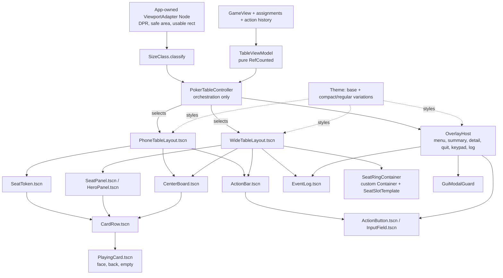

# Restructure GUI Tasks

Status: In progress — RG-00–RG-11 and RG-11R–RG-11R7 are implemented and
verified. Previously accepted keypads, Start and review7 phone previews retain
their recorded acceptance; the final two review8 boundary previews still
await review. The user requested a fresh `localtmp/` and resumed ordered work on
2026-10-29. RG-12 policy and isolated guidance presentation are implemented;
verification is complete. The user accepted the guidance design and authorized
continuation on 2026-10-29. RG-13 replacement routing is implemented and
verified and committed at `122f344`. RG-20 presentation models are implemented
and verified. RG-21 coverage migration is verified. The RG-30 theme review
candidate is authored, verified and user-accepted. RG-31 typography is implemented
and verified, including user-selected removal of reference font scaling.
RG-39 reusable controls are implemented, verified and user-accepted.
RG-40 card components are implemented, verified and user-accepted.
RG-41 seat and human-panel components are implemented and verified;
the user provisionally accepted review2 and authorized RG-42. The RG-31 checkpoint is committed at `4ae83cd`,
matching the locally recorded `origin/gui-restructure` branch.
RG-42–RG-45 and their RG-45R/R2/R3 review corrections are implemented.
The user accepted the component galleries, bot-seat arrangement, history scaling,
menu, summary, portrait keypad arrangement and revised compact landscape keypad.
Combined Phase 4 component design review is complete. The final RG-45R3 check is
recorded below; final table integration and device acceptance remain in their
ordered tasks. RG-50 seat-ring container/templates are implemented and verified;
RG-50R lowers the human and aligns its action rail; revised six-seat ring
placement is user-accepted, and review4 nine-seat placement is now accepted.
RG-50S reconciles the wide interiors and applies the requested human card corner.
Its refreshed six/nine-seat previews are accepted. RG-51 is verified; complete
RG-53 before requesting another design review.
Reviewed: 2026-10-27 against source commit
`0669f41b7fc203d60640a6250f661b933ee33247` and the current working tree.
This documentation review is not RG-00 baseline execution or device acceptance.
Owner mode: Tech Lead / Architect for Phase 0–1 decisions, Senior Software
Engineer for implementation, QA for Phase 6.

This backlog contains an analysis of the current Godot GUI against common
practice for responsive GUIs on desktop browsers, iPad and phones, an
assessment of the GUI tests, a target structure, and ordered tasks for a
structured refactoring. The target principles in this document lead the
redesign; the current implementation is a migration baseline, not a reason to
retain competing geometry owners or runtime-built presentation. The
[product specification](ProjectDescription.md) owns product rules and the
[architecture](ARCHITECTURE.md#gui-adapter) describes implemented behavior.
Proposed changes below must be recorded as future decisions before those
implementation descriptions are replaced. If implementation would contradict
product requirements or an approved architectural decision, stop and ask the
user to resolve that specific conflict. Do not silently weaken the redesign
or change requirements to make an implementation task pass.

This backlog is self-contained. Other `docs/*Tasks.md` files, active or
archived, are not inputs and may be outdated. Do not read their checkboxes
as requirements, do not wait on their open tasks, and do not update them from
this work. If one of them conflicts with this document, follow this document,
the product specification and the architecture. Device acceptance for the
restructured GUI is tracked in Phase 8 below.

## RG-41 panel review refinements — 2026-10-29

The user requested closer hole-card pairs with the same proportional gap for
opponents and the human; upper-left avatars; a larger winner star; SB/BB controls
matching the dealer button's height and width; full `All In` wording; and removal
of the redundant state line beneath the display name. Full panels now contain
three copy lines (name, stack, wager), with action/result copy in the permanently
reserved status band. Responsive fit may use larger preferred fonts or a lower
body while preserving the existing text/card floors and complete footprint.
RG-41 review2 implements these refinements before RG-42. Visual acceptance is
pending; this review does not authorize moving to the next task.

## Execution scope clarified by the user — 2026-10-28

Prioritize idiomatic responsive Godot layouts driven by available space and
measured content. Historical screen dimensions are regression samples, not
fixed design targets or a device whitelist. Support desktop physical-keyboard
input and touch on tablets/iPads and phones in both portrait and landscape.
Input modality remains independent of layout size/class. Use container minimums,
anchors, theme metrics and finite fit plans to adapt compositions while keeping
required content readable and targets reachable.

The replacement now targets phone landscape explicitly. Earlier deferral labels
in the recorded reference baseline describe legacy evidence; they do not defer
the new landscape implementation or acceptance. RG-12, RG-52 and RG-80 must
cover both phone orientations. Acceptance remains pending until implementation,
verification and the user's visual/device review.

Additional presentation clarifications (2026-10-28): the complete seat
component owns both its visible panel and the permanently reserved action/
showdown band beneath it. Winning hand/result descriptions use bold, bright
yellow text, including split/side-pot winners. Seat copy may scale down to
18 logical/CSS px (user confirmed); card ranks and other GUI text retain 20 px,
and touch targets retain 48×48. A hidden docked log remains accessible through
a Log action or reachable menu in every layout, including completed hands.
These are explicit RG-20/30/31/41/43–45/51–52/80–82 requirements; implementation
and visual acceptance remain pending in their owning tasks.

Control-style clarification (2026-10-28): every visible action, including
Quit, uses the shared rounded dark-green/white-text button presentation.
Number/text fields use sharp corners, white backgrounds and dark-green text.
Keypad keys belong to the button family; entry/value fields belong to the field
family. RG-30 defines the theme states and RG-39 authors the reusable controls
before their composition into other scenes.

Preview feedback (2026-10-29): reduce event-history text to 18 logical/CSS px
to show more lines, as a dedicated log-body exception to the 20 px floor for
other non-seat text. Preserve the shared top and bottom alignment of the docked
log, human panel and action area. Upper corner seats must clear the rounded
felt border, not merely fit its rectangular bounds. Keypad digits always use
`1 2 3 / 4 5 6 / 7 8 9`, with `0` directly beneath `8`, including compact
landscape. Reflow utility controls separately rather than widening the digit
grid to five columns. RG-11R revises the previews; RG-30/31/44/45/50/51 retain
these contracts in the replacement. The original previews are not accepted.

Seat-row clarification (2026-10-29, user confirmed): every horizontal row on
every screen/layout contains at most three player seats, including the human
when it occupies that row. This applies to all supported player counts and
both orientations, not only the upper row or one device family. Preserve
the later stricter phone-portrait rule: at most two opponents per row, with
one centered top seat for odd opponent counts. Preserve
clockwise seat identity and complete footprints when selecting more rows or
ring levels. Tiny vertical offsets do not turn a four-seat row into compliance.
RG-11R audits the reference; RG-12/42/50–52 and their tests must enforce the
cap through explicit row/slot composition, not a corrective collision pass.

Design independence reaffirmed by the user (2026-10-29): the legacy layout
does not constrain the new GUI on any screen. Its positions, row arrangements,
breakpoints, runtime-built hierarchy and exact-pixel tests are reference
implementation details, not replacement acceptance requirements. New layouts
may change all of them to satisfy the user's visual rules and measured fit.
Keep behavioral/privacy/input coverage; replace incidental structure checks
with independent component and container contracts. Legacy violations neither
justify exceptions in the new layout nor require a detour to redesign the old
GUI before implementing the replacement. RG-11R is only the selected preview
correction, not a template the replacement must reproduce.

Capacity/priority clarification (2026-10-29): prioritize measured phone fit
because it is the most constrained layout. Use the existing 2–7-player phone
scope as the working target in both orientations; larger tablet/desktop
layouts support 2–9. Seven-player phone fixtures are required stress cases
through component minimums, model density, action flow and final composition,
not a late reduction of a desktop design. Keep the role-specific text floors,
48×48 touch targets, exact required copy and three-seat row cap. Define and
test feasible envelopes; insufficient space shows guidance rather than shrinking
controls, hiding players or changing an active tournament's count. This
clarification changes fixture priority, not the ordered execution of tasks.

Keypad review refinement (2026-10-29): the user accepts the 3×3+centered-0
number arrangement and explicit value limits, but rejects the ragged utility
arrangement. Utility buttons must form a neat, filled rectangle with aligned
columns and uniform cells. Numeric entry contains no tournament Quit action.
Cancel discards the draft and leaves the committed field unchanged; Done
commits the draft for adapter validation. Tournament Quit remains outside number entry, reachable
after cancelling/closing it. RG-11R2 implements this revision; RG-39/45 inherit
the same presentation and responsibility boundary.

Earlier table review (2026-10-29; Total palette superseded below): the user accepts the revised 1280×720
table presentation except for the Total entry field, which still resembles an
action button. Apply the already-required white surface, sharp corners and
dark-green field text/caret/placeholder in normal, focused and read-only
states; preserve action-button styling for Raise. RG-11R3 makes this bounded
preview correction. It does not complete the authored RG-30/RG-39 theme/control
replacement. The forthcoming new wide layout must also show nine players for
review, with at most three seats in any row; the old layout is no constraint.

Latest review (2026-10-29, RG-11R4): the compact keypad is accepted only for
landscape aspect ratios; both portrait compositions remain accepted. The
table is accepted apart from a revised Total preference: light-grey text on
dark green, zero-radius rectangular corners and a slightly shorter face
vertically centered with Raise. Preserve a full 48 px interactive allocation;
draw a centered 40 px face at the 48 px baseline via StyleBox margins. This
Total-only variation supersedes its earlier white palette, not generic input
styling. RG-30/RG-39 retain the `WagerTotalField` variation and distinct drawn/
interactive geometry; tests must not lower target-size floors to shrink a face.
The same review also requires the table Quit control to have the rounded
rectangle border and interaction states of the action-area buttons. Reuse the
existing shared action-style application; tournament Quit remains outside
numeric entry. This is included in RG-11R4, not a separate layout redesign.

Branding/text refinement (2026-10-29, RG-11R5): use the supplied Pokahdot logo
above the Start-screen form and subtly embossed into the table cloth behind
game content, allowing partial obscuring. Convert the JPEG's baked checkerboard
to a genuinely transparent PNG (`assets/images/Pokahdot_logo.png`) and use
that shared asset in both places. Preserve aspect ratio, passive input behavior
and table geometry. The later review rejects startup scrollbars and any light
logo backing panel: fit essential controls by adapting optional copy and logo
allocation, retaining text/target floors. Total keeps its dark, sharp, shorter centered face,
but its grey text becomes slightly darker than the button labels (`#B8C3BB`
in this implementation). RG-30/39/45/51/52 preserve the branding and Total-role
contracts in the replacement; the logo component is reusable across cutover.

Earlier branding/phone review (2026-10-29): the user accepts branded Start-screen
layout at 390×844, 844×390 and 1280×720 apart from the light logo panel, which
must be removed for a transparent logo on the dark background. The 844×330
scrolling form is rejected: no Start-screen scrollbar is allowed. Desktop
embossed-table previews at 1280×720 and 1920×1080 are accepted. The phone
portrait table is rejected: redesign seat areas, move the full community group
immediately above the human area, and remove the surrounding table rim/margins
for a full green screen. New layouts must satisfy measured readability and
touch targets, not retain the rejected legacy arrangement. RG-11R6 is this
explicitly selected phone review task; RG-42/50–52 inherit its approved rules.
Subsequent acceptance: the no-scroll `rg11-review6-startup` captures and all
five `rg11-review7-*` two-column portrait captures are accepted. This completes
visual review of these increments; fresh broad verification remains required.

Visual-polish clarification (2026-10-29): the user permits GUI beautification
where it follows sound design practice and preserves user-facing functionality.
The single-font constraint remains: use only Godot's built-in default font,
including variations derived from it. Preserve existing text/target floors,
required copy and input behavior, and show new visual designs for acceptance
before continuing beyond their review checkpoint.

Theme-review refinement (2026-10-29): the user generally likes the RG-30
palette, with three requested changes. Disabled action labels use a slightly
darker grey (`#A8A8A8` in the revised candidate); enabled/hover/pressed/focus
labels remain white. Larger-screen seat surfaces must display the selected
avatar from the existing tournament assignment; compact phones may omit it.
Cards must retain a width/height ratio of at least 5:7 (poker-card proportions)
or be wider, including their actual rendered allocation, not just nominal
minimums. Value and suit have comparable visual size, fit as large as measured
content permits, and retain padding from every edge. Preserve the single
built-in font. RG-30 revises the gallery; RG-31/40–42/50–52 must retain these
contracts in the actual components and layouts. The revised preview awaits
acceptance; RG-31 remains untouched.

Further theme refinement (2026-10-29): folded seat surfaces, borders, text and
avatars must be fully grayscale. Give the human seat more reading space than
bot seats where the wide composition permits it; increase the human's text and
avatar allocation rather than scaling its painted pixels. Strengthen the acting
white border beyond the initial three-pixel candidate (six pixels in review3).
Increase card value/suit occupancy by measuring visible glyph bounds instead
of reserving unused font line leading. Retain safe padding, the single built-in
font, 5:7-or-wider card proportions and role-specific text floors. Cards must
be scalable with container space; the gallery's fixed 120×168 samples and
90/91 px fonts are examples, not production size constants. RG-30 revises this
preview; RG-31/40/41/50–52 carry the contracts into responsive components.
Review3 acceptance remains pending before RG-31.

### Visual instructions → implementation and acceptance

This table traces the user's chat instructions to the resulting GUI and code
structure. It specifies required replacement behavior, not completed work;
the checkboxes in the owning tasks remain the completion record.

| User instruction | Required GUI behavior | Code-structure impact / owning tasks | Acceptance evidence |
| --- | --- | --- | --- |
| Adapt to screens rather than copying old dimensions | Desktop keyboard and tablet/phone touch work in both orientations; resizing and rotation retain readable content and reachable actions. | One viewport adapter and size/fit policy; container-owned wide/phone compositions use measured component minima. Input modality is independent of size class. RG-10–13, RG-50–52. | Boundary/resize/safe-area sweeps plus physical reviews RG-80–82; historical dimensions remain regression samples. |
| Cards are a separate presentation component | Community, hero and opponent cards share face, back and empty-slot presentation. | Pure `CardViewModel`; reusable `PlayingCard` and `CardRow` scenes replace card factories and duplicated card construction. RG-20, RG-40–42, RG-54. | Render every state, rank `10`, minimum-size fit and recipient-safe hidden cards in every context. |
| A seat includes the text below its rectangle | The latest-action/showdown band stays allocated beneath the panel, including when blank; it cannot collide with neighbors. | `SeatPanel`, `HeroPanel` and compact `SeatToken` own their complete status footprint. Container minimum sizes and snapshots include the band, not just the drawn rectangle. RG-20, RG-41–42, RG-50–52. | Blank/action/two-line showdown cases preserve allocation and pass full-footprint containment and overlap checks. |
| Winning descriptions are bold and bright yellow | Every winning hand/result description uses bold `#FFFF00`, including split/side-pot winners and exact fold-win `Winner` text. | Models expose semantic winner emphasis; a shared `WinningHandText` theme variation renders it. Layout measures the bold font. RG-20, RG-30–31, RG-41–42. | Single/split/side-pot and fold-win component captures verify color, weight and complete text fit. |
| Seat text may shrink to the confirmed 18 px minimum | Seat names, stacks, markers and action/showdown copy can shrink within a bounded range; card ranks and other text stay at least 20 px, targets at least 48×48. | Role-aware compact/regular theme metrics and measured minima replace whole-tree font scaling. RG-30–31, RG-40–42. | Measure actual displayed sizes after viewport/DPR conversion and test long names, large values and bold showdown copy. |
| A hidden log must remain accessible | A reachable Log action/menu opens the same scrollable public history whenever docking does not fit, including completed hands. | One recipient-safe log model and reusable `EventLog`; `ActionBar`/menus expose access and `OverlayHost` owns the modal view. RG-20, RG-43–45, RG-51–52. | Activate Log in every composition and completed-hand/Pots state; verify history, scrolling, focus restoration and blocked underlying input. |
| Smaller log copy, aligned lower row and clear upper corners | Log body uses 18 px; docked log/hero/actions share top and bottom edges; no seat intersects the rounded felt border. | Dedicated log typography role, shared lower-row allocation and measured rounded-border clearance in the seat plan/container. RG-11R, RG-30/31/44/50/51. | Revised 1280×720 capture, exact row alignment and curved-border clearance checks; no other text-floor relaxation. |
| Conventional numeric keypad in every orientation | Digits stay in three ordered columns with centered 0 below 8. | Stable digit grid plus separately composed utility/actions; compact layout reflows surrounding regions. RG-11R, RG-39/45. | Portrait/compact-landscape captures and row/column order, fit, 48 px targets and transactional input checks. |
| Rectangular keypad utilities, no tournament Quit | Uniform utility cells form a filled rectangle; approved digits and visible limits remain. Cancel discards the draft; Done commits the draft for adapter validation. | One utility grid contains editing/preset/commit/cancel controls. Remove tournament-exit signal/button/wiring from number entry. RG-11R2, RG-39/45. | Inspect compact/portrait and plain-number/wager states; verify aligned cells, no Quit action, exact cancel/commit semantics and limits. |
| At most three seats side by side; two opponents in phone portrait | Every horizontal row contains at most three players. Phone portrait uses pairs; odd opponent counts start with one centered, equal-width seat. | Row/slot plans and content-derived minimums enforce these caps while retaining clockwise seat IDs and the human at the bottom. RG-11R6, RG-12/42/50–52. | Test every supported count and mode, including short phone portrait, 8/9-player wide layouts and live rotation; no cosmetic staggering to evade row limits. |
| Prioritize readable, tappable phone layouts; larger screens support nine players | Phones target 2–7 players and tablets/desktops 2–9, with readable copy and large enough actions. | Phone-constrained component minima and action flow inform unified fit policy and both compositions. RG-12/31/39–43/50–52. | Seven-player phone portrait/landscape stress fixtures, nine-player wide fixtures and live resize retain typography/targets and tournament state. |
| All actions, including Quit, share a defined button view | Rounded dark-green buttons with white text cover startup, wagering, menus, Quit, confirmations and keypad keys. | Shared theme variations and reusable `ActionButton`; compose it throughout components instead of local runtime styling. RG-30, RG-39, RG-43/45, RG-54. | Review normal/focus/hover/pressed/disabled states, keyboard/touch activation and minimum target sizes. |
| Fields must look different from buttons | Generic fields are sharp-cornered white/dark-green; Total uses light-grey on dark green with a shorter centered face. Touch entry retains its field presentation. | Separate `InputField`/`NumberField` and `WagerTotalField` theme variations; adapters retain validation and transactional drafts. RG-11R4, RG-30/39/43/45. | Compare normal/focus/read-only/error states, drawn face versus 48 px hit area, exact drafts and cancel/commit behavior. |
| Replace old code rather than accumulating wrappers | The finished GUI has clear owners and less custom responsive geometry. | Direct authored-component replacement; remove legacy factories, layout/collision helpers and reference-specific snapshot producers at verified cutover. See the retirement table below; RG-13, RG-39–54. | Record removed files and remaining geometry/build sites, preserve independent behavior coverage and remeasure code size at cutover. |
| Stop for acceptance when new design can be shown | Present each reviewable visual increment before continuing with later tasks. | Keep implementation status separate from user acceptance. Save screenshots under `localtmp/gui-elements/` when possible. | Every acceptance stop includes screenshots, the affected GUI behavior, a current file/component overview, Godot/responsive-layout rationale and explicit remaining legacy work. |

These requirements change presentation, component ownership and fit contracts;
they do not move poker rules into views or relax private-card protection.
Apply this checklist to tablet and desktop reviews as well as phone reviews.

## 1. Summary

The core/GUI separation, recipient-safe `GameView`, modal guard, transactional
keypad, input modality and Web DPR normalization remain sound foundations.
The proposed destination remains one viewport adapter, one classification
policy, pure presentation models, reusable component scenes, theme-owned
styling and container-owned layout, including a custom seat-ring container.

Some groundwork now exists. `PokerTableController` is 2,545 lines with 115
functions; `_layout_table()` is a 66-line coordinator. Typed seat, action,
overlay and layout helpers have replaced the earlier monolithic implementation.
All four diagnostic matrices already share one runner. These extractions are
useful migration boundaries, but most widgets are still built in code and the
layout helpers still apply manual geometry, competing classification predicates
and deferred collision/center corrections. They do not implement the target
scene/container architecture. Architectural quality and responsive behavior are
the acceptance criteria; reducing the diff or retaining existing GUI code is
not a requirement. A replacement GUI built from scratch is an acceptable
implementation strategy.

The migration must also preserve newer behavior: complete seat/status
footprints, clockwise core-seat order, measured card/name/stack copy, finite
phone content rows, default completed-hand winner presentation, and existing
modal/focus/keypad rules. The native/Web refresh profiler and exported-browser
layout runner are existing verification tools to extend, not new tools to
recreate. Keep the legacy GUI available as a reference while building the replacement,
using separate scenes or a temporary selector where useful. Reuse helpers only
when they fit the target design. Preserve product behavior and verification
coverage, not legacy node trees, pixel coordinates, visual defects or internal
APIs. Cut over only after the replacement and its tests satisfy the contracts.

## 2. Current structure and reusable foundations

The inventory below describes the pre-migration reviewed source, not current
acceptance evidence or size limits. RG-11 has since moved Window normalization
from startup to the app-owned viewport adapter.

| Area | Current files / size | Migration implication |
| --- | --- | --- |
| Controller | `scripts/gui/poker_table_controller.gd`: 2,545 lines, 115 functions | Still owns binding, copy, pacing, input and significant phone/desktop layout work; its main coordinator is already extracted. |
| Typed components | `gui_table_seat_factory.gd` / `gui_table_seat_view.gd` (491 / 55 lines), `gui_table_action_controls.gd` (196), `gui_table_overlay_views.gd` (129) | Reuse ownership boundaries and handles while replacing factories/runtime mutation with authored scenes. Handles are still discovered once by child name. |
| Layout policy/application | `gui_table_layout_pass.gd` / `gui_table_seat_layout.gd` (159 / 233), `gui_mobile_table_layout.gd` (515), `table_seat_layout.gd` (245) | Branching has moved into these helpers; changing only controller predicates would leave competing policy behind. |
| Finite plans | `gui_phone_layout_plan.gd`, `gui_phone_seat_layout.gd`, `gui_phone_token_content_plan.gd`, `gui_six_seat_desktop_plan.gd` | Preserve complete-footprint, content-fit and stable-seat-order contracts when moving their math behind containers. |
| Scenes / startup | `scenes/poker_table.tscn` (425), `scenes/main.tscn` (197), `startup_config_controller.gd` (414) | Table still mixes phone/wide nodes; startup is container-based but owns app-wide Web geometry normalization. |
| Theme / input | `resources/gui_theme.tres` contains only `default_font_size = 29`; `wager_keypad.gd` (350), `gui_modal_guard.gd` (138) | Move style and keypad construction into resources/scenes while preserving input transactions and modal lifetime. |
| Tests | 36 `tests/unit/test_gui_*.gd` files, 262 test functions, 9,005 lines; nine GUI support scripts | Current coverage is broader than the original inventory, but still coupled to internal structure. Non-`test_gui_*` startup/keypad tests also remain relevant. |
| Matrix runner | `tests/support/gui_invariant_matrix_runner.gd`, `gui_invariant_matrix_suites.gd`, `gui_phone_matrix_contract.gd` | Already consolidated. Preserve ordered case identities: 348 M3, 406 phone, 288 iPad, 232 desktop; four manual files are thin entry points. |
| Browser / performance | `tools/run_web_input_tests.py`, `tools/run_web_layout_tests.py`, `tools/web_layout_assertions.py`, `tools/profile_gui_refresh.py`, `tests/web/`, `tests/performance/` | Reuse observers, real `Window` geometry, order/content checks and profiling fixtures throughout migration. |

### Transitional size and retirement plan — 2026-10-28

RG-00 baseline `4e087960` versus the RG-11 working tree: production
`scripts/gui/` grew from 36 scripts / 7,226 lines to 49 / 8,355; the two scenes
grew from 622 to 626 lines. No production files have been removed. Counts exclude
`.uid` metadata and tests. The 13 additions comprise nine snapshot/measurement
scripts (557 lines) and four platform scripts (408 lines); existing scripts
grew by 164 lines. This is safety/viewport infrastructure, not completed GUI
simplification. The controller remains 2,651 lines. Measure these totals again
at cutover alongside custom geometry ownership and runtime widget construction;
component scene count alone is not a simplicity measure.

| Legacy files / family | Replacement tasks | Removal gate |
| --- | --- | --- |
| `gui_layout_profile.gd`, `gui_table_layout_pass.gd` | RG-12/13 unified policy | RG-54 after independent replacement coverage |
| `gui_mobile_table_layout.gd`, `gui_table_seat_layout.gd`, `table_seat_layout.gd`, `gui_six_seat_desktop_plan.gd` | RG-50/51 measured seat-ring and wide containers | RG-54 |
| `gui_phone_layout_plan.gd`, `gui_phone_seat_layout.gd`, `gui_phone_token_content_plan.gd` | RG-42/52 measured token/phone containers | RG-54; retain pure row-fit logic only if useful without fixed geometry ownership |
| `card_face_factory.gd`, `gui_table_seat_factory.gd`, `gui_table_seat_view.gd` | RG-40–42 authored card/seat components | RG-54 after all production/reference callers migrate |
| `gui_table_action_controls.gd`, `gui_table_overlay_views.gd`, keypad runtime construction | RG-39/43/45 shared controls, action bar and overlay host | RG-54; preserve transaction/focus contracts |
| `gui_table_style.gd`, `folded_seat_style.gd` | RG-30/31 theme variations and authored material where needed | RG-54 after style callers migrate |
| `gui_web_viewport_geometry.gd` | RG-11 viewport adapter | Remove after remaining reference/test callers migrate; production no longer uses it |
| Reference-specific `gui_table_snapshot_producer.gd`, `gui_startup_snapshot_producer.gd` | Replacement components expose semantic measurements | RG-53/54; retain the detached snapshot API, not permanent legacy wrappers |
| `scenes/poker_table.tscn` and old controller implementation | RG-51–53 replacement compositions and small orchestrator | RG-54 after RG-60–62; retain `main.tscn` as the composition root |

Remove a retired script's `.uid` after all references are gone. Reuse independent
assignment services, safe formatters, pacing and modal contracts where they fit.
Stop extracting further legacy builder/layout helpers: implement replacements
directly. RG-13 may use a small temporary policy bridge if necessary; replacement
layouts consume the new policy directly. Review consolidation of tiny snapshot
value files during cutover only if it improves clarity; that is not extra work
before the replacement. Final ownership and less custom layout code matter more
than forcing every reusable component into fewer files.

RG-31 timing clarification (2026-10-29): the user explicitly selected immediate
removal of font scaling in the reference GUI, including the recursive font
repair helper. That typography migration happens in RG-31; retirement of the
remaining reference scenes, factories and geometry owners stays at RG-54.

## 3. Analysis against responsive-GUI practice in Godot

### 3.1 Viewport, scaling and safe areas

The gaps below describe the pre-migration review. RG-10 measured the scaling
effects; RG-11 now owns normalization, safe-area intersection and export metadata
through the app adapter. They are retained here to explain those tasks.

The target needs a defined mapping between physical/backing pixels, browser CSS
pixels, Godot logical units and usable table-local coordinates. These are not
interchangeable, and DPR must not be applied twice.

- The reference used `GuiWebViewportGeometry` to convert backing size using
  screen scale; `StartupConfigController` applied it to
  `Window.content_scale_size` on Web. Move this ownership to the app adapter, preserving the existing startup/table
  behavior and leaving CLI/simulation processes unaffected.
- The reference had no implemented safe-area adapter or export `viewport-fit=cover`
  contract. Measure Web insets through a CSS probe and convert native mobile
  display-safe rectangles into window/logical coordinates. Preserve the usable
  rectangle's origin, not only its size, and subtract browser/inset reductions
  once. Headless tests must inject geometry instead of trusting display APIs.
- Native uses a 1920 × 1080 design viewport with `canvas_items` / `expand`.
  A smaller window can retain design-space coordinates while rendering them
  at a reduced scale. The effect on classification, output text and touch size
  needs an actual `Window` measurement in RG-10; a nominal 20-unit font is not
  proof of a 20-CSS-pixel or physical-pixel output. Do not infer physical text
  size from the base viewport alone.
- Headless scene fixtures mostly set `SubViewport`/Control geometry directly.
  The exported input and layout fixtures already mount production main and
  exercise Web normalization through the real `Window`; reuse that path.

### 3.2 Classification and fit policy still disagree

`GuiLayoutProfile.classify()` already has a fallback for every size. The issue
is inconsistent policy across owners, not the absence of a total function.

| Owner | Current input / policy |
| --- | --- |
| `GuiLayoutProfile` | Root size; phone short edge ≤ 600, long edge ≤ 920 and aspect ≥ 1.35; tablet and small-desktop ranges. |
| `GuiTableLayoutPass` | Root classification plus inset surface predicates, compact-tablet/full-ring conditions and helper-selected scales. |
| `GuiMobileTableLayout` | Surface-size portrait/tablet/small-desktop tests; small desktop `< 1300 × < 760`, unlike profile `< 1100 × < 760`. |
| `GuiSixSeatDesktopPlan.can_use()` | Six-seat desktop only, width below 1600 plus complete-footprint feasibility; it already bypasses legacy clearance passes when selected. |
| Remaining controller / seat helpers | Additional measured-center, numeric-copy, seat-count and height decisions, including short seven-/nine-seat compositions. |

A focused headless policy probe confirms `DESKTOP` plus mobile-portrait flags for
650 × 900, and `DESKTOP` plus legacy small-desktop sizing at 1250 × 700
(with the authored surface inset); 1377 × 777 instead selects the deterministic
six-seat plan. These are characterization cases, not
verified overlap defects. iPad portrait deliberately combines a tablet profile
with portrait geometry. Record observed results before declaring failures.

The replacement must classify one adapter-owned usable rectangle, then pass a
typed policy to components. Local measured-fit decisions (for example a third
content row or a container minimum size) remain necessary; they must not become
another set of global device breakpoints. Width/height class monotonicity is
specified per axis and orientation, not by ordering arbitrary profile enum IDs.

### 3.3 Layout ownership

Godot containers own the geometry of their direct Control children. The custom
seat container must implement `NOTIFICATION_SORT_CHILDREN`, use
`fit_child_in_rect()` and report content-derived minimum sizes. Its pure plan
must account for child minima; normalized anchors alone cannot guarantee fit.
See [Godot container guidance](https://docs.godotengine.org/en/stable/tutorials/ui/gui_containers.html)
and the [Container API](https://docs.godotengine.org/en/stable/classes/class_container.html).

Current manual/deferred geometry remains in the controller and extracted
helpers. The ordinary paths still call clearance/intersection resolvers;
the constrained six-seat desktop plan instead reserves complete footprints
before placement. Preserve that deterministic behavior while replacing all
paths with one container owner, not merely moving the old collision loops.
The reference phone token has a finite measured-row plan. Preserve its exact
content and visibility rules; RG-45R explicitly replaces the variable replacement
arrangements with the user-selected fixed corners and measured native minimum.

A layout outside its declared minimum cannot fit arbitrarily many seats while
retaining the role-appropriate 18/20 px text floors and 48 px controls. Define feasible envelopes and an
explicit unsupported-size/guidance state. Existing supported canonical fixtures
remain mandatory; reducing their support requires an explicit user decision. Never silently clip required copy,
shrink type, drop players or change an active tournament to make a sweep pass.

### 3.4 Scenes, models and styling

The typed helpers are already useful boundaries but remain runtime builders.
`GuiTableSeatView` captures handles once; helpers still style/reparent controls,
restore metadata-backed state, and mix phone/wide nodes in one table scene.
Replace those implementations with authored component scenes and explicit
models while keeping the ownership improvements.

Presentation copy remains distributed across controller, seat/action helpers,
`ShowdownHandFormatter`, `GuiEventFormatter` and `TournamentStatusFormatter`.
Reuse the pure formatters. View models select recipient-safe content and action
availability; they call existing core helpers such as `PotWagerTarget` rather
than implementing poker validation or minimum-raise rules in the GUI.

Styling remains runtime-heavy: 54 `add_theme_*` call sites in the controller,
with further calls in extracted helpers, mobile layout, startup and keypad.
The theme still contains only a default font size. Move static palette,
StyleBoxes, variations and sizes into resources. Verify effective inherited
fonts and actual component/touch rectangles; theme values alone cannot certify
fit or button minimum size. Retain complete names, exact numeric values and
rank `10` measurement with the built-in default font.

### 3.5 Contracts to preserve

- Core/GUI separation, recipient safety and presentation-only assignments/RNG.
- Human at the bottom and opponents in clockwise core-seat order, including
  reordered view arrays and nonzero recipient seats.
- Whole seat/status footprints, `Winner` after fold wins, default phone winner
  copy/Pots access, exact awards and legitimately revealed cards.
- Phone 2–7 and larger profiles 2–9; an 8-/9-player match resized to phone
  keeps its state and shows guidance. The replacement must support both phone orientations with measured fit guidance.
- At least 18 px seat copy and 20 px card/other GUI text, 48 × 48 touch
  targets, full names/stacks and reachable history through a Log action/menu
  whenever its dock is hidden. Keep all existing numeric-bound cases.
- Modal exclusivity, held advancement, focus restore, Escape/engine-back,
  touch/pointer modality, and keypad commit/cancel behavior.
- Current profile-exit behavior cancels a phone wager draft without committing
  it; phone rotation preserves the draft. The target may preserve more state,
  but RG-45/RG-53 must explicitly resolve that change before replacing tests.
- `GuiActionPacer` and the two-second action / five-second completed-hand
  cadence. Component decomposition does not authorize changed game pacing.

## 4. Verification strategy

### 4.1 Reuse existing coverage

The existing invariant helper checks containment, overlap, clipping, font floors
and targets. Current tests also protect clockwise order, finite phone rows,
long names, large exact numbers, modal/keypad behavior and repeated resizes.
There are 15 canonical viewport fixtures with varied count sets; phone includes
7 players and iPad includes 7 and 9. Counts 3, 5 and 8 and broader automatic
classification paths still need systematic coverage.

`run_web_layout_tests.py` already drives production-main Window normalization,
resizes, geometry/content/order checks and DPR 1/2. Its default report mode can
retain failures while returning success; use `--strict` for a correctness gate.
The CI `Exported Web input` job already tests pointer/touch/keypad/focus and
showdown behavior, but is not yet the full layout/DPR matrix proposed here.

Native/Web refresh profiling and lifetime evidence already exist. The current
architecture retains disposable seat/card widgets in the existing runtime
builder because measured results did not justify retrofitting retention there.
That finding does not require a new scene-based GUI to reproduce the old
lifetime policy. Define explicit ownership for persistent component scenes or
disposable subcontent, render fresh safe models, and test privacy, focus, modal
and stale-content behavior. Profile the replacement against the baseline;
geometry-only resizes should avoid unnecessary reconstruction. A whole-view
cache is not a substitute for correct component lifetime.

### 4.2 Migrate contracts, not incidental structure

Many tests and both Web observers access internal nodes, private controller
fields and exact rectangles. A stable snapshot must cover every existing
invariant before deleting those dependencies: seats/status/cards, labels and
text-fit data, controls/targets, overlays, effective fonts, coordinate origins,
visibility, layout readiness and core-seat ownership. Preserve rejection tests
that deliberately expose a private card or introduce overlap; a snapshot that
omits the offending child must not produce a false pass.

Move pure copy/availability assertions to model tests, while retaining scene
integration tests that exercise real control activation, input modality,
`PlayerAction` submission and core rejection without state mutation. Reuse core
rule tests; do not reduce adapter tests to emitting a mocked signal.

Characterization sweeps are finite samples, not continuous proofs. Separate
cheap pure geometry/policy sweeps from a bounded rendered scene matrix, and
budget CI runtime before choosing grid steps. Include measured fit transitions,
±1 breakpoint cases, fractional DPR, safe-area origins and real resize streams.
Known failures need exact signatures and review; fail on regressions and on
unexpected passes until the record is updated. Unsupported sizes require an
explicit supported-minimum contract rather than blanket exceptions.

Nested containers can need multiple deferred passes after minimum-size changes.
Retain a bounded settle/readiness contract and detect non-convergence; do not
promise that one frame always settles a composition. Physical-device acceptance
remains separate from headless and exported-browser checks in Phase 8.

## 5. Target structure



Principles:

- **Design before reuse.** A full GUI replacement is allowed. Existing
  helpers are references and potential inputs, not mandatory target modules.
  Implement clean scene/container boundaries directly when adapting a helper
  would preserve competing ownership, hidden mutation or incidental structure.
- **One geometry source.** `ViewportAdapter` (an app-owned Node under
  `Main`, implemented in `scripts/gui/platform/`) owns Web normalization and safe-area insets and
  emits an immutable geometry snapshot plus `usable_rect_changed(rect)`.
  Define units, usable origin, window-to-logical transforms and inset ownership.
  On Web a CSS probe exposes computed `env(safe-area-inset-*)` values through
  `JavaScriptBridge`; audit the export viewport meta tag before enabling
  `viewport-fit=cover`. On native mobile convert/intersect
  `DisplayServer.get_display_safe_area()` with the app window before mapping to
  logical coordinates. Headless/non-GUI roots use a safe injected/no-op path.
  See the [DisplayServer API](https://docs.godotengine.org/en/stable/classes/class_displayserver.html#class-displayserver-method-get-display-safe-area).
- **One classifier.** `SizeClass.classify(usable_size, override)` returns a
  width class and a height class, plus one derived `LayoutMode` (`PHONE`,
  `PHONE_LANDSCAPE`, `WIDE_COMPACT`, `WIDE`). It is total:
  every positive size maps to exactly one mode; invalid or uninitialized sizes
  have an explicit not-ready result. Define feasible minimums and an
  unsupported-size presentation separately from classification. Components may
  compare measured content minima with their allocation, but only this policy
  owns global layout breakpoints.
- **Pure presentation model.** `TableViewModel`, `SeatViewModel`,
  `CenterViewModel`, `ActionBarViewModel`, `HandSummaryViewModel` and
  `CardViewModel` are built
  from `GameView`, the assignments and the public action history, with a
  density parameter (full/compact/minimal). They contain every player-facing
  string and enabled flag. `CardViewModel` explicitly represents empty, back
  and authorized face states; hidden cards carry no rank/suit identity. They
  do not reference `Node`.
- **Component scenes.** Each component exposes `render(model)` and signals
  such as `action_requested(PlayerAction)` and `details_requested(seat)`. It
  does not read `GameView` or peer internals. Parent composition uses public
  child APIs and normal Control minimum-size measurement.
- **Container layout.** The wide layout is containers plus one
  `SeatRingContainer` (extends `Container`) that reserves a center rect and
  places complete seat/status footprints from `SeatSlotTemplate` resources
  and measured child minima. Implement `_get_minimum_size()` and normal
  minimum-size invalidation as well as sorting. Mirrored templates must retain
  clockwise core-seat order with the recipient at the bottom. The phone layout
  uses containers for opponent tokens, center, hero and action rail; reuse or
  replace `GuiPhoneSeatLayout` math as appropriate. Collision passes are
  removed: an infeasible plan reports unsupported size instead of publishing
  overlapping rectangles.
- **Theme-first styling.** The palette, `StyleBox`es and font sizes live in
  `resources/gui_theme.tres` with type variations. State changes (acting,
  folded, winner) switch `theme_type_variation` instead of creating
  `StyleBox`es at runtime. Compact/regular sizes come from two theme
  resources or font-size variations applied at the layout root when the size
  class changes. Theme lint checks defined sizes/inheritance; rendered component
  tests establish effective 18 px seat-copy/log-body / 20 px card/other text floors,
  full text fit and 48 px touch targets.
  The theme uses Godot's built-in default font
  (`ThemeDB.fallback_font`) only; no font files are added or downloaded.
- **Mode switch, not mutation.** When the layout mode changes, the
  controller frees the old layout scene and instantiates the other one, then
  renders the current view model. Tournament state and presentation assignments
  remain outside the replaced
  subtree; `OverlayHost` owns modal state, input drafts and focus restoration.
  RG-45/RG-53 explicitly resolve profile-exit cancel versus draft preservation
  before changing that behavior.
- **Stable test API.** `get_layout_snapshot() -> GuiLayoutSnapshot` returns
  role-named rectangles (`center`, `action`, `event`, `quit`, `more`,
  `seat/<id>`, `status/<id>`, `overlay`) and text/target/card-visibility metadata
  in a documented coordinate space,
  including usable origin, effective fonts and readiness. Include typed startup
  and overlay snapshots. Headless tests and exported read-only observers consume
  the same semantic roles and public signals; observers retain no private cards.
  Scene-loading paths remain valid bootstrap configuration, not layout selectors.

Review size targets: controller under 500 lines; other GUI scripts under 400
lines; zero
`find_child()` by name in production code; runtime `add_theme_*_override`
only where a value is truly data-dependent. Line counts do not substitute for
clear ownership, correct minimum-size propagation and responsive behavior.

## 6. Guardrails for every task

- Follow the AGENTS.md loop for implementation: establish passing
  `make check` and `make gui-current-invariant-gate` before restructuring and
  rerun both after each atomic implementation change. Documentation-only work
  runs `make docs-check`; it does not certify GUI behavior.
- Update architectural decisions and implemented component guidance as each
  change lands. RG-70 consolidates consistency; it does not postpone those
  updates until the end of the rewrite.
- Do not change `scripts/core/`, poker rules, `GameView` or simulation code.
- Preserve the product invariants listed in Section 3.5 and the modal/keypad
  contracts in [ARCHITECTURE.md](ARCHITECTURE.md#gui-adapter).
- A clean replacement implementation is permitted. Keep the legacy GUI
  available as a reference, not a mandatory architecture or visual template.
  Compare product contracts through a temporary selector/separate scenes; do not
  require new components to fit old node trees. Delete legacy code at cutover
  after the replacement tests and observers work independently.
- Write screenshots and logs to ignored `localtmp/`.
- A synthetic pass is not device acceptance; record device evidence only in
  the Phase 8 tasks of this document.
- Do not consult or edit other `docs/*Tasks.md` backlogs for this work.
- Use only Godot's built-in default font. Do not add, bundle, download or
  reference any other font file or system font; vary only font sizes.

## 7. Tasks

Each task lists status, mode, scope and completion condition. Complete them
in phase order unless the user selects another task. RG-54 is intentionally
placed after Phase 6 verification; deletion must follow test/observer migration.
A task may replace its whole GUI subsystem rather than adapt the old one,
provided the target contracts and acceptance evidence are retained.

### Phase 0 — Safety net before restructuring

- [x] **RG-00 — Record the executable baseline.** Status: Complete (2026-10-28). Mode: QA.
  Run `make check` and `make gui-current-invariant-gate`; record the source
  SHA, relevant dirty-source fingerprint, commands, case counts and limitations.
  Capture both M3 and phone reference suites using the existing visual runner
  with `--development --output` under `localtmp/restructure_baseline/`.
  Check current documentation links first: this review found preexisting
  relocation errors after the Astra record moved to `docs/arkiv/`; do not
  misreport those as GUI regressions or a green baseline.
  Done: all required gates pass and a reproducible reference is recorded here;
  existing defects are explicitly distinguished from accepted product behavior.

- [x] **RG-01 — Define and adapt the stable layout snapshot API.** Status:
  Complete (2026-10-28). Mode: Senior. Add typed `GuiLayoutSnapshot` and
  `PokerTableController.get_layout_snapshot()` over the current rectangle APIs
  and typed handles. Cover every existing invariant, startup/overlays, complete
  seat/status footprints, actual child/card visibility, text fit, effective
  typography, interaction targets and readiness. Normalize current mixed
  surface-local/global coordinates; specify the usable origin and conversion.
  Done: unit tests cover phone/wide/startup/overlay roles and invariants can
  still detect deliberate private-card exposure and content/geometry failures.

- [x] **RG-02 — Migrate shared assertions and observers to snapshots.** Status:
  Complete (2026-10-28). Mode: QA. Adapt `gui_invariant_assertions.gd`,
  `gui_phone_matrix_contract.gd`, `gui_scene_harness.gd` and `tests/web/`
  observers to the semantic contract, retaining bounded layout settling.
  Support the reference and replacement implementations without requiring the
  same node tree. Keep exported observers read-only and excluded from releases.
  Done: shared invariants do not traverse internal node paths/names or private
  controller fields; headless and exported gates retain rejection coverage.

- [x] **RG-03 — Characterize policy boundaries and fit envelopes.** Status:
  Complete (2026-10-28). Mode: QA. Add cheap pure policy/geometry sweeps over widths
  320–2560 and heights 320–1600, all counts 2–9, and ±1 at existing boundaries.
  Start with step 80, with a step-20 diagnostic `gui-layout-sweep` target;
  measure runtime before adding work to `check`. Use a bounded representative
  scene matrix for text, modal and real minimum-size propagation. Include
  650 × 900, 1250 × 700 and same-widget resize streams without presuming a
  failure. Identify phone 2–7 support, legacy landscape diagnostics and insufficient-space
  cases separately; never claim that every size can contain every count.
  Done: observed failure signatures/inputs are reviewed in
  `tests/fixtures/gui_layout_sweep_known_failures.json`; new failures and
  unexpected passes fail the characterization check. RG-10/RG-12 define the
  final support envelope; no blanket clipping or overlap exemptions.

- [x] **RG-04 — Preserve the existing consolidated matrix infrastructure.**
  Status: Complete (2026-10-28). Mode: QA. The shared `GuiInvariantMatrixRunner`,
  declarative `GuiInvariantMatrixSuites` and phone contract already exist.
  Verify their snapshot migration rather than creating another runner. Keep
  four thin manual entry points and existing Make aliases, ordered case IDs
  and capture-source provenance. Extend the shared definitions for new cases.
  Done: the 348 M3 / 406 phone / 288 iPad / 232 desktop historical selections
  remain identifiable; additional coverage is versioned explicitly and all
  four diagnostic gates pass.

### Phase 1 — One source of geometry truth

- [x] **RG-10 — Decide logical geometry, minimums and native scaling. [Decision]**
  Status: Complete (2026-10-28). Mode: Tech Lead. Define physical/backing, CSS, Window
  and Control units with evidence from actual 1280 × 720 and 1920 × 1080
  native windows and exported Web. Choose a coherent stretch/base/scale
  policy; multiplying by screen scale is not automatically correct. State the
  user-visible text/target interpretation and minimum feasible sizes per mode,
  density and count, including unsupported-size guidance.
  Done: record the decision and conversion examples in
  [ARCHITECTURE.md](ARCHITECTURE.md#gui-adapter), using
  [Godot scaling guidance](https://docs.godotengine.org/en/stable/tutorials/rendering/multiple_resolutions.html).

- [x] **RG-11 — Introduce `ViewportAdapter`.** Status: Complete. Mode:
  Senior. Implement the app-level GUI adapter and injectable immutable geometry
  snapshot. Transfer existing Web normalization out of startup; define CSS
  inset probing/export viewport metadata and native mobile safe-area conversion.
  Apply reductions once, retain nonzero origins, and handle resize, browser
  chrome, rotation and invalid/zero/headless geometry without affecting CLI
  or simulation roots.
  Done: startup and table consume one geometry source; tests cover DPR
  1/2/2.625/3, nonzero/asymmetric insets, fallback platforms and real Window
  normalization; existing exported input and strict layout checks pass.

- [x] **RG-11R — Revise foundation previews from user feedback.** Status:
  Complete; subsequent accepted revisions recorded below. Mode: Senior + QA.
  User-selected correction before RG-12:
  event-log body 18 px, aligned docked log/hero/actions at both edges, upper
  seats clear of the rounded felt border, and a permanent 3×3 digit grid with
  centered 0 below 8. Keep utility controls separate, all other typography
  floors and 48 px targets intact. Preserve draft/focus and recipient privacy.
  Done: revised screenshots under `localtmp/gui-elements/`, meaningful geometry,
  typography and keypad-order regressions, required gates, then user review.
  Audit the newly confirmed universal three-seat cap and record remaining
  legacy gaps; implementing it throughout the replacement belongs to
  RG-12/42/50–52 and is not completed by this six-player preview correction.

- [x] **RG-11R2 — Rectangular keypad utilities and number-entry scope.**
  Status: Complete; user-accepted in portrait and compact landscape only.
  Mode: Senior + QA.
  Preserve the accepted digit order
  and explicit limits. Compose editing/preset/Cancel/Done controls as a neat
  rectangle, including plain-number mode without wager presets. Remove the
  tournament Quit button, signal and wiring from the keypad; use Cancel then
  the table/menu Quit route instead. Preserve 20 px copy, 48 px targets,
  transactional drafts, focus and modal guards.
  Done: meaningful rectangle/state/input regressions, required gates, revised
  compact screenshot under `localtmp/gui-elements/`, ready for user review.

- [x] **RG-11R3 — Make Total visibly an input field.** Status:
  Implementation verified; white Total palette superseded by RG-11R4.
  Mode: Senior + QA. Apply sharp-cornered white field styling and dark-green
  text/caret/placeholder, retaining recognizable focus/read-only states and
  existing padding/font/target geometry. Keep Raise and other actions in their
  button family. Touch opening a keypad does not change field styling.
  Done: verify input/action distinction, unchanged editing/keypad behavior and
  layout invariants; capture the revised 1280×720 table for user review.

- [x] **RG-11R4 — Total/Quit styling and orientation-specific acceptance.**
  Status: Complete; subsequent branding/table reviews accepted. Mode: Senior + QA.
  Latest user review accepts the compact
  keypad for landscape only and the table apart from Total's palette/height.
  Restore light-grey text on dark green for Total, retaining sharp corners;
  draw its face slightly shorter and vertically centered beside Raise.
  Keep the 48 px interactive area and normal container geometry, distinguish
  drawn face from hit area, and leave other fields' white palette unchanged.
  Make compact horizontal keypad composition explicitly landscape-only.
  Apply the existing shared rounded/bordered action styles to the actual table
  Quit control in every normal/hover/pressed/focus/disabled state.
  Done: actual field-face/target/center measurements, portrait/landscape flow
  regressions, required gates and a new table capture ready for user review.

- [x] **RG-11R5 — Transparent shared logo, embossed felt and muted Total text.**
  Status: Complete (2026-10-29). Mode: Senior + QA. Produce the transparent PNG without
  overwriting the supplied JPEG. Author one passive reusable `BrandLogo`
  scene/texture, with normal Start-screen and embossed-cloth materials.
  Containers keep the startup form on screen with no scrollbar, adapting
  optional copy/logo allocation; fields/actions retain their font/target floors.
  Table branding is behind game content and affects no component minimums,
  recipient privacy or geometry. Darken Total's grey text relative to actions.
  Use a stable surface diagnostic role
  so decorative child insertion does not rename game-content failures.
  Done: alpha/rendering and startup scroll regressions, required gates,
  explicit reviewed diagnostic-ID migration, and Start/table captures ready
  for user acceptance.

- [x] **RG-11R6 — Rethink phone portrait seats and use the full screen.**
  Status: Implementation and verification complete (2026-10-29); final boundary
  previews await visual review. Mode: Senior + QA. User-selected redesign before RG-12:
  full green background without table border/perimeter margins; coherent
  opponent-seat content rows; community cards, pot and wager directly above
  the human seat/actions. The latest review requires at most two opponent seats
  per phone-portrait row, including reduced-height screens. For an odd opponent
  count, start with one centered seat of the same width as seats in paired
  rows. Preserve 2–7-player scope, exact copy, seat order, public/private
  card rules, complete status footprint and 48 px action targets. Larger-screen
  approved branding/layouts remain outside this portrait-only change.
  Done: portrait count/content/resize regressions and reduced-height fit,
  reviewed characterization changes, required gates and new actual phone
  captures for acceptance. This does not complete the later authored-component
  replacement or device acceptance tasks.

  Latest review: the `rg11-review6-startup` captures are user-accepted. The
  earlier three-column phone captures are superseded by accepted review7 images.
  The two-column implementation now passes 20 focused tests / 3,157
  assertions and 7 independent portrait-contract tests / 128 assertions.
  Five fresh GPU captures are ready in
  `localtmp/gui-elements/rg11-review7-captures.json`, with no captured invariant
  failures. The user accepted all five on 2026-10-29. Final broad gates and
  reviewed characterization changes now pass; see the execution record below.
  The final numeric-boundary fix adds a last vertical-card candidate, restores
  horizontal cards on resize, and uses actual available height. It keeps
  ordinary short-phone seat copy at 20 px when it fits. Updated ordinary and
  seven-way-split captures await review; RG-12 remains untouched.
  Additional requested asset conversion is complete:
  `assets/images/PokahdotAcesIF-transparent.png` (originally saved as
  `Pokahdot_logo2-transparent.png`) removes the checkerboard from the supplied
  logo2 image, now named `PokahdotAcesInFlames.png`. Actual RGBA transparency and
  transparent corners were verified. This separate asset is not yet selected
  as the shared Start/table logo. Prompt and alpha evidence are under
  `localtmp/gui-elements/logo2-transparency-*.json`.

- [x] **RG-11R7 — Keep expected popup diagnostics compatible with LAN builds.**
  Status: Complete (2026-10-29). Mode: Senior + QA. User-selected LAN rebuild regression:
  the native-popup rejection test passes but emits an intentional `ERROR:`
  into `make check`, which the strict LAN builder correctly rejects. Execute
  this negative test in a child Godot process; verify its exact diagnostic and
  unchanged native geometry without emitting the error into the parent log.
  Preserve rejection of unexpected diagnostics, including zero-exit commands.
  Done: focused regressions, full checks, GUI matrices and an actual successful
  `web-lan-rebuild` with ready status. No GUI design or RG-12 work.
  Evidence: popup tests 2/2 (12 assertions), LAN build regressions 9/9,
  full GUT suite 787/787 (115,270 assertions), all four GUI matrices passed.
  Build `01e2e34f1f674f1bb7f2c31d0880505c` is ready; check/import/export logs
  contain no engine/script error lines. Logs and status:
  `localtmp/lan-popup-fix/` and `localtmp/web-lan/builds/01e2e34f1f674f1bb7f2c31d0880505c/`.
  The LAN scanner and production popup guard are unchanged. Tests also verify
  a zero-exit check that emits an unexpected error still blocks export.

- [x] **RG-12 — Define unified `SizeClass` and supported fit policy. [Decision + implementation]**
  Status: Implemented and verified; guidance design user-accepted (2026-10-29).
  Mode: Tech Lead then Senior. Specify width/height
  classes and derived modes over adapter geometry, including medium portrait
  widths. Define invalid-size handling, explicit fixture overrides, feasible
  envelopes and the 8-/9-player phone guidance state. Enforce at most three
  seats in each horizontal row in every layout, with the stricter two-opponent
  portrait-phone cap and centered odd-count apex. Preserve seat IDs and entered
  startup values. Keep measured component-fit decisions distinct from
  global breakpoints; define monotonicity per dimension/orientation.
  Start fit evidence with the constrained seven-player phone cases and
  nine-player wide cases, retaining 2–7 phone / 2–9 tablet/desktop capacity.
  Done: one documented policy, tests at boundaries ±1 and minimum-fit edges,
  with explicit portrait/landscape phone fit envelopes; legacy diagnostic passes
  do not complete the replacement landscape implementation or acceptance.

- [x] **RG-13 — Route composition decisions through unified policy.** Status:
  Implemented and verified through the clean replacement path. Mode: Senior. Replace classification and density branches in
  `GuiTableLayoutPass`, `GuiMobileTableLayout`, `GuiSixSeatDesktopPlan` and
  controller/seat/action helpers. A clean replacement may bypass these legacy
  modules entirely. Pass one typed policy snapshot per operation, preserving
  the current deterministic six-seat footprint/order behavior as a contract.
  Use a small temporary bridge only where current callers require it; do not
  extract more legacy layout/builder helpers. Replacement compositions consume
  this policy directly rather than inheriting the temporary bridge.
  Done: global breakpoints have one owner; a scoped policy check permits local
  measured-fit constraints and ordinary containment checks, but rejects new
  device-specific thresholds in components. Characterization changes are
  explained and supported-size defects are closed rather than masked.

### Phase 2 — Presentation model

- [x] **RG-20 — Create `TableViewModel` and child models.** Status: Implemented
  and verified. Mode: Senior. Move display-name, marker, badge, compact action
  text, status band text, winner display, pot/wager copy, hand summary and
  action availability from the controller and extracted seat/action helpers into
  `scripts/gui/view_models/`. Pure `RefCounted` with typed fields and a
  density parameter. Include typed `CardViewModel` / card-row child models:
  empty, back and authorized face states; rank/suit presentation exists only
  for legitimately visible cards. Reuse pure formatters and core wager helpers;
  never copy poker rules into the model.
  Done: the controller consumes the models; unit tests cover every
  `PlayerAction.Kind`, fold/all-in/busted/acting states, exact large values,
  and privacy (no unrevealed opponent card in any model). Include semantic
  winner emphasis flags for hand/result descriptions from recipient-safe
  main/split/side-pot awards, and one shared recipient-safe event-log model
  independent of whether history is docked or shown in an overlay.

- [x] **RG-21 — Move poker-derived GUI tests to model tests.** Status: Implemented
  and verified; coverage map recorded. Mode: QA. Re-home pot-target, repeated-raise, short-stack and
  winner-text assertions from `test_gui_table_actions.gd` and the
  phone files into view-model tests where they test pure presentation. Keep
  real adapter integration tests for button activation, submitted targets, core
  rejection/no mutation, modality and privacy; retain core rule coverage.
  Done: a repository-owned old → new coverage map records every migrated case;
  scene tests retain meaningful integration behavior and runtime is measured.

### Phase 3 — Theme

- [x] **RG-30 — Build the theme palette and type variations.** Status: Implemented,
  verified and user-accepted (review3, 2026-10-29). Mode: Senior. Move colors and `StyleBox`es from
  `GuiTableStyle`, `FoldedSeatStyle`, extracted factories/controls/overlays,
  the controller and the keypad into
  `resources/gui_theme.tres` with variations (`Felt`, `Zone`, `SeatPanel`,
  `SeatPanelActing`, `SeatPanelFolded`, `HeroPanel`, `PhoneToken`,
  `StatusBand`, `ActionButton`, `PrimaryActionButton`, `OverlayPanel`,
  `KeypadKey`, `InputField`, `NumberField`, `WagerTotalField`, `CardFace`, `CardBack`, `WinningHandText`,
  `EventLogBody`). Log body uses 18 px; its headings/actions retain 20 px. Winning hand/result
  descriptions are bold and bright yellow (`#FFFF00`); use a bold variation
  derived from the built-in font, with no additional font file. Action buttons
  (including Quit, menu/close/cancel and keypad actions) use rounded corners,
  dark-green backgrounds and white enabled text; disabled labels use the
  approved grey exception. Number/text fields use zero-radius
  corners, white backgrounds and dark-green text, with a lighter surface than
  buttons. Focus, hover, pressed, disabled, read-only and validation states
  preserve the button/field distinction.
  Total is the later-approved exception: light-grey/dark-green, sharp corners,
  with a shorter centered face inside a full 48 px interaction allocation.
  Done: the palette and required state distinctions are reviewed; a new visual
  design is allowed and old pixel output is not the acceptance target. Theme
  lint validates defined/inherited fonts; rendered components verify effective
  seat-copy/log-body sizes ≥ 18, card/other GUI text ≥ 20 and actual interactive targets ≥ 48 × 48.
  Folded surfaces and avatars are fully grayscale; the acting frame is bolder
  than the original candidate. Wide human seats reserve more space/type size
  than bot seats, subject to measured fit.

- [x] **RG-31 — Add compact and regular size variants.** Status: Complete
  and verified (2026-10-29). Mode: Senior. Provide font-size/spacing variants per size class,
  applied at the layout root on mode change. Remove `content_scale`-driven
  font multiplication and `_enforce_minimum_gui_text_size_for_node()`.
  Seat text scales with the component within a bounded preferred-to-18 px
  range, including its status band. Card ranks remain at least 20 px even
  inside a seat; other GUI text remains at least 20 px, except 18 px log body.
  All card/seat/status
  minimums include the measured bold-font metrics where applicable.
  Done: one role-aware typography system; displayed font-floor and full-copy
  fit tests pass over the sweep without shrinking touch targets.

### Phase 4 — Component scenes

Build each component as `scenes/gui/components/<Name>.tscn` with a typed
script, `render(model)`, signals, theme variations only, and a component test
that renders all states at its minimum size and runs the snapshot invariants.

- [x] **RG-39 — Shared `ActionButton` and `InputField` presentation scenes.**
  Status: Implemented, verified and user-accepted (2026-10-29).
  Mode: Senior. Author typed reusable controls with public
  render/edit signals and theme variations. Route all visible actions through
  the button family, including startup, Quit, confirmation, menus, Log,
  More/Pots, wagering and keypad keys. Use rounded dark-green buttons with
  white enabled text and grey disabled labels. Number/text inputs and numeric
  draft/value-entry surfaces use
  sharp-cornered white fields with dark-green text; they never masquerade as
  action buttons when touch opens a keypad. Keep normal/focus/disabled/error
  states, including Total's separate light-grey/dark-green shorter-face variant,
  recognizable. Distinguish the drawn field face from its 48 px hit area. Keep
  20 px text and 48×48 interactive targets. Views
  emit UI intent; controllers/adapters own numeric validation, keypad
  transactions and game actions. Tests cover visual/state distinctions,
  keyboard activation/editing, touch dispatch and exact draft preservation.
- [x] **RG-40 — Reusable card presentation and `CenterBoard`.**
  Status: Implemented, verified and user-accepted (2026-10-29).
  Mode: Senior. Author `PlayingCard.tscn` with the public
  `render(CardViewModel)` contract, composed of `CardFace.tscn` and
  `CardBack.tscn`, plus an empty reserved-slot state. Author a reusable
  `CardRow.tscn` container for community, hero and opponent cards; those
  contexts reuse the same card components rather than building card controls
  separately. `CenterBoard` composes the row with pot/wager containers.
  Preserve equal minimum-safe slots across face/back/empty states and measured
  rank/suit constraints, including rank `10`; aspect-ratio containers respect
  actual content minima. Actual face/back/empty allocations must keep width/
  height ≥5:7 or wider; no parent may stretch a card into a narrower shape.
  Value and suit use comparable visual size, the largest measured fitting font
  against visible ink bounds with safe padding, and at least 20 px. Card size
  follows available container space rather than the gallery sample constants. Test rank `10`, all suits and actual
  container-assigned geometry rather than only nominal custom minima.
  Card components render recipient-safe presentation
  models and theme variations only, with no `GameView`, deck, evaluator,
  visibility decisions or poker rules inside the view. Tests render all states
  at minimum sizes, verify reuse across contexts, complete rank/suit fit and
  private-card redaction. This makes the user's 2026-10-28 card-component
  clarification explicit; implementation remains pending.
- [x] **RG-41 — `SeatPanel` and `HeroPanel`** as complete layout components.
  Their outer container owns the visible framed panel plus a permanently
  reserved band beneath it for the latest active-round action and showdown
  hand text. The drawn panel rectangle is only a sub-region; the component's
  minimum size, allocation, snapshot footprint and clearance include the band,
  even when blank. Keep the band within the component hierarchy rather than
  a separately positioned sibling. Render avatar, marker, winner star and the
  shared `CardRow`/`PlayingCard` components. On larger-screen layouts the
  selected `SeatViewModel.avatar_path` is visible, keeps its aspect ratio and
  remains stable across resize/rotation; constrained phone tokens may omit it.
  Avatar allocation participates in measured fit instead of introducing a
  second screen-size classifier. The folded treatment grayscales the entire
  surface and avatar, not just its background. Where space permits, the human
  component is larger and uses larger identity text/avatar than bot seats;
  complete-footprint measurement still includes its reserved band. Winning hand/result descriptions
  are bold, bright yellow via theme variations, including split/side-pot
  winners and exact `Winner` fold-win copy. Seat copy can scale to 18 px;
  embedded card ranks remain at least 20 px. Migrate or replace
  `GuiTableSeatFactory`/`GuiTableSeatView` with authored typed handles.
  Status: Implemented, verified and provisionally user-accepted (2026-10-29).
  Mode: Senior.
- [x] **RG-41R — Apply full-panel review refinements.** Status: Implemented
  and verified; provisionally user-accepted (2026-10-29). Mode: Senior + QA.
  Use one proportional close-pair gap for opponent/human hole cards, upper-left
  avatars, a larger winner star and 40×40 SB/BB markers matching the dealer.
  Keep only name/stack/wager inside the panel and full `All In` copy in the
  reserved status band. Preserve full-copy floors and exact minimum recovery
  after large allocations in compact/regular typography. Show revised panels
  for acceptance before RG-42.
- [x] **RG-42 — `SeatToken`** (phone) using native box layouts preserving
  complete content and visibility from `GuiPhoneTokenContentPlan`, with the
  fixed-corner arrangement selected in RG-45R and shared card components,
  replacing manual offsets without ellipsis, clipping or hidden required copy.
  Own the reserved action/showdown band within the token's complete measured
  footprint; apply the same 18 px seat-copy floor and bold bright-yellow
  winning-description variation as the full seat components.
  Status: Implemented, verified and user-accepted (2026-10-29). Mode: Senior.
- [x] **RG-43 — `ActionBar`** with one or two rows chosen by available width
  (`HFlowContainer` or explicit row model), keypad trigger and inline input by
  modality, phone hero summary as a sub-component, using the shared RG-39
  buttons and distinct input fields. Keep a Log action or a
  reachable menu entry whenever the docked log is hidden, including completed
  hand/Pots states. Status: Implemented, verified and user-accepted
  (2026-10-29). Mode: Senior.
- [x] **RG-44 — `EventLog`** as a reusable scrollable presentation component
  over the shared recipient-safe log model. Dock it where space permits and
  reuse it in an accessible log overlay/menu view when the dock is hidden,
  including phones in both orientations. Preserve full public history, empty
  state and exact copy; no hidden-card or bot-private data. Test docked and
  overlay renderings against the same model. Use 18 px log-body text to retain
  more visible lines; headings and controls keep the 20 px floor. Docked log,
  hero panel and action area share top and bottom edges. Status: Implemented
  and verified; design user-accepted (2026-10-29). Mode: Junior.
- [x] **RG-45 — `OverlayHost`** that owns menu, hand summary, seat detail,
  quit confirmation, event log and keypad on one full-rect layer with a backdrop and
  integrates `GuiModalGuard`. Keep this host outside replaceable layout scenes.
  Prefer in-canvas confirmation across profiles; explicitly record any retained
  native-dialog exception and the draft/focus policy on mode exit before changing
  the current cancel-without-commit behavior. Opening a log from More/Pots or
  another menu remains reachable, blocks underlying actions, pauses progression
  and restores focus on close; hidden docks never discard log data. Reuse or replace
  `GuiTableOverlayViews` ownership. Status: Implemented and verified
  (2026-10-29); component design user-accepted. Mode: Senior.
  Keypad digits retain three ordered columns (`1 2 3 / 4 5 6 / 7 8 9`) and
  centered `0` beneath `8` in every orientation; utility controls reflow
  separately. Fit compact landscape without changing digit order or targets.
  Utility actions form uniform rectangular grids; tournament Quit does not
  belong to the number-entry component. Cancel discards, Done commits, and
  visible limits explain the permitted value range.

- [x] **RG-45R — Standardize opponent tokens and resize event history.**
  Status: Implemented, verified and user-accepted (2026-10-29).
  Keep the accepted palette. Use one opponent arrangement: name with winner star
  at upper left, dealer/SB/BB at upper right, numeric stack and wager at left,
  horizontal hole-card pair at bottom right. Reduce excess box height while
  preserving card size, three complete text lines and no overlaps. Keep yellow
  winning text below the box. Event history must resize with its allocation.
  Verify resizing and all seat states, then show a revised component preview.

- [x] **RG-45R2 — Clarify and align numeric entry.** Status: Implemented
  and verified (2026-10-29); portrait accepted, landscape refinement
  accepted in RG-45R3. User-selected review correction before RG-50. Distinguish
  deleting a digit from cancelling the draft, align landscape utility keys with
  digit rows (Clear beside 3), and display the exact Pot preset amount. Preserve
  digit order, readable copy, target floors and transactional behavior. Show a
  revised landscape preview before continuing.

- [x] **RG-45R3 — Compact numeric-entry header.** Status: Implemented,
  verified and user-accepted (2026-10-29). User-selected correction before RG-50.
  Use a one-line-height value field directly right of Raise total; show Min and Max together on one
  line below. Preserve full legal values, aligned key rows, Pot amounts and
  draft/cancel behavior. Show the revised landscape preview.

Done for Phase 4: every component has a test over all states; components are
tested independently and ready for replacement layouts. Integration into the
legacy tree is optional; do not distort the component API merely to fit it.

- [x] Commit all changes to the current branch and push — Phase 4 implementation
  committed at `aa34d96` and pushed to `origin/gui-restructure` (2026-10-29).

User review gate (2026-10-29): finish RG-50S and obtain its design acceptance
first. After that approval, implement RG-51, RG-52 and RG-53 sequentially before
requesting another design verification. Keep individual implementation/check
statuses current and present the combined integrated result after RG-53.

### Phase 5 — Layouts and switching

- [x] **RG-50 — `SeatRingContainer` and `SeatSlotTemplate`.** Status:
  Implemented and verified (2026-10-29); layout design acceptance pending. Mode: Senior. Custom `Container` that reserves the center and
  lower regions and places seat footprints with `fit_child_in_rect()` in
  `NOTIFICATION_SORT_CHILDREN`; slots come from `.tres` templates for 2–9
  players with mirrored construction and hero-at-bottom mapping (preserve the
  behavior of
  `GuiTableSeatLayout.visual_slot_for_seat()`). Cover all recipient seats,
  reordered view arrays, clockwise order and complete footprints. Implement
  content-driven minimum sizes and explicit infeasible plans. Replace or retire
  the position tables in `table_seat_layout.gd`.
  Every horizontal row has at most three player seats, including the hero when
  applicable, for every supported count. Record row/slot membership in pure
  plan tests rather than testing only equal y-coordinates.
  Account for the surrounding felt's rounded corners and border thickness;
  rectangular containment alone is insufficient for upper corner seats.
  Done: pure/property tests and supported-envelope sweeps show no overlap and
  full containment after actual child minima are applied; infeasible allocations
  produce explicit guidance without any collision-resolution pass.

- [x] **RG-50R — Lower the hero and align the action area.** Status:
  Implemented, verified and user-accepted for ring placement (2026-10-29). Lower the human footprint by 72 px
  after the second review request (one button height plus another half), align
  action status to its left edge, and center each action row beneath it. Center
  the top pair inward for a table-like ring, with at least an avatar-width gap. Preserve explicit row membership,
  complete footprints, rounded containment and infeasible plans. Show revised
  six/nine-seat previews before RG-51.

- [x] **RG-50S — Reconcile wide interiors with the accepted design.**
  Status: Implemented, verified and user-accepted (2026-10-29). Bot name/star,
  markers, amounts and cards use the approved fixed-corner structure with
  upper-left avatars. Configurable seven-digit amount columns reserve useful
  standard width while longer actual copy can expand. Human cards also occupy
  the lower-right corner, retaining larger avatar/star and full stack wording.
  Native preferred-font minima recover after wide allocations. Absent marker
  wrappers do not leave empty space beyond visible upper-right markers.

- [x] **RG-51 — `WideTableLayout.tscn`** for tablet, small desktop and
  desktop, composed of containers, `SeatRingContainer`, `CenterBoard`,
  `HeroPanel`, `ActionBar` and an adaptively docked `EventLog`; a hidden dock
  retains a reachable Log action/menu. Status: Complete (2026-10-29). Mode: Senior + QA.
  Reuse the approved transparent BrandLogo with gui_table_logo_material on
  the felt behind game content; preserve aspect, passive input, and unchanged
  component minima. Verify actual branding in the replacement capture.
  Done: supported wide fixtures and fit/boundary sweeps pass in the replacement
  scene; infeasible sizes show the defined guidance. A temporary selector may
  expose reference/replacement scenes for comparison.

- [x] **RG-52 — `PhoneTableLayout.tscn`** using a container-owned phone plan
  (reuse or replace `GuiPhoneSeatLayout`), with `SeatToken`s, `CenterBoard`,
  `ActionBar`,
  More/Pots and reachable Log access, with safe-area margins from `ViewportAdapter`. Phone
  landscape uses a height-aware container composition with the same content
  and input contracts. Opponent/hero rows never exceed three seats. Status:
  Complete: revised layouts verified and user-accepted (2026-10-29).
  Mode: Senior + QA.
  Landscape places the human at bottom center, community directly above,
  actions to the human's right, and opponents symmetrically around the vertical
  center line (two opponents occupy the upper corners). Portrait centers the
  human panel with a width only slightly above the bot panels, expanding when
  actual content requires it.
  Preserve the same approved embossed table branding behind phone content;
  branding never displaces required copy/targets or raises the layout minimum.
  Done: supported portrait and landscape phone fixtures and fit/boundary sweeps pass in the
  replacement scene; unsupported counts/sizes preserve state and show guidance.

- [x] **RG-53 — Controller orchestration.** Status: Complete (2026-10-29). Mode:
  Senior. Implement `GuiReplacementTableController` with `GuiTableSession` for
  binding, pacing and model building, plus layout-mode switching
  (free/instantiate on change, never mutate), overlay routing and the snapshot
  API. Retain reference `PokerTableController` until RG-54. Apply the explicit RG-45 draft/focus policy
  across switches; update the documented current cancellation rule only after
  that decision. Define ownership/lifetimes for the new component scenes and
  their subcontent; persistent scenes rendering fresh models are permitted.
  Geometry-only resize reuses the active composition where possible. Update the
  old runtime-builder lifetime decision for the new design, with profiling and
  privacy/focus/invalidation tests rather than a requirement to retain churn.
  Done: live-viewport/modal regressions pass; resize reconstruction is counted
  and explained, and the existing native/Web profiler verifies no material
  regression. No blanket cache is introduced merely to meet a node-count test.

- [x] Commit all changes to the current branch and push — Phase 5 implementation
  `e09f82e` pushed to `origin/gui-restructure` (2026-10-29). All requested design
  reviews and final verification are complete. Stop before RG-60 as requested.

### Phase 6 — Tests and tooling

- [ ] **RG-60 — Replace implementation-coupled tests.** Status: Not started.
  Mode: QA. Rewrite or delete internal node-path/name and incidental exact-pixel
  assertions only when snapshot, sweep, component or integration checks replace
  their contract. Rename incident tests to their underlying rule and retain the
  fixtures. Include capture, browser-input and performance harnesses, not only
  unit assertions.
  Done: replacement checks and observers do not depend on internal legacy paths;
  every removed assertion has a repository-owned coverage mapping and deliberate
  defect injection still fails. Scene-loading paths remain legitimate.

- [ ] **RG-61 — Exported Web layout checks.** Status: Not started. Mode: QA.
  Extend the existing `tools/run_web_layout_tests.py` /
  `tools/web_layout_assertions.py` and read-only `tests/web/layout_fixture.gd`
  observer. Retain `run_web_input_tests.py` interaction coverage rather than
  replacing it with geometry tests. Cover phone/iPad/desktop at DPR 1/2/3 and
  fractional 2.625, automatic and explicit classification, usable origins/insets
  and real `Window` stretch. Run strict checks for supported cases and preserve
  report-only diagnostics separately.
  Done: CI runs exported strict layout plus existing input checks with recorded
  source/engine/browser/DPR identity; emulation is not device acceptance.

- [ ] **RG-62 — Default-font metric parity.** Status: Not started. Mode: QA.
  Verify that headless tests and the exported Web build measure text with
  the same built-in default font. Make the text-fit checks in RG-61 cover
  the longest names, exact large chip values and compact action copy. Do
  not add or download any font.
  Done: parity verified or differences recorded; text-fit tests pass in
  both paths using only the default font and the actual allocated rectangles.
  Keep existing rank/name/action regressions; document justified raster/metric
  tolerances rather than replacing the real font with a test substitute.

- [ ] **RG-54 — Cut over and remove the legacy GUI.** Status: Not started.
  Mode: Senior. Depends on RG-60–62 as well as RG-50–53. Make the verified
  replacement default, then remove the legacy scene/factories, old classification
  and geometry helpers, runtime mutation, deferred center reapplication,
  collision passes and temporary selector. Retain pure services or math only
  when they comply with the target design. A complete replacement is acceptable;
  no old GUI implementation is required to survive.
  Done: replacement tests, captures and observers work independently; supported
  sweep failures are closed, unsupported-size behavior is explicit, all required
  gates pass on the identified candidate and Section 5 size/ownership targets
  are met. Record performance and visual review before physical acceptance.

- [ ] Commit all changes to the current branch and push

### Phase 7 — Documentation

- [ ] **RG-70 — Update current documentation.** Status: Not started. Mode:
  Documentation Updater. Update the GUI adapter section of
  [ARCHITECTURE.md](ARCHITECTURE.md#gui-adapter),
  [ProvisionalGUILayoutGuidance.md](ProvisionalGUILayoutGuidance.md),
  [GUI_VISUAL_TESTING.md](GUI_VISUAL_TESTING.md), `devdocs/` references and
  `README.md` to describe the viewport adapter, size classes, components,
  theme and snapshot API; run `make docs-check`. Leave other
  `docs/*Tasks.md` files unchanged.
  Done: no stale references to removed scripts in current docs; docs check
  passes.

- [ ] Commit all changes to the current branch and push

### Phase 8 — Device acceptance

Record each review with commit SHA, device, OS and browser version, logical
viewport (CSS px), DPR, orientation, player count and screenshots under
`localtmp/restructure_acceptance/`. Mark a task complete only when the user
accepts it. Both phone orientations are part of replacement acceptance.

- [ ] **RG-80 — Phone portrait and landscape review.** Status: Not started. Mode: QA with
  user. Review a hosted build of the default switch (RG-54) on at least one
  physical Android and one iOS phone for representative counts 2, 4, 6 and 7 (automated portrait coverage includes
  every count 2–7). Review both orientations and rotate during a hand: phone
  composition selected, no clipped names/stacks, 18 px seat-copy / 20 px other
  text floors, 48 px targets,
  action rail clear of safe-area insets, More/Pots, hidden-log access, keypad, hand summary and
  quit flows, browser chrome/keyboard changes and actual device/browser Back.
  Done: evidence recorded here; user acceptance noted.

- [ ] **RG-81 — iPad review.** Status: Not started. Mode: QA with user.
  Landscape (primary) and portrait for 2, 6 and 9 players, including
  browser-chrome height changes and rotation during a hand.
  Done: evidence recorded here; user acceptance noted.

- [ ] **RG-82 — Desktop browser review.** Status: Not started. Mode: QA with
  user. Window sizes around 1280 × 720, 1920 × 1080 and a narrow window that
  crosses each size-class boundary, with pointer and keyboard input. Include
  the new nine-player layout and verify the three-seat horizontal-row cap.
  Done: evidence recorded here; user acceptance noted.

- [ ] **RG-83 — Close the backlog.** Status: Not started. Mode:
  Documentation Updater. Summarize accepted scope and remaining limitations
  at the top of this file and move it to `docs/arkiv/` when the user agrees.
  Done: status line updated; index in [README.md](README.md) updated.

## Review evidence and execution status

The 2026-10-27 reconciliation inspected production GUI/scenes, model/geometry
helpers, the product/architecture contracts, invariant support, browser
observers, CI and profiling tools. A headless policy probe confirmed the
650 × 900 / 1250 × 700 classifications and the 1377 × 777 six-seat plan, plus
all four ordered suite counts. Thirteen existing focused profile/component/
suite tests passed with 91 assertions. Logs are local-only under
`localtmp/gui-plan-review/`; these checks are not RG-00 or device acceptance.

### RG-00 executable baseline — 2026-10-28

Source: `4e0879602f61478b9ce33914b1a497731f70f4eb`; clean tracked and
untracked working tree before capture (`dirty_fingerprint: clean`). Engine:
Godot 4.7.2 stable official; macOS / Apple M4; Compatibility / OpenGL 3.
All commands ran from the repository root with
`GODOT=/Applications/Godot.app/Contents/MacOS/Godot`.

- `make docs-check`: six documentation tests; 27 current Markdown files;
  zero link/format errors. Archived relocation links are excluded by the
  current gate; the earlier review's 51 archive errors are historical context.
- `make GODOT=... check`: passed all Python, lint, format and Godot checks;
  103 Godot scripts, 702 tests, 111,943 assertions. The first sandboxed attempt
  failed because loopback socket binding was prohibited; rerunning with local
  socket access passed. This was an environment limitation, not a GUI defect.
- `make GODOT=... gui-current-invariant-gate`: all four matrices passed,
  preserving 348 M3 / 406 phone / 288 iPad / 232 desktop ordered cases.
- Rendered references used the existing visual runner with
  `--development --output`, one run with `--full-m3` and one with
  `--full-phone`. All 348 M3 and 406 phone cases settled and passed invariants.
  Logs and PNGs are in `localtmp/restructure_baseline/`; complete manifests
  are `m3-retry/manifest.json` and `phone/manifest.json`.
  Their SHA-256 values are respectively
  `625ba0fdda4962dfdadfb3ece58d771e018fdc3c55949be7dc5019d11e1a597a`
  and `712ddf4bc93c9a1655883aac469ed9cdda2ba9ca385571d790e9291514d51782`.

Reproduce captures using:

```sh
/Applications/Godot.app/Contents/MacOS/Godot --path . --always-on-top \
  --windowed --resolution 480x270 --position 0,0 \
  --rendering-method gl_compatibility --rendering-driver opengl3 \
  --audio-driver Dummy --script tests/visual/gui_visual_capture_runner.gd \
  -- --full-m3 --development --output res://localtmp/restructure_baseline/m3-retry
```

Use `--full-phone` and a fresh output directory for phone captures. The first
M3 attempt stopped making rendering progress at 119 staged images; it was
terminated and retained as incomplete evidence in `m3/`. The always-on-top
retry above completed. Do not use that partial run as a baseline.

These development captures are reproducible references, not visual acceptance
or physical-device evidence. No existing visual defect becomes accepted merely
because an invariant passes. The reference phone landscape captures are
diagnostic/deferred evidence; the later user scope clarification adds landscape
to replacement implementation and acceptance.
The completed baseline contains no GUI implementation changes; remaining
redesign tasks are unchecked until their own implementation and checks pass.

### RG-01 snapshot API — 2026-10-28

Implemented `GuiLayoutSnapshot`, typed element/seat/card/startup/overlay values,
reference producers and public table/startup `get_layout_snapshot()` APIs.
Measurements are detached and preserve semantic roles, complete footprints,
actual child/card visibility, local text allocations and transformed geometry.
Unauthorized card text/tooltips are redacted in both semantic and generic
observations. Existing visuals and invariant consumers are unchanged.

Verification: 12 focused tests / 544 assertions, including actual injected
private faces, hidden/missing cards, clipping, line limits, tiny targets,
rank/suit geometry, scaled/nonzero origins, popup controls and detached lifetime.
`make GODOT=... check` passed with 104 scripts / 714 Godot tests / 112,491
assertions; Python/lint/format/docs checks passed. All four current invariant
matrices passed. Final runs used normal local socket/log access and contain
zero engine errors or warnings. Evidence: `localtmp/restructure_rg01/`
(`check-final.log`, `invariants-final.log`) and
`localtmp/restructure_snapshot/focused-tests.log`.

Local content allocations subtract normal theme margins; optional button-icon
space is not separately measured. No current action uses an icon. Font sizes
remain explicitly separated into theme, transformed logical and output units;
CSS/physical parity and safe areas remain RG-10/RG-11 work. Existing invariant
and browser consumers migrate in RG-02; this API alone is not device acceptance.

### RG-02 shared consumers — 2026-10-28

Shared region/content/privacy assertions and the phone contract now consume
semantic snapshots. The harness accepts independent fixture drivers and uses
snapshot readiness/geometry for bounded settling; legacy setup and exact phone
position expectations live only in the reference driver. Snapshot metadata now
includes semantic modal targets, actual focus, exact input values, presence and
text kinds. Both Web observers use these values; the layout report/checker uses
semantic roles and viewport coordinates, including nonzero origins.

Preserved all deliberate rejection fixtures and added detached/no-tree,
integrated-status, independent-driver, timeout, extra private-face and hidden
card/rank/suit/faded-face checks. The numeric-bound test explicitly declares its
intentional menu for its content observation. No blanket overlay exception was
added. Capture provenance now fingerprints the reference driver and both
snapshot assertion helpers; original ordered matrix identities remain intact.

Final verification: `make GODOT=... check` passed 104 scripts / 720 Godot tests /
112,534 assertions plus Python/lint/format/docs checks. All four invariant
matrices passed. Fresh exported Chromium 140.0.7339.16 checks passed five input
cases (pointer/touch startup/table plus phone showdown) and five strict layout
resize observations (1280×720, 1369×724, 1920×1080 and return stream, DPR 1).
Browser identity/source/pack hashes and screenshots are recorded under
`localtmp/restructure_rg02/web-input-final/` and `web-layout-final/`;
full logs are `check-final.log` and `invariants-final.log`. No engine errors
or warnings in final gates. Broader DPR/device coverage remains RG-61/Phase 8.

Playwright 1.55.0 was installed from `requirements-web-test.txt`; its matching
Chromium is session-local under `localtmp/playwright-browsers/`. Reproduce with
`PLAYWRIGHT_BROWSERS_PATH="$PWD/localtmp/playwright-browsers"` for browser
commands. An earlier export completed before the browser download and could
not launch Chromium; the final fresh export/runs above passed. No visual
redesign or device acceptance is claimed by this task.

### RG-03 policy/fit characterization — 2026-10-28

Implemented inclusive pure sweeps across all counts 2–9, boundary ±1 and
orientation/aspect transitions, ordinary/large variants where the plans differ,
and 110 bounded scene/resize cases. Full recipient-safe view fingerprints and
seat IDs survive the same-widget streams. Actual root minima, text, modal,
card and target observations come from rendered controls; injected pure minima
are explicitly marked primitive evidence.

Canonical registry: `tests/fixtures/gui_layout_sweep_known_failures.json`,
schema 1, step 80, 9,994 unique inputs / 1,101 observed failing probe inputs.
The pure subset has 9,884 inputs / 1,070 failures (468 rejected alternative
six-seat plans, 94 raw ring-order observations, 508 phone plan failures).
The rendered/resize subset has 110 inputs / 31 failures. Review confirmed exact
signatures/input lists, matching source checksums and no category exemptions.
650×900 fails at every sampled count; tested 1250×700 cases pass; eight-player
1920×1080 has seat/status overlaps. Unsupported phone counts and deferred
landscape retain distinct diagnostic scopes. These records do not accept defects
or define the final support envelope.

Measured canonical runtime: approximately 0.5 s pure + 2.8 s scenes; the exact
characterization target now runs in `check`, after its existing Godot import.
`make gui-layout-sweep` measured 73,537 inputs / 4,991 failing probes in about
3.9 s pure + 2.8 s scenes; it explicitly labels 63,543 additional step-20
samples and remains diagnostic. Reports/raw details live under
`localtmp/restructure_rg03/`, `localtmp/gui-layout-characterization/` and
`localtmp/gui-layout-sweep/`.

Registry mutation tests reject new failures, unexpected passes, duplicate or
missing IDs, input/matrix drift and changed policy observations. Final
`make GODOT=... check` passed 107 scripts / 732 Godot tests / 112,751 assertions
plus Python, lint, format, docs and the exact registry comparison. All four
current invariant matrices passed; no engine errors or warnings. Logs:
`localtmp/restructure_rg03/check-final.log` and `invariants.log`.

### RG-04 consolidated matrix verification — 2026-10-28

Verified the existing shared runner and declarative definitions, four unchanged
thin manual entry points and original Make aliases. Ordered capture IDs match
the RG-00 manifests exactly: all 348 M3 and 406 phone IDs. The preserved iPad
288 and desktop 232 identity hashes also match their historical contract tests.
Capture provenance includes the reference driver and both snapshot assertion
helpers; original suite versions/ordering remain intact. RG-03 additional
coverage is independently versioned by registry schema/step/matrix hash.

All four snapshot-backed diagnostic gates passed on the current source.
Read-only identity audit completed with zero engine errors; evidence is
`localtmp/restructure_rg04/identity-report.json` and `identity.log`. No second
runner or replacement matrix infrastructure was created for this task.

### RG-10 logical geometry decision — 2026-10-28

Recorded the unit/conversion, scaling, input-modality and content-driven
minimum-feasibility contract in `ARCHITECTURE.md`. Per the user's clarification,
old dimensions are regression samples; responsive Godot containers and measured
content drive fit. Replacement phone landscape is now explicitly in RG-12,
RG-52 and RG-80 scope alongside portrait and both tablet orientations.

Measured 24 actual native Window records/screenshots across scale-1 and Retina
scale-2 displays, preserving the product settings in all experiments. Native
client/screen-scale normalization restores a 20 UI-unit font floor and 48-unit
targets; the fixed base shrinks output at smaller windows. Derived OS-point
sizes use the reported platform scale; independent OS frame bounds were
unavailable. All records settled and image writes succeeded, with zero engine
errors or warnings. Read-only fixture:
`tests/performance/gui_geometry_fixture.gd` / `.tscn`; evidence in
`localtmp/restructure_rg10/native/` and `native/retina/`.

Exported Web measurements cover 12 combinations of CSS size and DPR 1/2/2.625/3.
A fractional phone canvas differs from requested dimensions (389×843 actual CSS
for a requested 390×844); inferred normalization shrinks 20-pixel text to about
19.95 CSS pixels and a target to 47.94 CSS pixels. An isolated exported-copy
actual-CSS normalization prototype restored 20/48 across ten rotation/resize
observations, with zero browser/engine errors or logical invariant failures.
Per-axis metrics avoid falsely combining unrelated scalar minima. Reports,
source/pack hashes, prototype patch and screenshots are in
`localtmp/restructure_rg10/web/` and `web-candidate/`.

A separate 64-case fit probe passed all counts 2–9, ordinary/large preflop and
showdown content at two representative logical sizes. These demonstrate
feasible allocations; the decision defines component-derived minimum functions
rather than fixed supported screen dimensions. No production geometry change
was made in RG-10. RG-11 implements the adapter and closes the measured Web gap;
RG-12/40–52 implement the responsive fit/composition contract.

Final `make GODOT=... check` passed 107 scripts / 732 Godot tests / 112,751
assertions plus Python/lint/format/docs/characterization checks. All four current
invariant matrices passed; final logs contain no engine errors or warnings.
Evidence: `localtmp/restructure_rg10/check.log` and `invariants.log`.

### RG-11 shared viewport implementation — 2026-10-29

`Main/ViewportAdapter` now owns real GUI Window normalization and immutable
usable geometry for startup and table. Platform code lives under
`scripts/gui/platform/`; the pure geometry value, DOM probe and embedded-popup
placement have separate responsibilities. Web uses actual canvas CSS extent,
not backing-size/DPR inference. Native maps safe-area edges through the client
origin and paired logical/backing ratios. Nonzero origins and visual/safe-area
intersections apply once. Resize, rotation, DPI/screen moves and invalid-size
recovery invalidate readiness; headless/SubViewport fixtures inject geometry
without changing the host Window. Export metadata enables `viewport-fit=cover`;
native sensor orientation permits rotation.

GUI popups explicitly use embedded subwindows, sharing the app's logical units.
A forced separate-native PopupPanel experiment clipped its children and is
unsupported/unaccepted; its original capture remains diagnostic evidence only.
The incorrect native-sizing branch was removed. A guard rejects unsupported
native popups without leaving an invisible modal input block. Fresh supported
embedded captures across screen 0→1→0 contain every child; the compact Retina
618×302 logical keypad retains 20 px text, 48 px targets, draft and focus.
Evidence: `localtmp/restructure_rg11/native/embedded-verified.json`.

Final verification passed: `make check` (110 scripts, 754 Godot tests,
112,950 assertions plus Python/lint/format/docs/characterization), all four
current invariant matrices (348/406/288/232), exported input (5), strict quick
layout (5), and exported geometry (24 across DPR 1/2/2.625/3). Geometry export
verification compared 400 production files with no copy mismatch or source
changes. Browser gates reported no errors; the unit suite includes one
explicitly asserted expected unsupported-popup diagnostic. Logs/reports:
`localtmp/restructure_rg11/check-final.log`, `invariants-final.log`,
`web-input-policy-final/`, `web-layout-policy-final/` and
`web-geometry-policy-final/` (including `source-verification.json`).

Review captures under `localtmp/gui-elements/` include
`rg11-web-table-1280x720.png`, `rg11-native-normalized-table-retina.png` and
`rg11-embedded-compact-keypad-retina.png`. These demonstrate viewport/fit
infrastructure with the legacy presentation, not completed shared card/seat/
button/field components. Their owning tasks remain unchecked. User visual
acceptance is pending; stop before RG-12 with the current code organization,
Godot/responsive-layout rationale and remaining legacy work explained.

### RG-11R preview corrections — 2026-10-29

Implemented the selected review corrections without introducing new production
files. The actual event-log body uses 18 logical/CSS px. Snapshot collection
retains that node's semantic identity; only `event` + rich-text observations
receive the 18 px exception in GDScript and paired-axis Web output checks.
Unrelated rich text, labels, cards, keypad text and touch targets retain their
existing floors. Smaller copy shows more history in the same docked height;
scroll-following may leave a partial older line at the top.

The compact six-seat plan reserves measured rounded-felt corner clearance for
the upper side seats and checks complete seat/status footprints before use.
Its lower log, human and action rectangles are unchanged and retain common top
and bottom edges. No collision pass or new layout helper was added.

The keypad uses a permanent three-column digit grid, with placeholders around
the single `0` below `8`. Separate utility and footer containers keep digit
order independent of available space. A `BoxContainer` selects horizontal or
vertical composition from measured minima. Public action/focus handles replace
private-path coupling in production and six existing test files; transaction,
wager, visibility and modal assertions remain intact. Tests cover long exact
Min/Pot values, portrait→618×302→portrait, child containment, digit positions,
20 px keypad text, 48 px targets, draft and focus preservation.

Final checks passed: `make check` (112 scripts, 761 Godot tests, 113,199
assertions plus Python/lint/format/docs/characterization), all four current
invariant matrices (348/406/288/232), exported geometry 24, strict quick layout
5 and exported input 5. There were no unexpected errors; the unsupported-popup
unit test deliberately asserts its diagnostic. Evidence lives in
`localtmp/restructure_rg11_review/` (`check.log`, `invariants.log`,
`web-geometry/`, `web-layout/`, `web-input/`). Focused migration evidence is
also in `localtmp/restructure_retirement/keypad-callers.log`.
`source-verification.json` compares 400 production files for each browser gate
with zero mismatches. The actual compact Retina capture also records its
matching keypad source hash and zero escaped children in
`localtmp/gui-elements/rg11-revised-keypad-review.json`.

The universal three-seat-row requirement is mandatory for the new layouts.
Known reference conflicts remain in small-desktop counts 5–9
(`table_seat_layout.gd`), nine-seat compact-tablet/full-ring paths
(`table_seat_layout.gd`, `gui_table_seat_layout.gd`) and the unsupported 8/9-phone
fallback (`gui_phone_seat_layout.gd`). These old positions do not constrain
replacement design or require further legacy redesign before RG-12/42/50–52.
The reviewed six-player sample has an independent horizontal-band capacity
check, including an anti-stagger rejection; it does not certify all layouts.

Revised review files: `localtmp/gui-elements/rg11-revised-table-1280x720.png`
and `rg11-revised-keypad-618x302.png`, with session metadata alongside them.
Both are implementation previews, not final replacement/device acceptance.
User visual acceptance remains pending; stop before RG-12.

### RG-11R2/RG-11R3 keypad utilities and Total field — 2026-10-29

The user accepted the number arrangement and explicit wager limits, requested
rectangular utility controls, and rejected tournament Quit within numeric
entry. The revised table layout was accepted apart from the Total field;
this is not acceptance of the forthcoming replacement or physical devices.

Removed the keypad's tournament-exit signal, button, configuration API and
controller wiring. One two-column grid now owns equal measured utility cells:
Clear/Back, Min/Pot, Cancel/Done for wager entry; Clear/Back, Cancel/Done for
plain numbers. Wager presets remain visible across layout profiles; plain
number mode alone omits them. Shared cell widths derive from visible content
minima and normal expansion flags. The approved 3×3+centered-0 digit grid and
explicit wager limits remain. Cancel preserves the exact committed value;
Done commits the draft for the owning adapter's validation. Tournament exit
remains in the table/menu after closing entry. Modal tests retain confirmation,
focus, Escape/back and no-game-mutation coverage through that route.

The actual Total `LineEdit` now has a white surface and zero-radius corners
in normal, focus and read-only states, with dark-green text/caret/placeholder
and contrasting selection. Existing padding, border widths and geometry are
preserved; Raise retains its action-button styling. This bounded correction
does not complete the authored shared theme/control work in RG-30/RG-39.

Combined final verification: `make check` passed 112 scripts / 762 Godot tests /
113,324 assertions plus Python/lint/format/docs/characterization checks. All
four final invariant matrices passed (348/406/288/232). Fresh final exported
geometry 24, strict quick layout 5 and input 5 passed without browser/export
errors. The GUT suite retains one deliberately asserted unsupported-popup
diagnostic. Final evidence is in `localtmp/restructure_rg11_keypad_review/`:
`check-final.log`, `invariants-final.log`, `web-geometry-final/`,
`web-layout-final/` and `web-input-final/`. Earlier unsuffixed reports there
cover the keypad revision before Total-field styling, not the combined final
candidate. Focused field evidence: `localtmp/restructure_retirement/total-field.log`.
Final `source-verification.json` compares 400 production files per browser
gate with zero mismatches. The clean native capture batch is `capture-final.log`;
an initial capture-only texture-bootstrap diagnostic remains in `capture.log`
and is not acceptance evidence. Final compact, number and wager captures all
report no Quit control, no escaped children, no font/target/text-fit failures
and uniform utility cells, with matching live source hashes.

Review images under `localtmp/gui-elements/`:
`rg11-keypad-rectangle-618x302.png`,
`rg11-keypad-rectangle-wager-portrait.png`,
`rg11-keypad-rectangle-number-portrait.png`, and
`rg11-table-input-field-1280x720.png`, with metadata/source identity alongside.
User visual acceptance of these revisions remains pending; stop before RG-12.

Partial visual acceptance (2026-10-29): the user accepted
`rg11-keypad-rectangle-number-portrait.png` and
`rg11-keypad-rectangle-wager-portrait.png`. The remaining current review images
are `rg11-keypad-rectangle-618x302.png` (compact utility rectangle) and
`rg11-table-input-field-1280x720.png` (updated Total field). Their acceptance is
still pending before RG-12; older captures are superseded reference evidence.

### RG-11R4 Total appearance, Quit border and keypad acceptance — 2026-10-29

The user accepted `rg11-keypad-rectangle-618x302.png` for landscape aspect ratios
only; both portrait keypad previews were already accepted. The keypad now has
an explicit landscape guard for horizontal composition in addition to measured
fit. Actual-rectangle tests verify utilities below digits in portrait and
beside them in compact landscape. Accepted keypad geometry is unchanged.

The user revised Total to light-grey (`#D6DED8`) text on dark green, with sharp
corners and a shorter face vertically centered beside Raise. All three field
states use -4 top/bottom StyleBox expansion: the 80×48 input hit rectangle at
(1037,567) paints an 80×40 face at (1037,571); Raise is 56×48 at (1121,567),
sharing center y=591. Content padding, container allocation and typography
remain unchanged. Generic fields retain their white/dark-text palette; the
future theme/control tasks preserve the Total-specific variation.

The actual table Quit control joins the existing action-style loop, using the
same normal/hover/pressed/focus/disabled styles as Raise. Its normal border is
1 px with 4 px corner radii. Tournament Quit remains outside numeric entry.
No production file, wrapper or manual child-position adjustment was added.

Final combined `make check` passed 112 scripts / 762 Godot tests / 113,361
assertions plus Python/lint/format/docs/characterization checks. All four final
invariant matrices passed (348/406/288/232), as did fresh exported geometry 24,
strict quick layout 5 and input 5, without browser/export errors. One unit test
continues to assert the expected unsupported-popup diagnostic. Evidence:
`localtmp/restructure_rg11_total_final/check-final.log`, `invariants-final.log`,
`web-geometry-final/`, `web-layout-final/`, `web-input-final/` and
`source-verification.json` (400 production files per gate, zero mismatches).
Unsuffixed reports in that directory predate the final Quit-border revision.

Review screenshot: `localtmp/gui-elements/rg11-total-dark-inset-1280x720.png`.
Its `rg11-total-dark-inset-review.json` records matching source hashes and
independent PNG evidence: painted rows 571–610, 40 px high, with 4 px unpainted
hit strips above/below. `total-hit-edge-proof.json` records browser pointer
focus at both strips and successful keyboard entry/submission of 250, without
opening a keypad. Style measurements and focused evidence are in
`total-style-measurements.json` and
`localtmp/restructure_retirement/total-inset.log` / `quit-family.log`.

At that review checkpoint, keypad previews were accepted for their respective
orientations and the latest Total/Quit appearance remained pending. Subsequent
branding/phone acceptance and final verification are recorded below.


### RG-11R5/R6 final execution record (2026-10-29)

The no-scroll Start captures and all five review7 phone captures were accepted
by the user. Final boundary verification found and fixed a seven-way winner
summary overlap at 360×640. A last measured seat candidate stacks the two
revealed 46×30 cards vertically while preserving ranks, names, chip values,
roles and the two-line status band. Direct resize/rebind regressions verify
horizontal card positions and typography restore on landscape/wider layouts.
The layout uses the shared actual community/hero height budget; ordinary
short-phone copy can stay at 20 px instead of unnecessarily falling to 18 px.
Four of five review7 captures remain pixel-identical.

Final verification against the frozen implementation:

- `make GODOT=/Applications/Godot.app/Contents/MacOS/Godot check`: passed;
  118 GUT scripts, 787 tests, 115,267 assertions, plus all Make prerequisite
  checks, lint and formatting. Log:
  `localtmp/restructure_rg11_review7final/check-final.log`.
- `gui-current-invariant-gate`: all four matrices passed (348 / 406 / 288 /
  232 cases). Log: `localtmp/restructure_rg11_review7final/invariants-final.log`.
- Exported browsers: 24 geometry, 5 input and 5 strict layout cases passed;
  415 production/asset files compared per export with zero mismatches.
  Evidence: `localtmp/restructure_rg11_postfit/`, including
  `source-verification.json` and `capture-verification.json`.
- Characterization retains all 9,994 inputs and its policy hash: 1,098 known
  failure cases, zero unexpected deltas. Only unsupported nine-player phone
  records were reviewed and changed; no supported two-to-seven-player waiver
  was added. Exact audits:
  `localtmp/restructure_rg11_branding/r6-max2-registry-migration-audit.json`
  and `r6-extreme-registry-migration-audit.json`. A passing unsupported sample
  does not expand phone startup capacity.

Final additional review images:
`localtmp/gui-elements/rg11-review8probe-table-360x640-p7-human-turn-preflop.png`
and
`localtmp/gui-elements/rg11-review8-extreme-table-360x640-p7-showdown-long.png`.
Their metadata records matching source hashes and no invariant failures.
These two additions await visual review; all prior user acceptances remain
recorded. No RG-12 implementation or replacement-component/device acceptance
is claimed. Stop here as requested.


### RG-12 unified size and fit policy — 2026-10-29

Implemented the replacement-only pure `GuiSizeClass`, `GuiFitMetrics`,
`GuiFitCandidate`, `GuiSeatRows` and `GuiFitPolicy` under `scripts/gui/layout/`.
The architecture records the axis classes, derived modes, fixture override,
finite measured envelopes, capacity guidance and per-axis/orientation monotonicity.
Explicit rows cap wide seats at three and portrait opponents at two with a
centered odd apex. Landscape opponents also use two per band so a hero rail
cannot create a four-seat row. Clockwise IDs and caller input are retained.

Seven-player portrait/landscape and nine-player wide edge tests use explicitly
marked primitive minima; they certify the solver, not final component fit.
Tests cover all recipients/counts, invalid inputs, threshold ±1, usable extent,
minimum-fit edges, density fallback and growing space across preferences.
The passive authored `SpaceGuidance.tscn` reuses the transparent brand scene,
measures actual wrapped text at 20 px and takes no input or game ownership.
Its rendered containment/font tests cover portrait and short landscape.
The running legacy GUI is unchanged; routing remains RG-13.

Session outputs were cleared at the user's request before work. Historical
`localtmp/` filenames above remain historical references, not fresh evidence.
New review images under `localtmp/gui-elements/`:
`rg12-capacity-portrait.png`, `rg12-capacity-landscape.png` and
`rg12-space-portrait.png`, with `rg12-guidance.json` metadata. The seven-player
space warning uses deliberately oversized primitive minima to demonstrate its
state; it does not declare 360×640 unsupported for the forthcoming components.
Guidance visual review is pending; stop before RG-13 for user acceptance.


Verification: `make GODOT=/Applications/Godot.app/Contents/MacOS/Godot check`
passed 120 GUT scripts / 800 tests / 118,379 assertions plus Python, lint,
formatting, docs and exact characterization checks. All four current GUI
invariant matrices passed. Final logs contain no engine/script errors or
warnings: `localtmp/restructure_rg12/check-final.log` and
`invariants-final.log`. The new policy/guidance coverage adds 13 tests.
Rendered captures completed with zero save errors; source and image hashes are
in `localtmp/gui-elements/rg12-source-verification.json`. Documentation links
and formatting were checked after updating this completion record.
RG-12 implementation is checked; new guidance acceptance remains pending.
RG-13 and all subsequent tasks remain untouched.


### RG-12 guidance acceptance — 2026-10-29

The user accepted the guidance design shown in the RG-12 portrait/landscape
previews and authorized continuation. This accepts that component's appearance;
it does not accept final table layouts, device support or production integration.
RG-13 is the next ordered task.


### RG-13 replacement routing execution — 2026-10-29

Used the explicitly permitted clean replacement path: `CompositionHost.tscn`
registers authored scenes by selected fit mode and passes `GuiCompositionState`
to their `apply_policy()` API. Density/action flow now belong to measured
candidates. Real independent container fixtures verify seven-player phone
orientations and nine-player wide routing, fallback selection, stable IDs for
every recipient, origin application once, same-mode reuse, mode replacement,
invalid/missing registrations and actual content-minimum recovery.

The host bypasses the named reference modules rather than extracting another
legacy geometry helper. Finished table scene registrations remain RG-51/52;
match/model/overlay orchestration remains RG-53 and default cutover RG-54.
No reference positions, six-seat expectations, known-failure records or product
state were changed. The scope guard runs in default checks and has mutation
coverage for forbidden imports/reclassification/viewport thresholds versus
allowed measured fit, containment and target-floor validation.

Final verification passed: `make check` (121 GUT scripts / 807 tests /
118,499 assertions plus Python/lint/format/docs/policy/characterization checks)
and all four reference GUI matrices. No engine/script errors or warnings in
`localtmp/restructure_rg13/check-final.log` and `invariants-final.log`.
The registry and deterministic six-seat tests are unchanged. Focused routing
coverage passes seven tests / 118 assertions; five policy-guard mutation tests
pass. This task introduces no new table design; accepted guidance is reused.
The owner must defer remeasurement until the current presentation completes.
RG-20 follows next.


### RG-20 presentation model execution — 2026-10-29

Implemented pure typed card/card-row, seat, center, action-bar, table, hand-summary
and event-log models. The controller and reference seat/action adapters consume
them; source poker rules and GameView are unchanged. Models detach all visible
card values and retain no core or scene objects. Identity-free backs/empty slots,
all action kinds, exact values, densities, active/retained action lifetimes and
main/split/side/fold-winner emphasis have focused coverage. History is one model
independent of docked/overlay use. Pre-tree binding/rebinding is tested.

Focused model/adapter batch passed 76 tests / 3,098 assertions before the final
pre-tree regression was added. Final `make check` passed 126 GUT scripts /
836 tests / 119,776 assertions, plus Python/lint/format/docs/policy and exact
characterization checks. All four GUI matrices passed; final logs contain no
engine/script errors or warnings. Evidence: `localtmp/restructure_rg20/`
(`check-final.log`, `invariants-final.log`, `focused-final.log`). The
previous task's verified checkpoint is committed as `122f344`, using
`git add --all` as the user requested, before any RG-20 implementation.


### RG-21 presentation-test migration — 2026-10-29

The [coverage map](GuiModelCoverage.md) records every moved action/summary case,
the exact replacement model tests and retained adapter responsibilities. Pure
Pot boundary evaluation now runs without a scene. Real core-derived views feed
repeated-raise, short-stack and closed-rights model coverage. Exact phone
fold/split/side-pot names/shares moved to summary tests; actual overlay button
activation, bound text, privacy, input/modals and submitted/rejected wagers remain
in scene tests. Core rule tests, matrix definitions and characterization are
unchanged. Single-case before/after timing is recorded without a speedup claim.
Final `make check` passed 127 GUT scripts / 841 tests / 119,817 assertions
plus Python/lint/format/docs/policy and exact characterization checks. All four
GUI matrices passed. No engine/script errors or warnings in the final logs
under `localtmp/restructure_rg21/` (`check-final.log`, `invariants-final.log`).
The coverage map records the before/after timings and limitations. RG-30 is next.


### RG-30 shared-theme review candidate — 2026-10-29

Authored the replacement palette/type variations in `resources/gui_theme.tres`,
including button/field state distinctions, sharp light fields, the approved
Total exception and bold bright-yellow winner text. All use Godot's built-in
default font; no font file or SystemFont is introduced. Effective inheritance,
role fonts, actual control allocations, default bold-font metrics, validation
focus and Total face/target geometry pass six focused tests / 380 assertions.

The independent native gallery is
`localtmp/gui-elements/rg30-theme-palette-1280x980.png`; matching source hashes,
zero image-save error and zero escaped controls are recorded in
`rg30-theme-palette.json`. It shows at most three seat samples per row and
reserved status bands beneath panel surfaces. Fixture-only simultaneous
hover/pressed/focus simulations make authored states comparable in one image.
These are theme samples, not completed card/seat/action scenes or device support.
The legacy default remains unchanged until replacement components/cutover.

Final `make check` passed 128 GUT scripts / 847 tests / 120,197 assertions
plus Python/lint/format/docs/policy and exact characterization checks. All four
GUI matrices passed. Final logs contain no engine/script errors or warnings:
`localtmp/restructure_rg30/check-final.log` and `invariants-final.log`. The
current screenshot/source hashes match the final resource; capture reports
zero escaped controls and zero save errors. Documentation checks passed after
updating this record. The palette must be user-reviewed before checking RG-30
or proceeding to RG-31. No RG-31 implementation has started.
The user permits visual polish while retaining functionality and the single
font constraint.


### RG-30 review refinement: disabled labels, avatars and card proportions — 2026-10-29

The user generally liked the palette and requested grey disabled-button text,
avatars on larger-screen seats and broader cards with large, balanced value/
suit glyphs. The revised theme sets disabled action text to `#A8A8A8`. Four
wide/human gallery seats display existing assigned avatar samples; the compact
phone sample omits one. Reserved status bands and the three-seat row cap remain.

The gallery now gives face/back samples fixed 120×168 allocations (5:7) with
vertical shrink alignment so the surrounding row cannot stretch them narrower.
Black `10♠` and red `A♥` show equal value/suit font sizes chosen from actual
default-font metrics and the padded content area. The next size is checked
against independent Label/Container minima. This fitting script is a review
fixture, not early completion of RG-40; the future reusable components inherit
these contracts. The actual running reference table has not been redesigned.

Eight focused theme tests / 421 assertions pass, including avatar identity,
aspect preservation, actual card proportions, glyph fit and largest fitting
size. Revised review image:
`localtmp/gui-elements/rg30-theme-review2-1280x980.png`, with matching source
hashes and measured card/font records in `rg30-theme-review2.json`.
Final `make check` passed 128 GUT scripts / 849 tests / 120,238 assertions
plus Python/lint/format/docs/policy and exact characterization checks. All four
GUI matrices passed. No engine/script errors or warnings appear in the final
logs under `localtmp/restructure_rg30_review/` (`check-final.log`,
`invariants-final.log`, `capture-final.log`). Native metadata confirms all
three cards are 120×168 and both face samples use equal 55 px value/suit fonts;
no controls escape the capture and the image saves successfully. Source/image
hashes are verified in `rg30-theme-review2-source-verification.json`.
Documentation checks pass. RG-30 stays unchecked pending review of these
refinements; RG-31 is not started.


### RG-30 review3: grayscale, human prominence, stronger acting frame and card ink — 2026-10-29

The revised gallery applies the authored `gui_grayscale_material.tres` to the
complete folded sample and inherits it through every descendant, including its
avatar. The folded surface/border are neutral grays. Human sample allocation
is 403×112 versus 350×84 bot faces, with 22 px identity text and an 80×80 avatar
versus 18 px / 64×64. The acting frame is six pixels wide rather than three;
legacy reference styling remains unchanged until component cutover.

Card samples retain 120×168 proportions and positive six-pixel content margins.
The review fixture measures shaped glyph ink with the default font, chooses a
fitting size and draws at the corrected baseline, avoiding unused line leading.
Native samples now use 90/91 px instead of 55 px. Independent saved-PNG checks
find 65–80 px-high value/suit ink, wholly within the safe padding; folded
surface/avatar pixels have zero RGB channel difference while the active avatar
retains color. The fixed review dimensions/fonts do not constrain scalable
RG-40 components. The user's scaling question is answered by the existing
container-fit contract; smaller sizes must retain the 20 px text floor.

Final `make check` passed 128 GUT scripts / 850 tests / 120,268 assertions plus
Python/lint/format/docs/policy and exact characterization checks. All four GUI
matrices passed; final logs have no engine/script errors or warnings. Evidence:
`localtmp/restructure_rg30_review3/check-final.log`, `invariants-final.log`,
`theme-focused.log` (9 tests / 449 assertions), `capture-final.log` and
`pixel-verification.log`. The review image is
`localtmp/gui-elements/rg30-theme-review3-1280x980.png`, with matching metadata
and independent pixel/source verification JSON alongside it. These are palette
and sample-rendering checks, not completed RG-40/41 or device acceptance.
RG-30 remains unchecked pending review3 acceptance; RG-31 remains not started.


### RG-30 review3 acceptance — 2026-10-29

The user explicitly accepted the latest theme: full grayscale folded surfaces/
avatars, larger human seat, stronger acting frame and ink-fitted cards, and
authorized continuation. RG-30 is checked off. This accepts the theme/sample
appearance, not unfinished replacement components or device support. RG-31 is
the next ordered task; independent Rules/Profile Hover plans remain unstarted.

### RG-31 implementation and marker review — 2026-10-29

Compact/regular metric Themes now apply at the replacement composition root
from the selected candidate density. Native inheritance retains palette styles
and bold metrics. `GuiSeatTextFit` measures complete normal/bold runs, including
blank status bands, with an explicit failure below the 18 px floor. Focused
tests exercise same-root density changes, fallback selection, exact fit edges,
invalid measurements and seven/nine-seat typography groups. These group
fixtures do not complete the future phone/wide table sweep. The replacement
policy guard rejects content scaling and recursive font repair.

The requested separate white circular D, SB/BB badges and all-winner stars are
authored theme roles and independent gallery samples. Heads-up D + SB are
separate; side-pot and fold winners also show stars. Preview:
`localtmp/gui-elements/rg31-markers-winners-1280x980.png`, with matching capture
metadata. Visual acceptance is pending. Production component binding remains
in RG-41/42. RG-31 stays unchecked: reference scaling/helper removal and its
full completion criteria remain outstanding. The user requests committing all
changes on the current branch and pushing after RG-31 is complete and verified,
before continuing to the next task.

Verification of this intermediate candidate: `make check` passed 129 GUT scripts,
856 tests and 120,465 assertions, together with documentation, Python, lint,
format and characterization checks. All four GUI invariant matrices passed.
Logs: `localtmp/restructure_rg31/check-after.log`, `invariants-after.log` and
`focused.log` (29 tests / 1,021 assertions). These passes verify the current
candidate; they do not mark RG-31's outstanding criteria complete.

### RG-31 marker review2 — 2026-10-29

The user accepted the white dealer button and SB/BB badge appearance, requested
their placement in the upper-right corner, and requested a larger winner star
independent of a single text line. The gallery now places markers at the
upper-right inset and a separate 44 px star at the lower right. Bot/human face
heights are 108/124 to keep markers, stars and identity copy separate. The
human retains larger type and avatar. This reviews independent state samples;
production seat rendering remains in RG-41/42.

Focused palette/typography tests pass (15 tests / 645 assertions), including
corner placement, separate heads-up D/SB, star size and non-overlap with badges.
Native capture reports no escaped controls or engine errors. Review image:
`localtmp/gui-elements/rg31-markers-winners-review2-1280x980.png`, with matching
JSON metadata. Revised placement/star acceptance is pending; RG-31 stays open
and its requested commit/push checkpoint has not been reached.

Full `make check` passed for review2: 129 GUT scripts / 856 tests / 120,467
assertions, plus documentation, Python, lint, format and characterization
checks. Log: `localtmp/restructure_rg31/review2-check.log`.

### RG-31 marker acceptance and status alignment — 2026-10-29

The user explicitly accepted the winner-star, dealer and SB/BB placement.
This acceptance covers the revised gallery appearance; RG-31's remaining
implementation criteria and the later production seat components stay open.

Status labels previously filled a grid column while bot seat boxes were
narrower and centered. They now share the seat box width and centered
allocation, so last-action/result copy starts at the box's left edge. The
human's wider box and matching status width are retained. Focused tests verify
both edges for all five samples (15 tests / 655 assertions). Native review3
capture has no escaped controls or engine errors:
`localtmp/gui-elements/rg31-markers-winners-review3-1280x980.png` and matching
JSON metadata. Full `make check` passed: 129 GUT scripts / 856 tests / 120,481
assertions plus documentation, Python, lint, format and characterization gates.
Log: `localtmp/restructure_rg31/review3-check.log`.

### RG-31 completion and commit checkpoint — 2026-10-29

The user accepted the final gallery and authorized continuation. To resolve the
retirement timing conflict, the user explicitly selected removing reference
font scaling now. RG-31 therefore applies shared metric Themes to both paths:
replacement composition roots, reference TableSurface, startup Form and keypad
popup. Content/portrait/seat scale no longer multiplies font sizes. Geometry
scales remain for avatars/cards, popup allocations and targets. The table's
recursive font-floor repair and startup's recursive font traversal are removed.

Native inheritance preserves the palette and single built-in font. Seat text
is bounded to 18, cards/other text to 20 and log body to 18. Normal/bold native
Label minimums agree with the bounded fitter across preferred sizes 18–26 and
multiple available rectangles, including a blank reserved band. Role tests
cover every inherited label, button, field and log font. Reference fit/identity,
privacy, keypad transactions, modal behavior and stable-footprint tests remain.
Native dialog Theme constants keep internal OK/Cancel buttons at 48×48; the
Fold allocation also retains that floor after its text becomes smaller.

The exact characterization update preserves 9,994 ordered inputs, the matrix
hash and the same 1,098 failing inputs. Typography/semantic-role changes alter
25 already-failing scene/resize diagnostic sets. Pure cases are unchanged and
no newly failing input is registered. The audit and previous registry are under
`localtmp/restructure_rg31/characterization-migration-audit.json` and
`characterization-registry-before.json`. This records reference defects rather
than accepting them or completing later replacement-composition work.

Final `make check` passes 129 GUT scripts / 860 tests / 120,901 assertions, plus
Python, documentation, lint, formatting and exact characterization checks.
All four GUI matrices pass, with their case definitions unchanged. Read-only
review identified the native dialog target regression; it is fixed and the
matrices were rerun. Logs: `localtmp/restructure_rg31/check-final3.log`,
`invariants-final2.log`, `floors-focused.log` and `startup-keypad-after.log`.
RG-31 is checked off. The requested checkpoint stages all accumulated changes,
commits them on `gui-restructure` and pushes that branch before RG-39.

Development captures under `localtmp/gui-elements/rg31-reference-desktop/`,
`rg31-reference-phone/` and `rg31-reference-startup/` show the reference GUI's
typography after scaling removal; their manifests report passing invariants.
These still use reference layouts/cards/markers, not completed replacement
components or device acceptance. Show these visible typography changes for
review before proceeding to RG-39. The accepted replacement gallery remains
`localtmp/gui-elements/rg31-markers-winners-review3-1280x980.png`.


### RG-39 reusable control implementation — 2026-10-29

Cleared all `localtmp/` contents before starting, as requested. Historical
capture paths above remain historical records. The RG-31 checkpoint is committed
at `4ae83cd`; the locally recorded remote branch matches that commit. The user
requested continuation with acceptance pauses for newly visible designs.

Authored `ActionButton.tscn` and `InputField.tscn`, typed detached presentation
models and intent/edit/submit/entry signals. Both scenes inherit native palette/
metric Themes from their composition ancestor. Native Button activation serves
all action roles, including Quit and keypad keys. Fields retain exact drafts,
leading zeroes, spaces and invalid strings for adapter validation; equal-value
renders preserve caret/selection without emitting edits. The adapter owns
commit/cancel and numeric validation. Null models fail closed with explicit
errors, covered as expected errors in tests.

Total normal/focus/disabled/error states preserve the sharp dark surface, grey
copy and 40-unit face within a 48-unit target. Enabled keypad fields keep their
normal surface instead of adopting disabled styling. Actual touch requests
entry independently of viewport size; keypad-only surfaces additionally accept
pointer/keyboard entry requests. Emulated mouse events cannot duplicate one
physical tap. Models set native accessible labels. No core rules, reference
layout positions, matrix inputs or characterization records were changed.
RG-43/45/51–54 compose these controls and retire reference builders; RG-39 does
not claim that the running reference startup/table/keypad already uses them.

Independent preview: `localtmp/gui-elements/rg39-shared-controls.png`, with
source/geometry metadata in `rg39-shared-controls.json` and independent hash/
floor verification in `rg39-verification.json`. All 21 sampled controls meet
20-unit text and 48×48 targets; no controls escape the capture. Simultaneous
hover/pressed/focus samples use fixture-only style previews. The image is a
component review, not table/device acceptance.

Focused verification passes 15 tests / 650 assertions. Read-only review caught
and resolved duplicate touch requests, keypad disabled appearance, local Theme
shadowing and accessible-label assignment. Final `make GODOT=/Applications/Godot.app/Contents/MacOS/Godot check` passes
130 GUT scripts / 875 tests / 121,560 assertions, plus Python, lint, formatting,
documentation, policy and exact characterization checks. All four current GUI
invariant matrices pass. Their definitions and known-failure registry are
unchanged. Logs: `localtmp/restructure_rg39/check-final.log`,
`invariants-final.log`, `shared-controls-final.log`, `capture-final.log` and
`docs-final.log`. Only the two deliberately asserted null-model errors occur;
there are no unexpected engine/script errors or warnings in final checks.
RG-39's implementation checkbox is complete; this does not grant design
acceptance or authorize skipping the review pause.
Visual acceptance is pending; stop here before starting RG-40.


### RG-39 design acceptance — 2026-10-29

The user accepted the shared-control preview and authorized continuation.
This accepts the RG-39 controls; RG-40 card components follow next.


### RG-40 reusable cards and center-board implementation — 2026-10-29

Authored `CardFace.tscn`, `CardBack.tscn`, `PlayingCard.tscn`, `CardRow.tscn`
and `CenterBoard.tscn`, with typed model bindings and inherited theme roles.
The same card scene serves community, human and opponent rows. Back/empty
bindings clear identity-bearing glyph and accessible text; snapshot text is
redacted unless the caller explicitly authorizes it. Models are copied into
view state rather than retained as core objects. No game rules or recipient
visibility decisions were added to views.

All three states reserve equal measured minima for every rank/suit at 20 px.
Native aspect fitting uses a slightly broader 3:4 ratio, preserving actual
width/height at least 5:7 despite integer rounding. The production glyph painter
measures visible ink with the built-in font, uses equal rank/suit font sizes
and finds the largest measured fit from the actual allocation. It corrects
baselines and retains safe theme padding. Invalid zero-ink copy logs an explicit
error and clears rather than looping. Native Container propagation required
explicit measured custom minima on every surface, not a script virtual alone.

The center uses the model's full pot/current-wager and blind-level strings,
flowing totals and wrapped blind copy. Initial wrapped text waits for the first
native container allocation, preventing a zero-width label from latching an
inflated ancestor minimum. Removal/reentry during deferred binding is guarded.
Maximum legal pot/wager/blind copy fits tested 320×350 and 844×240 component
allocations; these are component checks, not completed seven-player tables.

Shared face-content validation now checks non-intersection rather than forcing
horizontal glyph order. Existing containment, font floors, full-copy checks,
legacy suit allocation minima and deliberate-defect rejection remain. New
snapshots distinguish each visible ink rectangle from the actual shared glyph
Control allocation. The exact reference characterization remains 9,994 ordered
inputs / 1,098 observed failures with the same registry; no reference defect
was reclassified or accepted. Existing snapshot/card tests passed before the
assertion adaptation (21 tests / 703 assertions).

Review image: `localtmp/gui-elements/rg40-card-components.png`, with source,
rectangles and font metadata in `rg40-card-components.json`. The independent
`rg40-verification.json` checks source/image hashes, all 22 card surfaces and
font floors. Captured face fonts range from 38 to 104 px. Native rendering
reports zero escaped controls and zero save errors. The gallery shows a wide
and constrained center, every suit, hidden/empty slots and shared hand rows.

Final `make GODOT=/Applications/Godot.app/Contents/MacOS/Godot check` passes
131 GUT scripts / 888 tests / 123,446 assertions, plus Python, lint, formatting,
documentation, policy and exact characterization checks. All four GUI regression
matrices pass. Focused card coverage passes 13 tests / 1,875 assertions; the
card/snapshot/reference-card batch passes 34 tests / 2,578 assertions. Seven
typography tests also pass with the new inherited roles. Explicit null/invalid
model and zero-ink errors are asserted by GUT; there are no unexpected errors
or warnings in final checks. Logs: `localtmp/restructure_rg40/check-final.log`,
`invariants-final.log`, `focused-final.log`, `typography-card-final.log`,
`characterization-final.log`, `capture-final.log` and `docs-final.log`.
Source commit is `4ae83cd`; the capture and independent verification JSON
record relevant source hashes and a source fingerprint. The user's existing
`AGENTS.md` edits were preserved.

RG-40's implementation checkbox is complete. Design acceptance is pending;
stop before RG-41. The running reference table and device acceptance are unchanged.


### RG-40 design acceptance — 2026-10-29

The user accepted the reusable-card/center-board preview and authorized
continuation to RG-41. This accepts the components, not final table/device fit.


### RG-41 full seat and human-panel implementation — 2026-10-29

Authored `SeatPanel.tscn` and inherited `HeroPanel.tscn`, with typed bindings and
complete detached seat snapshots. Native containers own the framed body and
permanently reserved below-panel band. Blank/action/two-line result states keep
the same band height and panel-aligned edges. Reservation includes actual
normal/bold font metrics, native line spacing and Copy container separation.
Human avatars measure 80×80 versus 64×64, with larger preferred identity copy
and a larger complete minimum. Assigned textures preserve aspect and identity
through resize/density changes; missing assets clear the old avatar with an error.

The shared CardRow expands with available width and keeps RG-40's card/ink
contracts. D and SB/BB use separate upper-right allocations. Every winner uses
the independent 44 px themed star at lower right and bold bright-yellow status,
including split/side pots and exact fold-win `Winner` copy. The folded root's
shared grayscale material propagates through all descendants, including avatar,
cards and status. No runtime style cloning or replacement viewport classifier
was added. Five explicit copy labels fit between 18 px and ancestor preferred
metrics using the existing bounded fitter; card text remains at least 20 px.

Added pure `SeatViewModel.state_text` for Turn/Fold/AI/Out without repeating
D/SB/BB in identity copy. Legacy badge/token strings are unchanged. Per-card
snapshot authorization and expected badge text detach from the supplied safe
model; direct child mutations cannot authorize an unrevealed face. Invalid/null
models clear stale identity/cards/markers/material/avatar and log an error.
The active reference factory/view remain until the planned RG-51–54 composition
and cutover; RG-41 supplies their authored successors without changing reference
layouts or game rules.

Review image: `localtmp/gui-elements/rg41-seat-panels.png`, with source/geometry
metadata in `rg41-seat-panels.json`. Eight samples use two seats per row and
cover normal, acting, folded, all-in, split/side/fold winners and human prominence.
Native rendering reports zero escaped controls and zero save errors. Independent
PNG/channel and source-hash checks are recorded in `rg41-verification.json`:
folded-avatar RGB channel difference is 0, active-avatar difference is 231;
status edges, complete footprints, human prominence and card font/proportion
floors pass. These are component samples, not final table/device acceptance.

Final `make GODOT=/Applications/Godot.app/Contents/MacOS/Godot check` passes
132 GUT scripts / 903 tests / 124,100 assertions, plus Python, lint, formatting,
documentation, policy and exact characterization checks. All four current GUI
invariant matrices pass. Focused component coverage passes 15 tests / 651
assertions; the component/model/typography batch passes 29 tests / 1,419 assertions.
Existing relevant coverage passed before changes: 27 tests / 2,640 assertions.
Reference characterization retains the same 9,994 inputs / 1,098 observed
failures and unchanged registry. Final logs under `localtmp/restructure_rg41/`:
`check-final.log`, `invariants-final.log`, `focused-final.log`,
`seat-components-final.log`, `before.log`, `capture-final.log` and `docs-final.log`.
Only deliberate GUT-asserted invalid-model/missing-avatar errors occur; there
are no unexpected engine/script errors or warnings. Source commit remains
`4ae83cd`; metadata records relevant current source hashes/fingerprint. Existing
user edits to `AGENTS.md` were preserved.

RG-41's implementation checkbox is complete. Visual acceptance is pending;
stop before RG-42.


### RG-41R panel review2 implementation — 2026-10-29

Applied the user's requested refinement before RG-42. Both full-seat scenes now
contain exactly three copy lines (name, stack, wager); action/result information
remains in the permanent status band. Seat state and status copy spell `All In`
in full. Legacy compact badge/token strings and the existing action-format
helper retain their prior contracts. Avatars align to the upper-left content
inset. SB/BB markers use centered 20 px copy in the same 40×40 allocation as
D. The separate seat winner-star role grows from 44 to 64 px; all winner kinds
retain their bold yellow result and independent star allocation.

`HoleCards.tscn` fits each complete pair around the existing shared CardRow and
PlayingCard scenes. Equal cells and the pair aspect yield the same visible gap
of 6% of card width for bot and human cards, including faces, backs and empty
slots. Native HBox separation stays zero so scaled spacing cannot inflate an
intrinsic minimum. Floor card measurements own the stable pair minimum.
Community-card rows retain their RG-40 composition. Full seat copy likewise
has complete measured 18 px intrinsic widths, independent of fitted display
fonts; independent text/allocation invariants still require every glyph to fit.
This fixes a grow-then-shrink boundary defect exposed by the added regression.

The revised gallery uses regular ancestor metrics: bot names render at 22 px,
human copy at 26 px. Compact typography and the 18 px floor remain available;
three lines allow larger preferred copy or a lower body where the native
marker/star/avatar minimums permit. A larger star still reserves real space.
The preview is `localtmp/gui-elements/rg41-seat-panels-review2.png`, with source/
geometry metadata in `rg41-seat-panels-review2.json` and independently verified
hashes/geometry in `rg41-review2-verification.json`. It retains eight samples
in two columns. All samples have three body-copy lines, 40×40 markers, upper-left
avatars and 64 px stars. Visible gaps measure 5.75 px for 96.75 px cards in both
bot and human samples (5.94%, within logical-pixel rounding). Rendering reports
zero escaped controls or save errors. The original RG-41 image remains a
historical first candidate; it is not this revision's evidence.

Relevant existing checks passed before refactoring: 35 tests / 2,792 assertions.
Expanded focused coverage passes 47 tests / 4,264 assertions across panel,
card, seat-model and typography tests. Twenty panel cases / 1,612 assertions
include exact native-container recovery through minimum → 1800×800 → the exact
original minimum, for compact/regular metrics, both roles and normal/winner/
folded states. The test does not mask latching with `max(current_minimum)`.
Old-code failure evidence is `localtmp/restructure_rg41_review/minimum-recovery-before.log`;
the final focused log is `focused-final.log` in the same directory.
Final `make GODOT=/Applications/Godot.app/Contents/MacOS/Godot check` passes
132 GUT scripts / 908 tests / 125,068 assertions, plus Python, lint, formatting,
documentation, policy and exact characterization checks. All four current GUI
matrices pass. Characterization retains 9,994 ordered inputs / 1,098 observed
failures with the same registry. Final logs under `localtmp/restructure_rg41_review/`:
`check-final.log`, `invariants-final.log`, `focused-final.log`, `capture-final.log`
and `docs-final.log`. Deliberate invalid-model/missing-avatar errors remain
GUT-asserted; final checks have no unexpected engine/script errors or warnings.
The revision implementation checkbox is complete. RG-41R visual acceptance
remains pending; RG-42 has not started.


### RG-41/R review2 provisional acceptance — 2026-10-29

The user accepted the revised panels as looking OK for now and authorized
continuation, noting that actual gameplay will better reveal what works.
Record this as provisional component-design acceptance, not final gameplay,
layout or device acceptance. RG-42 is the next ordered implementation task.


### RG-42 phone-token implementation — 2026-10-29

Authored SeatToken with measured native column/row alternatives, pooled shared
PlayingCard/HoleCards views and a permanently reserved compact-status band.
The replacement row planner pins name/stack to the first two rows and assigns
remaining complete fields across at most five rows; it imports no reference
layout helpers. The token shows exact numeric stacks/wagers, separate matching
30×30 passive phone markers, full All In copy and bold yellow winning results.
Avatars are omitted in this constrained component. The shared card row now uses
native BoxContainer orientation, retaining the prior horizontal separation roles;
vertical pairs keep the same proportional card gap without allocation-dependent
minimums. A canonical column-fit minimum remains stable across mode changes.
Touch/pointer/keyboard intent selects seat details; recipient authorization is
copied from safe models and stale identity clears on invalid binding.

Relevant pre-change checks passed 35 tests / 3,603 assertions. The final focused
batch passes 53 tests / 5,451 assertions across token, cards, full seats and
typography. It includes a six-opponent two-column component fixture, mode and
orientation changes, exact minimum recovery, semantic containment/fonts/card
fit, private-face mutation rejection and removal/reentry. Logs:
`localtmp/restructure_rg42/before.log`, `card-orientation.log` and
`focused-final.log`. Final whole-Phase-4 verification and a combined visual
review follow RG-45; no final table/device support is claimed here.

The user explicitly requested RG-42 through RG-45 before another design review.
That instruction supersedes the per-component review pause for this batch;
continue with RG-43 in order and present the combined result after RG-45.


### RG-43 action bar implementation — 2026-10-29

Authored ActionBar, shared-control wager unit and HeroActionSummary. A pure
one/two-row partition measures complete action units; native boxes reparent
existing controls and a stable canonical minimum recovers after wide allocation.
Input modality is an explicit API independent of width. Keyboard input keeps
Total beside Raise/Bet; keypad mode uses that action as an entry trigger. Drafts,
caret/selection and every digit survive model refreshes and modality changes.
Views emit intent only; adapters retain parsing, numeric validation and poker
submission. `ActionBarViewModel.can_continue` supplies public completed-hand
availability without inspecting status strings in the view. More/Pots remains
reachable after hands and tournament closure; RG-45's menu includes Log and Quit.
The phone hero summary reuses safe card components and exact identity/value copy.

Existing model/shared-control checks passed 26 tests / 896 assertions before
composition. Action-bar component tests pass 13 / 581 assertions; the focused
bar/model/shared-control/token batch passes 54 tests (the final component run
adds explicit modality visibility/editability checks). Logs:
`localtmp/restructure_rg43/before.log`, `focused-final.log` and
`action-component-final.log`. Review also isolated the replacement phone frame's
resource ID from legacy PhoneToken and made focus visible in folded/acting
states; the expanded token regression suite passes. Both metric themes now
author the token/action-specific gaps explicitly. Final Phase-4 whole-suite
verification and combined design review remain after RG-45. RG-44 follows next.


### RG-44 reusable event-history implementation — 2026-10-29

Authored EventLog with one detached plain-text history model for docked/overlay
use, 18 px scrollable log body and 20 px heading/empty copy. BBCode-like input
stays literal. Empty/history transitions retain the same measured minimum;
long history scrolls rather than inflating the component. Repeated equal models
preserve selection/reader position. New events follow the end only if the reader
was already there; coalesced updates, hidden views and tree reentry retain intent.
Native wheel/keyboard and touch dragging are covered. Null binding clears with
an explicit error. No core/private-card filtering is implemented in the view;
the adapter supplies public history as established by the model boundary.

Baseline existing checks passed 4 tests / 34 assertions. New component coverage
passes 12 / 189 assertions; combined final coverage passes 16 / 223. Logs:
`localtmp/restructure_rg44/before.log` and `focused-final.log`. Lint, format,
documentation/policy checks pass. Final whole-Phase-4 checks and combined visual
review follow RG-45. RG-45 is next; the user requested no earlier review pause.


### RG-45 overlay host and Phase 4 verification — 2026-10-29

Implemented the persistent in-canvas OverlayHost for menu, public hand summary,
seat detail, event history, quit confirmation and numeric entry. It composes
shared controls and GuiModalGuard with an authored backdrop. Focus is trapped
and restored; pending progression stays paused across panel switches and resumes
once on close. Quit cancels pending advancement. Controllers must check modal
activity before handling their own input or advancement.

NumericKeypad preserves a local raw draft and visible limits. Cancel and mode
exit discard without committing; Done emits the draft once for adapter validation.
Digits keep their ordered three-column grid and centered zero. Uniform utility
grids reflow independently for portrait and short landscape. Focused button Enter
activates that button; entry Enter commits. All replacement confirmations are
in-canvas, with no retained native-dialog exception. Insufficient space presents
recoverable guidance; teardown cancels pending work and reentry starts inactive.

Verification: the complete `make check` passes **137 GUT scripts, 979 tests and
129,778 assertions**, plus Python, LAN, Web layout, CLI process, lint/format,
documentation/policy and exact characterization checks. All four current GUI
invariant matrices pass. The reference registry remains **9,994 inputs / 1,098
observed known failures**; these are characterized reference cases, not newly
accepted replacement behavior. Logs: `localtmp/restructure_rg45/check-final.log`
and `invariants-final.log`. Independent overlay tests pass 15/15 (670 assertions).

Combined preview: `localtmp/gui-elements/rg42-rg45-components.png`, plus menu,
summary, portrait-number and landscape-number PNG/JSON pairs. All five captures
save successfully, report no geometry/font/card failures and match recorded
source hashes. These are component previews, not finished table or device
acceptance. RG-42–RG-45 are complete; pause for the requested combined design
review before RG-50. Default gameplay remains on the reference GUI until the
ordered integration and cutover tasks.


### RG-45R standard opponent layout and resizable history — 2026-10-29

The user accepted the palette and requested one standard opponent arrangement
based on Emiliano. Replaced the variable row/column token branches with authored
Header/Body boxes: name and adjacent winner star at upper left, dealer/SB/BB at
upper right, stack/wager at left and the horizontal pair at bottom right.
Markers retain separate 30×30 cells. Cards keep their intrinsic pair size and
6% proportional visible gap at both minimum and expanded allocations. The
previous content-dependent replacement planner is removed. Reference layouts
remain unchanged. The first review box is now 99 px tall instead of 132 px;
its pair remains 94×59 px. Winners retain the yellow status text and star.
Complete copy and fixed corners determine the new token minimum; RG-52 must
respect that width when composing the phone table.

EventLog now authors expansion on both axes and resizes its body with the parent
allocation. Body text remains 18 px; long history scrolls rather than enlarging
the intrinsic minimum. Resize preserves either end-following or an earlier
reader offset. The gallery no longer forces a 700×500 minimum on the log.

Focused verification passes 15 token tests / 3,190 assertions, and 32 event-log,
overlay and font-policy tests / 966 assertions. Six PNG/JSON pairs under
`localtmp/gui-elements/rg42-rg45-review2-*` save successfully with no reported
geometry/font/card failures and matching recorded source hashes. The components
and history-resize previews were visually inspected. Historical previews remain
available. Revised visual acceptance is pending before RG-50; no whole-table
or device acceptance is claimed.

The complete post-revision `make check` passes **137 GUT scripts, 981 tests and
131,475 assertions**, with Python, LAN, Web layout, CLI process, lint/format,
documentation/policy and exact characterization checks also passing. Reference
characterization remains 9,994 inputs / 1,098 observed known failures. Evidence:
`localtmp/restructure_rg45_review/check-final.log`. RG-45R is checked off for
implementation and verification; pause for the user's revised design review.


### RG-45R2 numeric-entry review correction — 2026-10-29

Back and Cancel have separate behavior: Back deletes the selected digits or the
last digit, while Cancel discards the whole draft and closes the keypad. Renamed
the deletion key to ⌫ and added its deletion tooltip. Cancel remains explicit.
Top-aligned digit and utility grids now place Clear beside 3, Min beside 6 and
Cancel beside 9, using matching 48 px heights. Pot displays its exact preset
amount. No numeric parsing or game-rule computation was added to the view.

Measured candidates retain full captions and uniform utility cells. Portrait
can use two-line Pot copy when needed; compact landscape can put a horizontal
header above both aligned grids. The input reserves enough width for legal
values so its leading digit stays visible. Long invalid drafts still scroll.
Failed fitting restores the displayed caption and sizes. Snapshot measurement
now recognizes mandatory line breaks in Button captions instead of measuring
the whole string as one line.

Baseline keypad/overlay tests: 29/29 (2,296 assertions). Revised focused tests:
30/30 (3,245 assertions), including maximum Pot values at 272×592, 796×282 and
592×282, exact row alignment, repeated reflow, failed-fit recovery and existing
backspace/cancel/commit behavior. Evidence is under
`localtmp/restructure_keypad_review/`. Seven new PNG/JSON pairs use the prefix
`localtmp/gui-elements/rg42-rg45-review3-`; historical previews are preserved.
Revised design acceptance remains pending before RG-50.

Complete verification of the final source passes `make check`: **137 GUT scripts,
982 tests and 132,426 assertions**, plus Python, LAN, Web layout, CLI process,
lint/format, documentation/policy and exact characterization checks. Reference
characterization remains 9,994 inputs / 1,098 observed known failures. Log:
`localtmp/restructure_keypad_review/check-verified.log`. All seven captures report
no geometry/font/card failures and match recorded source hashes. Landscape,
compact-landscape and portrait keypads were visually inspected. RG-45R2 is
checked off for implementation/verification; pause for design acceptance.


### RG-45 menu design acceptance — 2026-10-29

The user accepted `localtmp/gui-elements/rg42-rg45-menu.png` as OK. Record
visual acceptance for the menu component only. The revised opponent/history
and numeric-entry previews and the hand-summary design retain their pending
review status. This menu acceptance does not complete table/device acceptance
or authorize proceeding past the outstanding component review.


### Phase 4 component review acceptances — 2026-10-29

The user accepted these specific previews:

- `rg42-rg45-review2-components.png`: component gallery, explicitly including
  the bot-player seat areas.
- `rg42-rg45-review2-history-resize.png`: event-history scaling examples.
- `rg42-rg45-review2-summary.png`: hand-summary design.
- `rg42-rg45-portrait-number.png`: portrait number-entry arrangement, subject
  to clarifying Back/Cancel and showing the Pot amount (implemented in RG-45R2).

The menu acceptance remains recorded above. The user subsequently preferred
`rg42-rg45-review3-compact-landscape-number.png` with a further header refinement:
Raise total followed immediately by a shorter input, and one Min/Max line below.
This selects the compact landscape variant for refinement and resolves the
pending scrolling-versus-landscape question; no scrolling change is requested.
Revised keypad design acceptance remains pending for RG-45R3. These are component
acceptances, not final table/gameplay/device acceptance.


Additional acceptance: the user also accepted `rg42-rg45-review3-components.png`
and `rg42-rg45-review3-history-resize.png`, including event-history scaling.
The explicit response to the layout question selected the compact landscape
arrangement when needed. Prefer the accepted portrait arrangement when it fits;
use the revised compact header for shorter allocations.

The user also accepted `rg42-rg45-review3-summary.png` as the hand-summary design.


### RG-45R3 implementation and visual acceptance — 2026-10-29

Compact landscape now has an authored two-row header: Raise total followed
immediately by the value, then Min and Max together on one line below. The
NumberFieldInline theme draws a 32 px white face within the 48 px selectable
input allocation. Native rows pack the header and keys without extra vertical
gaps, fitting a 280 px keypad inside the short landscape envelope. Text remains
20 px and every key retains its 48 px target. Portrait retains its stacked
arrangement and is preferred whenever its complete footprint fits. The unused
side-header landscape branch is removed. Invalid fit attempts restore prior
appearance, and editing/reflow preserve native controls and draft semantics.

Focused baseline: 30 tests / 3,245 assertions. Revised keypad/overlay suite:
31 tests / 3,639 assertions, including direct title/value adjacency, shared
vertical alignment, one-line Min/Max copy, visual insets with retained targets,
portrait recovery and styling after edits. Seven `rg42-rg45-review4-*` PNG/JSON
pairs save with no reported geometry/font/card failures and matching recorded
source hashes. The compact and wider landscape previews were visually inspected.

The user accepted `rg42-rg45-review4-compact-landscape-number.png`. This completes
the pending Phase 4 component design review together with the specific gallery,
history, menu, summary and portrait-arrangement acceptances above. No final table,
gameplay or physical-device acceptance is implied. The Phase 4 commit/push
checkpoint and RG-50 remain unchecked.

Final RG-45R3 verification passes `make check`: **137 GUT scripts, 983 tests,
132,823 assertions**, plus Python, LAN, Web layout, CLI process, lint/format,
documentation/policy and exact characterization checks. Reference characterization
remains 9,994 inputs / 1,098 observed known failures. Evidence:
`localtmp/restructure_keypad_header/check-final.log`. All seven refreshed captures
match final source hashes. Documentation links/policy and whitespace checks pass.


### Review4 gallery and history acceptance — 2026-10-29

The user also accepted `rg42-rg45-review4-components.png` and
`rg42-rg45-review4-history-resize.png`. These confirm the latest gallery and
history-scaling previews, alongside the accepted review4 compact keypad.
Phase 4 component design review remains complete.

The user also accepted `rg42-rg45-review4-landscape-number.png`, confirming
the wider landscape preview of the RG-45R3 keypad header.

The user also accepted `rg42-rg45-review4-menu.png`, confirming the latest
menu preview.


### Phase 4 repository checkpoint — 2026-10-29

Committed the accepted reusable GUI components, verification, documentation and
existing user edits to AGENTS.md as `aa34d96` and pushed successfully to
`origin/gui-restructure`. Session captures/logs remain ignored under `localtmp/`.
The last complete check passed 983 tests / 132,823 assertions. RG-50 is next.


### RG-50 seat-ring implementation — 2026-10-29

Implemented GuiSeatSlotTemplate Resources for 2–9 seats, the detached
GuiSeatRingPlan and authored SeatRingContainer scene. Explicit rows preserve
clockwise recipient mapping regardless of input/child order, including sparse
ID ranks; the hero occupies bottom center. Rows cap at three seats, including
the hero's row (six: 1/2/3; nine: 2/2/2/3). Measured complete seat footprints,
center and optional lower region determine the minimum. Native sorting calls
fit_child_in_rect without any collision pass. A conservative rounded-corner
inset accounts for the actual felt radius/border and theme margins.

Invalid/infeasible plans publish no partial geometry. Parent-imposed local
allocation limits show guidance and hide all owned seats/regions together;
restoring space reuses the same controls and state. Rebinding cleans measurement
signals and respects controls moved to another parent. Resources are configured
before binding; changing their geometry requires rebinding. Reference position
tables remain active only in the reference GUI and are marked for RG-54 removal.

Baseline component checks: 48 tests / 6,679 assertions. New pure/property suite:
8 tests / 80,752 assertions across all counts/recipients, explicit row oracles,
reordered/sparse IDs, rounded-corner containment, minimum−1 and growth sweeps,
optional lower region, invalid schema, non-finite/overflow values and detached
results. Native container suite: 6 tests / 4,194 assertions, including actual
SeatPanel/HeroPanel/CenterBoard minima in both densities, reentry, minimum recovery,
freed/reparented controls and guidance recovery. Independent review found and
resolved stale-owner hiding during rebind.

Standalone previews: `localtmp/gui-elements/rg50-seat-ring-6.png` and
`rg50-seat-ring-9.png`, each with measured JSON evidence and source fingerprints.
Their measured sample minimums are 1140×851 and 1140×1033 respectively; they are
not universal device thresholds. Both save successfully with zero content/font/
card/containment failures. These samples reserve a 600-unit lower action region.
Logs are under `localtmp/restructure_rg50/`. Design acceptance is pending; stop
before RG-51. This is not controller cutover or final gameplay/device acceptance.


Final RG-50 verification: `make check` passes **139 GUT scripts, 997 tests and
217,778 assertions**, with Python, LAN, Web layout, CLI process, lint/format,
documentation/policy and exact characterization checks passing. Reference
characterization remains 9,994 inputs / 1,098 observed known failures. Evidence:
`localtmp/restructure_rg50/check-final.log`; editor import reports no errors or
warnings. Both previews were visually inspected and their recorded source hashes
verified. RG-50 is checked off for implementation/verification; pause for layout
acceptance before RG-51. RG-50 work remains local for review; the prior Phase 4
checkpoint is already pushed.


### RG-50R ring placement review — 2026-10-29

The user provisionally accepted the original six/nine-seat arrangement subject
to lowering the human by about a button height, aligning action status with the
human's left edge and centering buttons below it. After review2, the user asked
for the human to be even lower. The final theme offset is 72 px: the original
48 plus another half-button. This reserves real minimum height; it does not
clip status bands, reduce fonts or fake row-count compliance. The human remains
in its explicit bottom row even when vertically offset from its bot neighbours.

The top pair (Freya/Sofia in nine seats) now forms one measured centered group
with the themed gap, bringing both inward while preserving their IDs, row,
clockwise order and complete footprint. This rule applies consistently to any
two-seat apex. Other bot columns retain their geometry. At corresponding
old/new minimums, bots/board stay in place while the human and footer descend.

The optional action rail aligns its native MarginContainer status frame to the
human footprint and centers each HBox action row. A Control measurement boundary
keeps these allocation-dependent margins out of intrinsic width, preventing
minimum latching after resize. Status height is measured using the aligned width
before first feasibility, including long copy and initially insufficient space.
The default unaligned ActionBar API remains available to other compositions.

Focused checks pass 12 pure tests / 125,485 assertions and 23 action-bar/container
tests / 5,112 assertions. New tests cover 72 px offsets at all apex counts,
centered unequal-width pairs, exact/minimum−1 fit, native aligned row centering,
status-edge alignment, reset/resize recovery and long status in a constrained
initial layout. Baseline action-bar/container suite passed 21 / 4,792 assertions.

Previews: `localtmp/gui-elements/rg50-seat-ring-review3-6.png` and
`rg50-seat-ring-review3-9.png` with matching JSON. Measured sample minima are
1140×923 and 1140×1105; the larger height includes the requested offset. Both
captures save successfully with no reported failures. Logs are under
`localtmp/restructure_rg50_revision/`.

The user accepted **six-seat ring placement** in review3 and explicitly stated
that seat interiors are outside this review. These captures use the earlier full
SeatPanel and do not supersede the approved fixed interior from RG-45R. Track
that renderer mismatch in RG-50S before wide integration. Revised nine-seat
placement still awaits review; pause before RG-51.


Further RG-50R review: six-seat `rg50-seat-ring-review3-6.png` placement is
confirmed accepted. The user requested at least an avatar-width gap between the
topmost pair in nine seats; review3's pair was too close. The next revision uses
the measured opponent avatar-size theme metric for that minimum separation,
without changing the accepted six-seat arrangement or re-approving interiors.


### RG-50R final spacing and placement acceptance — 2026-10-29

The top-pair gap is now at least the widest opponent avatar-size theme metric
(currently 64 px), while the complete pair stays centered. The pure apex_gap
parameter participates in both minimum measurement and placement. The six-seat
review4 PNG is byte-identical to the accepted review3 six-seat image.

The user accepted both `rg50-seat-ring-review4-6.png` and
`rg50-seat-ring-review4-9.png` for ring placement, then authorized continuation.
Seat-interior approval remains separate; RG-50S is the next ordered task.

Final checks pass **139 GUT scripts, 1,005 tests and 299,137 assertions**, plus
Python, LAN, Web layout, CLI process, lint/format, documentation/policy and exact
characterization. The pure suite passes 14 tests / 161,791 assertions; the native
action/container suite passes 23 / 5,114. Reference characterization remains
9,994 inputs / 1,098 observed known failures. Final log:
`localtmp/restructure_rg50_revision/check-apex-final.log`. Both review4 captures
report no failures and match recorded source hashes. RG-50R is checked off.


Review pacing update — 2026-10-29: the user explicitly requested completing
RG-51, RG-52 and RG-53 as one review batch after RG-50S is approved. RG-50S
acceptance is still required first. Intermediate design-review stops within
that batch are deferred; implementation order and verification remain atomic.


Further RG-50S steering — 2026-10-29: the user accepted the corrected bot-panel
structure, then requested wider standard bot boxes in both ring samples so
larger stacks and bets have room. Reserve a seven-digit presentation budget in
the bot amount columns; keep real copy and allow additional content to expand
the width. The user also requested the human pair in the lower-right corner.
This supersedes the earlier plan to keep the entire human hierarchy unchanged;
retain its distinct avatar/star/text roles and full stack copy while fixing the
card corner. RG-50S still requires approval before the RG-51–53 review batch.


### RG-50S implementation, verification and acceptance — 2026-10-29

Both authored full panels now use upper-left avatars, name-line winner stars,
upper-right packed 40×40 markers and an intrinsic horizontal pair at lower right.
Bots render numeric stack_value_text (fallback stack_text for manual models),
three copy lines and the 28 px name-line star. Their amount_digits theme budget
(default 7) reserves measured '8888888'/'Bet 8888888' width without displaying
synthetic copy or calculating game limits. Larger actual values/names still win
the measurement. Human keeps 80 px avatar, 64 px star and full stack text, while its
cards follow the same requested corner. Both reserve preferred text metrics to
prevent minimum latching after display-font growth. Shared semantic get_field
handles replace deep hierarchy coupling; snapshots/card authorization remain
compatible. HeroPanel is authored separately to preserve its distinct roles.

Focused baseline 55/11,094; final seat/card/token/ring batch 55/13,896 assertions.
The complete final `make check` passes 139 GUT scripts, **1,005 tests and 301,949
assertions**, plus Python, LAN, Web layout, CLI process, lint/format,
documentation/policy and exact characterization. Reference registry stays 9,994
inputs / 1,098 observed known failures. Log:
`localtmp/restructure_rg50s/check-verified.log`.

The user approved `rg50s-seat-panels.png`, requested the final human card corner,
then accepted **both** `rg50s-seat-ring-review2-6.png` and
`rg50s-seat-ring-review2-9.png` and authorized continuation. All three PNG/JSON
pairs save successfully, report no failures and match current source hashes.
Their native minimums are 947×927 and947×1073 for these synthetic ring samples.
These are component/composition measurements, not new device breakpoints.
The refreshed footprints differ from the earlier ring captures and are now
explicitly accepted. RG-50S is checked off. Continue RG-51→RG-52→RG-53 with
individual verification/status updates, then request the next combined design
review as instructed; no intermediate review stop is required.


Branding traceability clarification — 2026-10-29: RG-11R5 already owns the
transparent shared asset/BrandLogo and its Start/felt acceptance; the replacement
requirements map that work to RG-51/52. Their task bullets now explicitly require
the existing embossed table material, passive/aspect-preserving placement behind
content, no effect on minimums, and rendered verification. RG-53/54 must retain
the accepted Start presentation and shared asset through controller/cutover work.

RG-51 completion — 2026-10-29: the native wide composition, optional external
history dock, embossed logo, detached diagnostics and schema-2 invariant contract
are implemented. Measured fit supports both wide modes; hidden history remains
reachable through More. The white history body aligns with the human/action
span without increasing the undocked minimum. Draft/caret/selection retention,
invalid binding, fit boundaries and recovery are verified. Four `rg51-wide-*`
PNG/JSON pairs under `localtmp/gui-elements` have zero capture failures.
`make check` passes: 141 scripts, 1,031 tests, 308,051 assertions; the historical
registry remains 9,994 inputs / 1,098 known observed failures. Evidence:
`localtmp/restructure_rg51/check-final.log`. Continue RG-52 then RG-53 before
asking for the next combined design acceptance, per the user's batch request.

RG-52 completion — 2026-10-29: native portrait/landscape compositions, measured
one/two-column plans, complete token footprints, embossed branding and explicit
fit/capacity guidance are implemented. Actual physical band limits are verified
independently of row metadata. Fresh-small and grown-first measurements agree;
ordinary refresh remains visible, concealed measurement blocks input, and stale
bindings cannot publish a candidate. Four `rg52-phone-*` PNG/JSON pairs under
`localtmp/gui-elements` have zero failures and matching source hashes.
`make check` passes: 142 scripts, 1,044 tests, 309,171 assertions. Evidence:
`localtmp/restructure_rg52/check-final.log`; exact default/large-value fit outcomes:
`localtmp/restructure_rg52/capability.json`. Current 390×844 ordinary fixtures fit
two through five seats; six/seven need 991 px. At 844×390, two/three fit;
four/five need 537 px and six/seven 696 px. Larger public amounts can also require
more width/height. These are measured limitations to review after RG-53, not
physical-phone acceptance or a changed tournament player limit. Continue RG-53
before requesting the combined design review.

Design acceptance — 2026-10-29: the user accepted
`localtmp/gui-elements/rg51-wide-2-docked.png`. This approves that two-seat wide
layout and dock appearance; remaining integrated RG-51–53 review items are
tracked separately. Final RG-53 verification continues before the combined gate.

Design acceptance — 2026-10-29: the user also accepted
`localtmp/gui-elements/rg51-wide-6-docked.png`, approving that six-seat wide
layout and dock appearance. This is separate from the remaining integrated
RG-53 screenshots and final gameplay/device acceptance.

Design acceptance — 2026-10-29: the user accepted
`localtmp/gui-elements/rg51-wide-6-hidden-log.png` and
`localtmp/gui-elements/rg51-wide-9-docked.png`. Together with the previously
accepted two/six-seat docked previews, all four RG-51 wide previews are accepted.
The integrated RG-53 and phone review remains separately tracked.

Phone design revision — 2026-10-29: the user rejected the asymmetry in
`rg52-phone-landscape-3.png`. Place the human at bottom center, community directly
above, actions to the right, and the two opponents in the upper corners; retain
symmetry around the vertical center line generally. The user considers
`rg52-phone-portrait-4-large.png` otherwise acceptable but requests a human panel
only slightly wider than bot panels. RG-52 is reopened for these concrete changes;
its earlier verification remains historical evidence. Finish this revision and
RG-53 verification before the next combined design gate. All four RG-51 wide
previews remain accepted.

Phone review — 2026-10-29: the user accepted the arrangement in
`rg52-phone-portrait-4.png`; preserve it while applying the separately requested
human-panel width refinement. The user finds `rg52-phone-portrait-6.png` visually
acceptable but questions its aspect ratio. Its 390×1100 allocation is explicitly
a measured-fit canvas, not a claimed or tested device profile. Current six-seat
content needs approximately 991 px; 390×844 shows guidance. Revised examples
must distinguish minimum-fit evidence from ordinary viewport/device acceptance.

Combined review acceptances — 2026-10-29: the user accepted the following
integrated artifacts under `localtmp/gui-elements`:

- `rg53-phone-6-guidance.png`
- `rg53-phone-menu.png`
- `rg53-phone-number.png`
- `rg53-phone-portrait-4.png`
- `rg53-web-final-four-suits.png`
- `rg53-web-final-keypad.png`
- `rg53-web-four-suits.png`
- `rg53-web-input-suits.png`
- `rg53-web-keypad.png`
- `rg53-wide-6.png`
- `rg53-wide-9.png`

The earlier Web artifacts remain historical; the corrected final Web suit,
back/star and Delete fallbacks are separately verified and their final gallery
/keypad are accepted. The user rejected `rg53-phone-landscape-2.png` and directs
the same symmetric arrangement requested for `rg52-phone-landscape-3.png`.
Outstanding design revisions are landscape symmetry and the portrait human-panel
width refinement; preserve the accepted arrangements and overlays otherwise.

Phone revision acceptance — 2026-10-29: the user accepted
`rg52-review2-phone-portrait-4-large.png`, confirming the narrower human panel.
The user also accepted `rg52-review2-web-landscape-keypad.png`,
`rg52-review2-web-landscape-safe.png` and
`rg52-review2-web-landscape-symbols.png`, confirming the symmetric landscape
presentation with safe insets and the retained keypad/symbol presentation.
These files are under `localtmp/gui-elements`; final revision verification and
any remaining preview-specific review are tracked separately.

Phone revision acceptance complete — 2026-10-29: the user accepted
`rg53-review2-phone-landscape-2.png`, `rg53-review2-phone-landscape-3.png`,
`rg53-review2-phone-landscape-safe-3.png`, `rg53-review2-phone-portrait-4.png`
and `rg53-review2-phone-portrait-6.png`. Together with the accepted large-value
portrait and Web landscape examples, all requested phone design corrections
are accepted. No Phase 5 design approval remains pending. Complete final
verification and the Phase 5 commit/push checkpoint without requesting duplicate
confirmation. Gameplay/physical-device acceptance remains in its later tasks.

Execution boundary — 2026-10-29: the user requests stopping before RG-60.
Finish final Phase 5 verification and its commit/push checkpoint, then stop.
RG-60 implementation and subsequent tasks remain unstarted.

Final Phase 5 verification — 2026-10-29: `make check` passed on the accepted
source: 149 GUT scripts, 1,102 tests, 323,843 assertions, plus documentation,
Python, CLI process, lint and formatting gates. The exact historical layout
characterization remains 9,994 inputs / 1,098 known observed failures; no
replacement result rebases that registry. Full log:
`localtmp/restructure_rg53/check-accepted-final.log`.

The final native/Web profiler passed 24 workloads × 120 samples (2,880 total),
with zero engine/privacy/core errors and zero live probes afterward. Matching
visible-operation p95 improved in all eight comparisons; guidance is measured
separately. All 554 production files match the accepted safe-landscape Web
export. Results: `localtmp/restructure_rg53_profiles_final5`, using
`replacement-native-phone2-retry` for the native phone group. The initial
launch timeout and successful bounded diagnostic remain recorded separately.
Architecture records the authoritative metrics and scope. RG-52/RG-53 are
complete; all Phase 5 designs are accepted. Physical-device and gameplay
acceptance remain later tasks. Stop before RG-60 after the checkpoint.
