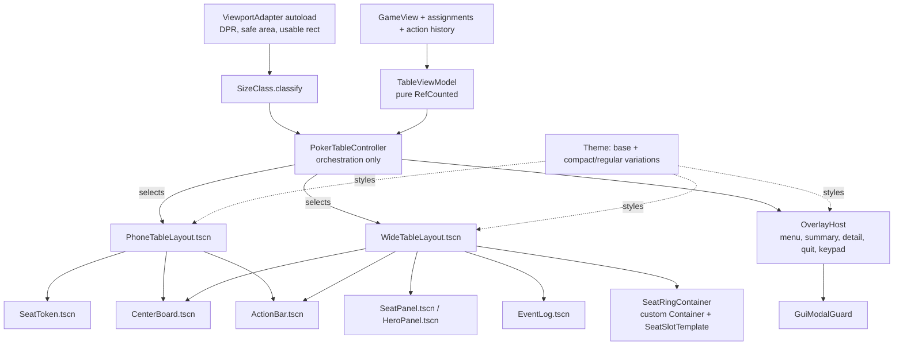

# Restructure GUI Tasks

Status: Proposed — no task started.
Reviewed: 2026-10-27 against the current `main` working tree.
Owner mode: Tech Lead / Architect for Phase 0–1 decisions, Senior Software
Engineer for implementation, QA for Phase 6.

This backlog contains an analysis of the current Godot GUI against common
practice for responsive GUIs on desktop browsers, iPad and phones, an
assessment of the GUI tests, a target structure, and ordered tasks for a
structured refactoring. It does not change product rules. The
[product specification](ProjectDescription.md) and the
[architecture](ARCHITECTURE.md#gui-adapter) remain authoritative.

This backlog is self-contained. Other `docs/*Tasks.md` files, active or
archived, are not inputs and may be outdated. Do not read their checkboxes
as requirements, do not wait on their open tasks, and do not update them from
this work. If one of them conflicts with this document, follow this document,
the product specification and the architecture. Device acceptance for the
restructured GUI is tracked in Phase 8 below.

## 1. Summary

The core/GUI separation is sound. `GameView`, recipient safety, the modal
guard semantics, the transactional keypad, touch/pointer modality and Web DPR
normalization are good foundations that should be kept.

The table presentation is the problem. `PokerTableController` holds 3,324
lines and 138 functions. It builds every widget in code, sets about 91 theme
overrides at runtime, and positions most nodes manually in a 630-line
`_layout_table()` plus a separate phone branch. At least five independent
size classifiers use thresholds that disagree. Correctness depends on post-hoc
collision passes (`_resolve_status_band_clearance()`,
`_resolve_seat_panel_intersections()`), deferred re-application of the center
bounds, and a layout-generation counter. Each device fix has added another
branch keyed to a specific size or player count (for example 7 seats below
1200 px, 9 seats, `x < 1200`, `x < 1600`, `y < 900`), so changes are risky and
fixes for one device can break another.

The tests protect valuable invariants but are tightly bound to node paths,
child names and exact pixel values of the current implementation. They sample
about 15 discrete viewports and do not show that every size between them gets
a valid layout. Several concrete gaps exist (Section 3.2).

The recommended direction is a set of incremental changes, each released
separately, that keeps the old code running until the new parts replace it:
one viewport adapter, one size classifier, a pure view model, component scenes
styled by a `Theme`, and layout done by Godot containers, including one custom
`Container` for the seat ring. A stable, role-based layout snapshot API should
let the existing invariant tests survive the rewrite.

## 2. Current structure

| Area | Files | Lines | Observation |
| --- | --- | --- | --- |
| Table controller | `scripts/gui/poker_table_controller.gd` | 3,324 | Binding, formatting, widget factories, styling, four layout variants, overlays, pacing, input, and test hooks in one class. |
| Table scene | `scenes/poker_table.tscn` | 425 | One scene contains both desktop and phone nodes (`PhoneMoreButton`, `PhoneOverflowMenu`, `QuitButton`, `EventLog`) toggled by visibility; overlays are siblings with `z_index`. |
| Layout helpers | `gui_mobile_table_layout.gd`, `table_seat_layout.gd`, `gui_phone_layout_plan.gd`, `gui_phone_seat_layout.gd` | 1,040 | Static helpers that mutate nodes by `find_child()` name, reparent markers, store state in `meta`, and hold six hard-coded seat-position tables. |
| Classification | `gui_layout_profile.gd`, `gui_mobile_table_layout.gd`, controller inline checks | — | Several predicates with different thresholds (Section 3.2). |
| Styling | `resources/gui_theme.tres`, `gui_table_style.gd`, controller | — | The theme contains only `default_font_size = 29`; colors, fonts, margins and boxes are set in code. |
| Startup | `startup_config_controller.gd`, `scenes/main.tscn` | 414 / 197 | Container-based form; also owns Web viewport normalization for the whole app. |
| Keypad / modal | `wager_keypad.gd`, `gui_modal_guard.gd` | 350 / 138 | Behavior is good; the keypad builds its UI in code. |
| GUI tests | 28 `tests/unit/test_gui_*.gd`, 5 support files, 4 manual matrix runners | ≈ 9,500 | 239 tests; strong invariant helpers; strong coupling to the implementation. |

## 3. Analysis against responsive-GUI practice in Godot

### 3.1 Viewport, scaling and device geometry

Common practice is to keep one logical-pixel coordinate system. You use the
`canvas_items` stretch mode with `expand` aspect, derive the scale from
DPR/DPI in a single place, subtract safe-area insets, and lay out from the
result.

- Good: `GuiWebViewportGeometry` normalizes the Web backing canvas to CSS
  pixels, which fixed the Android misclassification.
- The normalization lives in `StartupConfigController`, a screen controller,
  rather than in an app-level adapter. The table relies on it indirectly.
- Safe areas are not handled: there is no `DisplayServer.get_display_safe_area()`,
  no CSS `env(safe-area-inset-*)` and no `viewport-fit=cover`. iPhone notches,
  home indicators and Android gesture bars can therefore cover the bottom
  action rail, which is the most important touch area.
- Native desktop uses a 1920 × 1080 base with `expand`. A 1280 × 720 native
  window is scaled to 0.67, so the "20 px minimum" becomes about 13 physical
  pixels, and such a window can never classify as small desktop. Web is
  unaffected because it overrides `content_scale_size`. The decision should
  be explicit and the same on every platform.
- The tests set `table.size` directly and never go through `Window` stretch,
  so the full DPR → content scale → classification path is only covered by
  the separate Chromium input job.

### 3.2 Size classification: several sources of truth

Common practice is to have one total function from usable logical size to a
small set of size classes (compact/medium/expanded width and height). Every
layout decision reads only that result.

Current predicates:

| Predicate | Input | Thresholds |
| --- | --- | --- |
| `GuiLayoutProfile.classify()` | root `size` | phone short ≤ 600, long ≤ 920, aspect ≥ 1.35; tablet short 680–900/1200; small desktop `< 1100 × < 760` |
| `GuiMobileTableLayout.is_mobile_portrait()` | table surface (≈ 64 × 56 px smaller) | aspect ≥ 1.2 |
| `GuiMobileTableLayout.is_small_desktop()` | surface | `< 1300 × < 760` |
| `GuiMobileTableLayout.is_landscape_tablet()` / `is_portrait_tablet()` | surface | 1600 × 1200, 680–900 |
| Inline in `_layout_table()` | surface | `x < 1200`, `x < 1600`, `y < 900`, `y < 1200` with 7 seats, 9 seats |

Consequences that can be reproduced by reading the code:

- **Gap between phone and tablet.** A 650 × 900 portrait canvas (large
  phone, foldable, iPad split view) is not a phone (short edge > 600) and not
  a tablet (short edge < 680). It is classified as `DESKTOP`, while
  `is_mobile_portrait()` is true. The layout runs a hybrid
  desktop/mobile-portrait branch that no fixture covers.
- **Disagreeing small-desktop boundaries.** At 1250 × 700 the profile is
  `DESKTOP`, but the surface (≈ 1186 × 644) satisfies `is_small_desktop()`,
  so small-desktop geometry runs under a desktop profile.
- iPad portrait (768 × 1024) is both `TABLET` and `is_mobile_portrait()`, so
  mobile scaling rules and tablet tables mix.
- The profile is computed from the root size, while geometry uses the inset
  surface. Thresholds therefore mean different things in different files.

### 3.3 Layout ownership

Common practice in Godot is to place nodes with containers (`VBoxContainer`,
`HBoxContainer`, `GridContainer`, `FlowContainer`, `AspectRatioContainer`,
`MarginContainer`) and size flags. When a layout cannot be expressed with
stock containers, you write a custom `Container` that places its children in
`NOTIFICATION_SORT_CHILDREN` with `fit_child_in_rect()`. Godot then handles
ordering, deferred sorting and minimum-size propagation.

Current state:

- Most table nodes use `layout_mode = 0` or are free `Control`s positioned by
  `position`/`size` assignments. The center stack is placed manually and then
  re-applied deferred, guarded by `_layout_generation`, because container
  minimum sizes later overwrite it. This code fights the layout system.
- Seat placement uses nested ternaries over six normalized position tables,
  then special-case overrides (full-ring desktop footprints, small-desktop
  cell order `[1, 2, 0, 3, 5, 6, 4, 7]`, seven-seat slot remaps). After that,
  iterative collision passes move panels until they stop overlapping. A layout
  that only works after collisions are pushed apart is not deterministic by
  construction and is hard to reason about.
- Magic numbers are spread through layout code (198, 220, 170, 172, 184, 306,
  360, 416, 0.91, 0.23, 0.27 …) with no names or data source.
- Phone tokens place their labels with hand-written offsets (`offset_top =
  23.0`, `offset_right = -44.0`) and measured string widths instead of an
  `HBoxContainer`/`GridContainer` with `clip_text` and size flags.

### 3.4 Scene composition

Common practice is small reusable component scenes (`SeatPanel.tscn`,
`ActionBar.tscn` …), each with a typed script and a `set_model()` /
`render()` API. A layout scene composes them. Variants are separate scenes or
theme type variations, not runtime mutation.

Current state:

- Seats, tokens, cards and overlays are built in GDScript. You cannot inspect
  or adjust them in the editor.
- Profile changes mutate existing widgets. They reparent `Marker` and
  `MainPotWinnerStar`, cache `standard_text` and `standard_style` in node
  `meta`, and later "restore standard overlays". Rebuilding seats on profile
  exit exists to undo these mutations.
- Helpers find children by name (`find_child("Stack", true, false)`), so a
  rename fails silently.
- One scene contains phone-only and desktop-only nodes at the same time.

### 3.5 Styling and typography

Common practice is a project `Theme` with a palette, font sizes and
`StyleBox`es, plus theme type variations (`SeatPanel`, `SeatPanelActing`,
`HeroPanel`, `ActionButton`, `PhoneToken` …). Different sizes use an
alternative theme or font-size variations switched at size-class changes.
Runtime `add_theme_*_override` calls are kept to a minimum.

Current state:

- `gui_theme.tres` sets only `default_font_size = 29`. There are about 91
  overrides in the controller, 26 in `gui_mobile_table_layout.gd`, 26 in the
  keypad and 19 in startup.
- The same constants are duplicated (`OPPONENT_AVATAR_SIZE`,
  `HERO_AVATAR_SIZE`, `OPPONENT_CARD_SIZE`, font sizes) in the controller and
  `GuiMobileTableLayout`.
- Mobile font sizes come from `content_scale × base`, while desktop uses
  source sizes, so two typography systems coexist.
- `_enforce_minimum_gui_text_size_for_node()` patches the 20 px floor
  afterwards instead of making it a property of the theme.

### 3.6 Presentation logic mixed with views

Compact action text (`C10`, `A2k`), badge text, winner detection for
display, hand-summary text, pot-target selection and action availability all
live in the controller next to node code. They are pure functions of
`GameView` plus assignments and could be a `TableViewModel` tested without a
scene tree. Several GUI tests currently drive a live `TournamentMatch`
through the scene only to check such derived values.

### 3.7 Parts to keep

- Core/GUI boundary, `GameView` recipient safety, seat-ID-based remapping.
- `GuiModalGuard` semantics (exclusive surfaces, held advancement, focus
  trap, back/escape).
- `WagerKeypad` transaction semantics and modality-based input dispatch.
- `GuiActionPacer`, name/avatar assignment services, formatters.
- Product invariants: 20 px text floor, 48 × 48 touch targets, phone limit of
  2–7 players, no phone event log, exact chip values, human at the bottom.

## 4. Are the GUI tests addressing the right issues?

### 4.1 What they get right

- `GuiInvariantAssertions` checks generic, product-level properties:
  containment, non-intersection, text clipping (including ellipsis and
  wrapping), font floor and touch-target size. These are the right kind of
  layout assertions.
- Canonical named viewport and state fixtures are shared by headless tests
  and screenshot capture.
- Modal, keypad, focus and resize-preservation behavior is tested.
- Recipient safety (no private card leakage) is tested through the GUI.
- A real exported Web build is driven by Chromium pointer, touch and keyboard
  events.
- Rendered captures are explicitly separated from headless geometry checks.

### 4.2 Where they miss or cost too much

1. **Coupled to the implementation, not the contract.** Tests reach
   `TableMargin/Felt/TableSurface/Seats/Seat0`, `find_child("Name")`,
   `%PotLabel`, and assert exact values such as `MIN_WIDENED_SEAT_WIDTH =
   416`, `"Big blind 10"` in `Seat5Status`, or a specific two-row button
   split. Any structural refactoring breaks hundreds of assertions even when
   user-visible behavior is unchanged. This is the main obstacle to the
   restructuring.
2. **Tests named after incidents.** Names such as
   `test_observed_desktop_raster_keeps_quit_clear_of_human_identity` or
   `test_seven_player_ipad_*` freeze one past failure at one size. They do
   not express the underlying rule ("Quit never intersects any seat footprint
   at any supported size"), which the invariant sweep should cover generally.
3. **Sparse sampling.** About 15 viewports × {2, 4, 6, 9} players. Gaps such
   as 650 × 900 and the 1250 × 700 classifier disagreement (Section 3.2) are
   not exercised. Player counts 3, 5, 7 and 8 are only partly covered by the
   matrix. Nothing checks breakpoint boundaries (±1 px).
4. **The classifier test checks the wrong source of truth.**
   `test_gui_layout_profile.gd` verifies `GuiLayoutProfile`, but the layout
   also branches on other predicates. A passing profile test does not show
   which geometry actually ran.
5. **Poker behavior through the scene.** `test_gui_table_actions.gd` (1,251
   lines) checks pot-raise targets, repeated raises and short-stack rules
   through a live match and a mounted scene. Those belong to a pure presenter
   or view-model test; scene tests should only check that the button emits the
   intended action.
6. **Missing dimensions.** No safe-area tests. No test through `Window`
   stretch with fractional DPR. No test of continuous resizing (only burst
   coalescing). No desktop keyboard focus order test. No guard against seat
   rebuilds per resize (a performance regression risk on low-end phones).
   Only one test checks that the text still fits when the exported Web
   build renders it with Godot's built-in default font.
7. **Duplicated runners.** Four manual matrix runners (M3, phone, iPad,
   desktop) differ mainly in their fixture filter.
8. **Tests depend on deferred timing.** `_settle_layout()` waits on frames
   because geometry is applied deferred. A container-based layout makes
   geometry available after a single `queue_sort`/frame and simplifies tests.

### 4.3 What the tests should target

1. Pure units: size classification (total, monotonic, boundary values), view
   model text and privacy, seat-ring geometry (non-overlap property over all
   counts and a size sweep), viewport adapter (DPR, safe area).
2. Component scenes at their declared minimum size: no clipping, font floor,
   touch targets, all states (acting, folded, all-in, busted, revealed).
3. Composition invariants over a **continuous sweep** of sizes and all
   player counts 2–9 (2–7 for phone), using the existing invariant
   assertions through a stable layout snapshot API.
4. Behavior: modal, keypad, resize preserving state, profile switching.
5. Exported Web with Chromium device emulation (DPR 1/2/3, touch, sizes).
6. Rendered captures for human review; physical-device acceptance is
   recorded in Phase 8.

## 5. Target structure

Principles:

- **One geometry source.** `ViewportAdapter` (autoload under
  `scripts/gui/platform/`) owns Web DPR normalization and safe-area insets and
  emits `usable_rect_changed(rect)`. On Web it reads CSS
  `env(safe-area-inset-*)` through `JavaScriptBridge` (export shell uses
  `viewport-fit=cover`); on native mobile it uses
  `DisplayServer.get_display_safe_area()`.
- **One classifier.** `SizeClass.classify(usable_size, override)` returns a
  width class and a height class, plus one derived `LayoutMode` (`PHONE`,
  `PHONE_LANDSCAPE` kept deferred, `WIDE_COMPACT`, `WIDE`). It is total:
  every positive size maps to exactly one mode. No other code compares raw
  sizes against thresholds.
- **Pure presentation model.** `TableViewModel`, `SeatViewModel`,
  `CenterViewModel`, `ActionBarViewModel` and `HandSummaryViewModel` are built
  from `GameView`, the assignments and the public action history, with a
  density parameter (full/compact/minimal). They contain every player-facing
  string and enabled flag. They do not reference `Node`.
- **Component scenes.** Each component exposes `render(model)` and signals
  such as `action_requested(PlayerAction)` and `details_requested(seat)`. It
  never reads `GameView` or another component.
- **Container layout.** The wide layout is containers plus one
  `SeatRingContainer` (extends `Container`) that reserves a center rect and
  places seat footprints from a `SeatSlotTemplate` resource (normalized slot
  anchors per player count, mirrored by construction). The phone layout uses
  a `VBoxContainer` (opponent grid/arc, center, hero and action rail) and the
  existing `GuiPhoneSeatLayout` math wrapped as a container. Collision passes
  are removed: a template that overlaps fails a unit test.
- **Theme-first styling.** The palette, `StyleBox`es and font sizes live in
  `resources/gui_theme.tres` with type variations. State changes (acting,
  folded, winner) switch `theme_type_variation` instead of creating
  `StyleBox`es at runtime. Compact/regular sizes come from two theme
  resources or font-size variations applied at the layout root when the size
  class changes. The 20 px floor follows from the theme values and is checked
  by a theme lint test. The theme uses Godot's built-in default font
  (`ThemeDB.fallback_font`) only; no font files are added or downloaded.
- **Mode switch, not mutation.** When the layout mode changes, the
  controller frees the old layout scene and instantiates the other one, then
  renders the current view model. Tournament state, modal ownership and
  keypad drafts follow the existing contract.
- **Stable test API.** `get_layout_snapshot() -> GuiLayoutSnapshot` returns
  role-named rectangles (`center`, `action`, `event`, `quit`, `more`,
  `seat/<id>`, `status/<id>`, `overlay`) and text/target metadata. Tests and
  invariant runners use only this API and public signals.

Target size: controller under 500 lines; no GUI script over 400 lines; zero
`find_child()` by name in production code; runtime `add_theme_*_override`
only where a value is truly data-dependent.

## 6. Guardrails for every task

- Follow the AGENTS.md loop: one atomic change, then `make check` and
  `make gui-current-invariant-gate`; both pass before and after the change.
- Do not change `scripts/core/`, poker rules, `GameView` or simulation code.
- Preserve the product invariants listed in Section 3.7 and the modal/keypad
  contracts in [ARCHITECTURE.md](ARCHITECTURE.md#gui-adapter).
- Keep the old and new paths switchable until the parity task of a phase is
  complete; delete legacy code only in its dedicated task.
- Write screenshots and logs to ignored `localtmp/`.
- A synthetic pass is not device acceptance; record device evidence only in
  the Phase 8 tasks of this document.
- Do not consult or edit other `docs/*Tasks.md` backlogs for this work.
- Use only Godot's built-in default font. Do not add, bundle, download or
  reference any other font file or system font; vary only font sizes.

## 7. Tasks

Each task lists status, mode, scope and completion condition. Complete them
in order unless the user selects another task.

### Phase 0 — Safety net before restructuring

- [ ] **RG-00 — Record the baseline.** Status: Not started. Mode: QA.
  Run `make check`, `make gui-current-invariant-gate` and
  `make gui-visual-capture-development`; record test/assertion counts and the
  commit SHA here, with captures under `localtmp/restructure_baseline/`.
  Done: baseline recorded; all gates pass.

- [ ] **RG-01 — Add a stable layout snapshot API.** Status: Not started.
  Mode: Senior. Add `GuiLayoutSnapshot` (`scripts/gui/gui_layout_snapshot.gd`)
  and `PokerTableController.get_layout_snapshot()` with role-named
  rectangles, visibility, text-fit metadata and touch targets, built from the
  existing `get_resolved_region_rects()`/`get_seat_rects()`.
  Done: unit test covers every role for phone and wide profiles; no behavior
  change.

- [ ] **RG-02 — Move invariant assertions onto the snapshot.** Status: Not
  started. Mode: QA. Port `tests/support/gui_invariant_assertions.gd` and
  `gui_scene_harness.gd` from node paths to the snapshot.
  Done: no node path or `find_child()` in invariant support code; gates pass.

- [ ] **RG-03 — Add a characterization sweep.** Status: Not started. Mode: QA.
  Add `tests/unit/test_gui_layout_sweep.gd`: widths 320–2560 and heights
  320–1600 on a coarse grid (step 80 in `check`, step 20 in a new
  `gui-layout-sweep` Make target), plus ±1 px around each current
  threshold, for player counts 2–9 (2–7 when phone). Run the snapshot
  invariants. Record current failures (expected: 650 × 900 hybrid branch,
  1250 × 700 disagreement) in `tests/fixtures/gui_layout_sweep_known_failures.json`
  so they fail only if they change.
  Done: sweep runs; the known-failure list is reviewed and linked here.

- [ ] **RG-04 — Collapse the matrix runners.** Status: Not started. Mode: QA.
  Replace the four `tests/manual/gui_*_invariant_matrix_runner.gd` files with
  one parameterized runner selected by a fixture tag; keep the existing Make
  target names as aliases.
  Done: identical case count before and after; `release-candidate-gate`
  passes.

### Phase 1 — One source of geometry truth

- [ ] **RG-10 — Decide stretch and native desktop scaling. [Decision]**
  Status: Not started. Mode: Tech Lead. Choose either (a) a base viewport
  around 1280 × 720 with `canvas_items`/`expand` and
  `content_scale_factor` from screen scale on every platform, or (b) keep
  1920 × 1080 and apply the logical-size normalization on native too.
  Document the choice in [ARCHITECTURE.md](ARCHITECTURE.md#gui-adapter).
  Done: decision recorded with the effect on native 1280 × 720 windows.

- [ ] **RG-11 — Introduce `ViewportAdapter`.** Status: Not started. Mode:
  Senior. Create the autoload with `usable_rect` and `usable_rect_changed`.
  Move DPR normalization out of `StartupConfigController`. Add safe-area
  insets (Web: export head include with `viewport-fit=cover` and a
  `JavaScriptBridge` read of `env(safe-area-inset-*)`; native:
  `DisplayServer.get_display_safe_area()`). Inject a fake for tests.
  Done: unit tests for DPR 1/2/2.625/3 and inset combinations; startup and
  table both consume the adapter; Web input job passes.

- [ ] **RG-12 — Define the unified `SizeClass`. [Decision + implementation]**
  Status: Not started. Mode: Tech Lead then Senior. Specify width/height
  classes and the derived `LayoutMode` as a total function over usable size,
  including the 600–680 short-edge gap and portrait medium widths. Keep the
  explicit override for device-backed fixtures. Port `GuiLayoutProfile`
  tests and add boundary and monotonicity tests.
  Done: one classifier, documented thresholds, tests at every boundary ±1.

- [ ] **RG-13 — Route all branching through `SizeClass`.** Status: Not
  started. Mode: Senior. Replace `GuiMobileTableLayout.is_*` and the inline
  `x < 1200`/`x < 1600`/`y < 900`/`y < 1200` checks in the existing
  controller with derived flags from one `SizeClass` result per pass.
  Done: no raw-size threshold comparisons outside `SizeClass` (grep check in
  a documentation/lint test); sweep known-failure list shrinks or is updated
  with an explanation.

### Phase 2 — Presentation model

- [ ] **RG-20 — Create `TableViewModel` and child models.** Status: Not
  started. Mode: Senior. Move display-name, marker, badge, compact action
  text, status band text, winner display, pot/wager copy, hand summary and
  action availability from the controller into
  `scripts/gui/view_models/`. Pure `RefCounted` with typed fields and a
  density parameter.
  Done: the controller consumes the models; unit tests cover every
  `PlayerAction.Kind`, fold/all-in/busted/acting states, exact large values,
  and privacy (no unrevealed opponent card in any model).

- [ ] **RG-21 — Move poker-derived GUI tests to model tests.** Status: Not
  started. Mode: QA. Re-home pot-target, repeated-raise, short-stack and
  winner-text assertions from `test_gui_table_actions.gd` and the
  phone files into view-model tests; scene tests keep only "control emits the
  intended `PlayerAction`".
  Done: no loss of covered cases (map old → new test names in the commit
  message); GUI scene test runtime drops.

### Phase 3 — Theme

- [ ] **RG-30 — Build the theme palette and type variations.** Status: Not
  started. Mode: Senior. Move colors and `StyleBox`es from
  `GuiTableStyle`, `FoldedSeatStyle`, the controller and the keypad into
  `resources/gui_theme.tres` with variations (`Felt`, `Zone`, `SeatPanel`,
  `SeatPanelActing`, `SeatPanelFolded`, `HeroPanel`, `PhoneToken`,
  `StatusBand`, `ActionButton`, `PrimaryActionButton`, `OverlayPanel`,
  `KeypadKey`, `CardFace`, `CardBack`).
  Done: visual captures unchanged within review tolerance; theme lint test
  asserts every font size ≥ 20 and every button minimum ≥ 48 × 48.

- [ ] **RG-31 — Add compact and regular size variants.** Status: Not
  started. Mode: Senior. Provide font-size/spacing variants per size class,
  applied at the layout root on mode change. Remove `content_scale`-driven
  font multiplication and `_enforce_minimum_gui_text_size_for_node()`.
  Done: one typography system; font floor test passes over the sweep.

### Phase 4 — Component scenes

Build each component as `scenes/gui/components/<Name>.tscn` with a typed
script, `render(model)`, signals, theme variations only, and a component test
that renders all states at its minimum size and runs the snapshot invariants.

- [ ] **RG-40 — `CenterBoard`** (community cards in an `HBoxContainer` of
  `AspectRatioContainer` cards, pot and wager rows; equal fixed card slots).
  Status: Not started. Mode: Senior.
- [ ] **RG-41 — `SeatPanel` and `HeroPanel`** with the status band as part of
  the component footprint (no separate sibling label), avatar, marker,
  winner star and cards in containers. Status: Not started. Mode: Senior.
- [ ] **RG-42 — `SeatToken`** (phone) using a `GridContainer`/box layout with
  measured-text fallback to the expanded third row, replacing hand offsets.
  Status: Not started. Mode: Senior.
- [ ] **RG-43 — `ActionBar`** with one or two rows chosen by available width
  (`HFlowContainer` or explicit row model), keypad trigger and inline input by
  modality, phone hero summary as a sub-component. Status: Not started.
  Mode: Senior.
- [ ] **RG-44 — `EventLog`** (wide only). Status: Not started. Mode: Junior.
- [ ] **RG-45 — `OverlayHost`** that owns menu, hand summary, seat detail,
  quit confirmation and keypad on one full-rect layer with a backdrop and
  integrates `GuiModalGuard`. Use the in-canvas quit confirmation on all
  profiles unless RG-10/RG-12 records a reason to keep the native dialog.
  Status: Not started. Mode: Senior.

Done for Phase 4: every component has a test over all states; components are
used by neither layout yet or by the legacy layout behind a flag.

### Phase 5 — Layouts and switching

- [ ] **RG-50 — `SeatRingContainer` and `SeatSlotTemplate`.** Status: Not
  started. Mode: Senior. Custom `Container` that reserves the center and
  lower regions and places seat footprints with `fit_child_in_rect()` in
  `NOTIFICATION_SORT_CHILDREN`; slots come from `.tres` templates for 2–9
  players with mirrored construction and hero-at-bottom mapping (reuse
  `_visual_slot_for_seat`). Replace the six tables in
  `table_seat_layout.gd`.
  Done: property test over counts 2–9 and the sweep shows no overlap and
  full containment without any collision-resolution pass.

- [ ] **RG-51 — `WideTableLayout.tscn`** for tablet, small desktop and
  desktop, composed of containers, `SeatRingContainer`, `CenterBoard`,
  `HeroPanel`, `ActionBar` and `EventLog`. Status: Not started. Mode: Senior.
  Done: wide fixtures and the wide part of the sweep pass with the new
  layout behind a flag.

- [ ] **RG-52 — `PhoneTableLayout.tscn`** wrapping `GuiPhoneSeatLayout`
  geometry in a container, with `SeatToken`s, `CenterBoard`, `ActionBar`,
  More/Pots button and safe-area margins from `ViewportAdapter`. Phone
  landscape stays deferred. Status: Not started. Mode: Senior.
  Done: phone fixtures and the phone part of the sweep pass behind a flag.

- [ ] **RG-53 — Controller orchestration.** Status: Not started. Mode:
  Senior. Reduce `PokerTableController` to binding, pacing, model building,
  layout-mode switching (free/instantiate on change, never mutate), overlay
  routing and the snapshot API. Preserve keypad-draft, modal and focus rules
  across switches.
  Done: `test_gui_live_viewport_changes.gd` and modal tests pass on the new
  path; resize does not rebuild seats unless the mode or seat set changes
  (counted in a test).

- [ ] **RG-54 — Switch default and remove legacy code.** Status: Not
  started. Mode: Senior. Make the new path default, then delete
  `gui_mobile_table_layout.gd`, `table_seat_layout.gd`, the legacy branches,
  the layout-generation/deferred center logic, both collision passes, and
  unused scene nodes.
  Done: the sweep known-failure list is empty; all gates pass; size targets in
  Section 5 are met.

### Phase 6 — Tests and tooling

- [ ] **RG-60 — Replace implementation-coupled tests.** Status: Not started.
  Mode: QA. Rewrite or delete tests that use node paths, child names or
  exact pixel values when the rule is covered by snapshot invariants, the
  sweep or component tests. Rename incident tests to the rule they protect
  and keep their viewport as a fixture.
  Done: no `TableMargin/Felt/...` paths in `tests/`; every removed assertion
  is mapped to its replacement in the commit message.

- [ ] **RG-61 — Exported Web layout checks.** Status: Not started. Mode: QA.
  Extend `tools/run_web_input_tests.py` to run Chromium device emulation at
  DPR 1/2/3 for canonical phone, iPad and desktop sizes. Read the snapshot
  through the existing test-only observer and run the invariants in the real
  `Window` stretch path.
  Done: the `Exported Web input` job covers layout at three DPRs.

- [ ] **RG-62 — Default-font metric parity.** Status: Not started. Mode: QA.
  Verify that headless tests and the exported Web build measure text with
  the same built-in default font. Make the text-fit checks in RG-61 cover
  the longest names, exact large chip values and compact action copy. Do
  not add or download any font.
  Done: parity verified or differences recorded; text-fit tests pass in
  both paths using only the default font.

### Phase 7 — Documentation

- [ ] **RG-70 — Update current documentation.** Status: Not started. Mode:
  Documentation Updater. Update the GUI adapter section of
  [ARCHITECTURE.md](ARCHITECTURE.md#gui-adapter),
  [ProvisionalGUILayoutGuidance.md](ProvisionalGUILayoutGuidance.md),
  [GUI_VISUAL_TESTING.md](GUI_VISUAL_TESTING.md), `devdocs/` references and
  `README.md` to describe the viewport adapter, size classes, components,
  theme and snapshot API; run `make docs-check`. Leave other
  `docs/*Tasks.md` files unchanged.
  Done: no stale references to removed scripts in current docs; docs check
  passes.

### Phase 8 — Device acceptance

Record each review with commit SHA, device, OS and browser version, logical
viewport (CSS px), DPR, orientation, player count and screenshots under
`localtmp/restructure_acceptance/`. Mark a task complete only when the user
accepts it. Phone landscape remains deferred and is not part of acceptance.

- [ ] **RG-80 — Phone portrait review.** Status: Not started. Mode: QA with
  user. Review a hosted build of the default switch (RG-54) on at least one
  physical Android and one iOS phone for 2, 4, 6 and 7 players: phone
  composition selected, no clipped names/stacks, 20 px text, 48 px targets,
  action rail clear of safe-area insets, More/Pots, keypad, hand summary and
  quit flows.
  Done: evidence recorded here; user acceptance noted.

- [ ] **RG-81 — iPad review.** Status: Not started. Mode: QA with user.
  Landscape (primary) and portrait for 2, 6 and 9 players, including
  browser-chrome height changes and rotation during a hand.
  Done: evidence recorded here; user acceptance noted.

- [ ] **RG-82 — Desktop browser review.** Status: Not started. Mode: QA with
  user. Window sizes around 1280 × 720, 1920 × 1080 and a narrow window that
  crosses each size-class boundary, with pointer and keyboard input.
  Done: evidence recorded here; user acceptance noted.

- [ ] **RG-83 — Close the backlog.** Status: Not started. Mode:
  Documentation Updater. Summarize accepted scope and remaining limitations
  at the top of this file and move it to `docs/arkiv/` when the user agrees.
  Done: status line updated; index in [README.md](README.md) updated.
