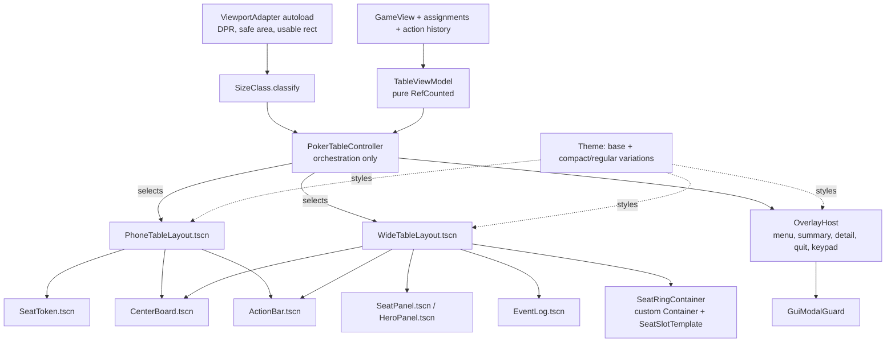

# Restructure GUI Tasks

Status: Proposed — reconciled with current code; no redesign task started.
Reviewed: 2026-10-27 against source commit
`0669f41b7fc203d60640a6250f661b933ee33247` and the current working tree.
This documentation review is not RG-00 baseline execution or device acceptance.
Owner mode: Tech Lead / Architect for Phase 0–1 decisions, Senior Software
Engineer for implementation, QA for Phase 6.

This backlog contains an analysis of the current Godot GUI against common
practice for responsive GUIs on desktop browsers, iPad and phones, an
assessment of the GUI tests, a target structure, and ordered tasks for a
structured refactoring. The target principles in this document lead the
redesign; the current implementation is a migration baseline, not a reason to
retain competing geometry owners or runtime-built presentation. The
[product specification](ProjectDescription.md) owns product rules and the
[architecture](ARCHITECTURE.md#gui-adapter) describes implemented behavior.
Proposed changes below must be recorded as future decisions before those
implementation descriptions are replaced. If implementation would contradict
product requirements or an approved architectural decision, stop and ask the
user to resolve that specific conflict. Do not silently weaken the redesign
or change requirements to make an implementation task pass.

This backlog is self-contained. Other `docs/*Tasks.md` files, active or
archived, are not inputs and may be outdated. Do not read their checkboxes
as requirements, do not wait on their open tasks, and do not update them from
this work. If one of them conflicts with this document, follow this document,
the product specification and the architecture. Device acceptance for the
restructured GUI is tracked in Phase 8 below.

## 1. Summary

The core/GUI separation, recipient-safe `GameView`, modal guard, transactional
keypad, input modality and Web DPR normalization remain sound foundations.
The proposed destination remains one viewport adapter, one classification
policy, pure presentation models, reusable component scenes, theme-owned
styling and container-owned layout, including a custom seat-ring container.

Some groundwork now exists. `PokerTableController` is 2,545 lines with 115
functions; `_layout_table()` is a 66-line coordinator. Typed seat, action,
overlay and layout helpers have replaced the earlier monolithic implementation.
All four diagnostic matrices already share one runner. These extractions are
useful migration boundaries, but most widgets are still built in code and the
layout helpers still apply manual geometry, competing classification predicates
and deferred collision/center corrections. They do not implement the target
scene/container architecture. Architectural quality and responsive behavior are
the acceptance criteria; reducing the diff or retaining existing GUI code is
not a requirement. A replacement GUI built from scratch is an acceptable
implementation strategy.

The migration must also preserve newer behavior: complete seat/status
footprints, clockwise core-seat order, measured card/name/stack copy, finite
phone content rows, default completed-hand winner presentation, and existing
modal/focus/keypad rules. The native/Web refresh profiler and exported-browser
layout runner are existing verification tools to extend, not new tools to
recreate. Keep the legacy GUI available as a reference while building the replacement,
using separate scenes or a temporary selector where useful. Reuse helpers only
when they fit the target design. Preserve product behavior and verification
coverage, not legacy node trees, pixel coordinates, visual defects or internal
APIs. Cut over only after the replacement and its tests satisfy the contracts.

## 2. Current structure and reusable foundations

Counts describe the reviewed source, not acceptance evidence or size limits.

| Area | Current files / size | Migration implication |
| --- | --- | --- |
| Controller | `scripts/gui/poker_table_controller.gd`: 2,545 lines, 115 functions | Still owns binding, copy, pacing, input and significant phone/desktop layout work; its main coordinator is already extracted. |
| Typed components | `gui_table_seat_factory.gd` / `gui_table_seat_view.gd` (491 / 55 lines), `gui_table_action_controls.gd` (196), `gui_table_overlay_views.gd` (129) | Reuse ownership boundaries and handles while replacing factories/runtime mutation with authored scenes. Handles are still discovered once by child name. |
| Layout policy/application | `gui_table_layout_pass.gd` / `gui_table_seat_layout.gd` (159 / 233), `gui_mobile_table_layout.gd` (515), `table_seat_layout.gd` (245) | Branching has moved into these helpers; changing only controller predicates would leave competing policy behind. |
| Finite plans | `gui_phone_layout_plan.gd`, `gui_phone_seat_layout.gd`, `gui_phone_token_content_plan.gd`, `gui_six_seat_desktop_plan.gd` | Preserve complete-footprint, content-fit and stable-seat-order contracts when moving their math behind containers. |
| Scenes / startup | `scenes/poker_table.tscn` (425), `scenes/main.tscn` (197), `startup_config_controller.gd` (414) | Table still mixes phone/wide nodes; startup is container-based but owns app-wide Web geometry normalization. |
| Theme / input | `resources/gui_theme.tres` contains only `default_font_size = 29`; `wager_keypad.gd` (350), `gui_modal_guard.gd` (138) | Move style and keypad construction into resources/scenes while preserving input transactions and modal lifetime. |
| Tests | 36 `tests/unit/test_gui_*.gd` files, 262 test functions, 9,005 lines; nine GUI support scripts | Current coverage is broader than the original inventory, but still coupled to internal structure. Non-`test_gui_*` startup/keypad tests also remain relevant. |
| Matrix runner | `tests/support/gui_invariant_matrix_runner.gd`, `gui_invariant_matrix_suites.gd`, `gui_phone_matrix_contract.gd` | Already consolidated. Preserve ordered case identities: 348 M3, 406 phone, 288 iPad, 232 desktop; four manual files are thin entry points. |
| Browser / performance | `tools/run_web_input_tests.py`, `tools/run_web_layout_tests.py`, `tools/web_layout_assertions.py`, `tools/profile_gui_refresh.py`, `tests/web/`, `tests/performance/` | Reuse observers, real `Window` geometry, order/content checks and profiling fixtures throughout migration. |

## 3. Analysis against responsive-GUI practice in Godot

### 3.1 Viewport, scaling and safe areas

The target needs a defined mapping between physical/backing pixels, browser CSS
pixels, Godot logical units and usable table-local coordinates. These are not
interchangeable, and DPR must not be applied twice.

- `GuiWebViewportGeometry` already converts backing size using screen scale;
  `StartupConfigController` applies it to `Window.content_scale_size` on Web.
  Move this ownership to the app adapter, preserving the existing startup/table
  behavior and leaving CLI/simulation processes unaffected.
- There is no implemented safe-area adapter or export `viewport-fit=cover`
  contract. Measure Web insets through a CSS probe and convert native mobile
  display-safe rectangles into window/logical coordinates. Preserve the usable
  rectangle's origin, not only its size, and subtract browser/inset reductions
  once. Headless tests must inject geometry instead of trusting display APIs.
- Native uses a 1920 × 1080 design viewport with `canvas_items` / `expand`.
  A smaller window can retain design-space coordinates while rendering them
  at a reduced scale. The effect on classification, output text and touch size
  needs an actual `Window` measurement in RG-10; a nominal 20-unit font is not
  proof of a 20-CSS-pixel or physical-pixel output. Do not infer physical text
  size from the base viewport alone.
- Headless scene fixtures mostly set `SubViewport`/Control geometry directly.
  The exported input and layout fixtures already mount production main and
  exercise Web normalization through the real `Window`; reuse that path.

### 3.2 Classification and fit policy still disagree

`GuiLayoutProfile.classify()` already has a fallback for every size. The issue
is inconsistent policy across owners, not the absence of a total function.

| Owner | Current input / policy |
| --- | --- |
| `GuiLayoutProfile` | Root size; phone short edge ≤ 600, long edge ≤ 920 and aspect ≥ 1.35; tablet and small-desktop ranges. |
| `GuiTableLayoutPass` | Root classification plus inset surface predicates, compact-tablet/full-ring conditions and helper-selected scales. |
| `GuiMobileTableLayout` | Surface-size portrait/tablet/small-desktop tests; small desktop `< 1300 × < 760`, unlike profile `< 1100 × < 760`. |
| `GuiSixSeatDesktopPlan.can_use()` | Six-seat desktop only, width below 1600 plus complete-footprint feasibility; it already bypasses legacy clearance passes when selected. |
| Remaining controller / seat helpers | Additional measured-center, numeric-copy, seat-count and height decisions, including short seven-/nine-seat compositions. |

A focused headless policy probe confirms `DESKTOP` plus mobile-portrait flags for
650 × 900, and `DESKTOP` plus legacy small-desktop sizing at 1250 × 700
(with the authored surface inset); 1377 × 777 instead selects the deterministic
six-seat plan. These are characterization cases, not
verified overlap defects. iPad portrait deliberately combines a tablet profile
with portrait geometry. Record observed results before declaring failures.

The replacement must classify one adapter-owned usable rectangle, then pass a
typed policy to components. Local measured-fit decisions (for example a third
content row or a container minimum size) remain necessary; they must not become
another set of global device breakpoints. Width/height class monotonicity is
specified per axis and orientation, not by ordering arbitrary profile enum IDs.

### 3.3 Layout ownership

Godot containers own the geometry of their direct Control children. The custom
seat container must implement `NOTIFICATION_SORT_CHILDREN`, use
`fit_child_in_rect()` and report content-derived minimum sizes. Its pure plan
must account for child minima; normalized anchors alone cannot guarantee fit.
See [Godot container guidance](https://docs.godotengine.org/en/stable/tutorials/ui/gui_containers.html)
and the [Container API](https://docs.godotengine.org/en/stable/classes/class_container.html).

Current manual/deferred geometry remains in the controller and extracted
helpers. The ordinary paths still call clearance/intersection resolvers;
the constrained six-seat desktop plan instead reserves complete footprints
before placement. Preserve that deterministic behavior while replacing all
paths with one container owner, not merely moving the old collision loops.
Phone token content has a finite measured-row plan now; preserve its exact
content and visibility rules rather than rebuilding them from old offsets.

A layout outside its declared minimum cannot fit arbitrarily many seats while
retaining 20 px text and 48 px controls. Define feasible envelopes and an
explicit unsupported-size/guidance state. Existing supported canonical fixtures
remain mandatory; reducing their support requires an explicit user decision. Never silently clip required copy,
shrink type, drop players or change an active tournament to make a sweep pass.

### 3.4 Scenes, models and styling

The typed helpers are already useful boundaries but remain runtime builders.
`GuiTableSeatView` captures handles once; helpers still style/reparent controls,
restore metadata-backed state, and mix phone/wide nodes in one table scene.
Replace those implementations with authored component scenes and explicit
models while keeping the ownership improvements.

Presentation copy remains distributed across controller, seat/action helpers,
`ShowdownHandFormatter`, `GuiEventFormatter` and `TournamentStatusFormatter`.
Reuse the pure formatters. View models select recipient-safe content and action
availability; they call existing core helpers such as `PotWagerTarget` rather
than implementing poker validation or minimum-raise rules in the GUI.

Styling remains runtime-heavy: 54 `add_theme_*` call sites in the controller,
with further calls in extracted helpers, mobile layout, startup and keypad.
The theme still contains only a default font size. Move static palette,
StyleBoxes, variations and sizes into resources. Verify effective inherited
fonts and actual component/touch rectangles; theme values alone cannot certify
fit or button minimum size. Retain complete names, exact numeric values and
rank `10` measurement with the built-in default font.

### 3.5 Contracts to preserve

- Core/GUI separation, recipient safety and presentation-only assignments/RNG.
- Human at the bottom and opponents in clockwise core-seat order, including
  reordered view arrays and nonzero recipient seats.
- Whole seat/status footprints, `Winner` after fold wins, default phone winner
  copy/Pots access, exact awards and legitimately revealed cards.
- Phone 2–7 and larger profiles 2–9; an 8-/9-player match resized to phone
  keeps its state and shows guidance. Phone landscape remains deferred.
- At least 20 px player-facing text, 48 × 48 touch targets, full names/stacks,
  and no phone event-history surface. Keep all existing numeric-bound cases.
- Modal exclusivity, held advancement, focus restore, Escape/engine-back,
  touch/pointer modality, and keypad commit/cancel behavior.
- Current profile-exit behavior cancels a phone wager draft without committing
  it; phone rotation preserves the draft. The target may preserve more state,
  but RG-45/RG-53 must explicitly resolve that change before replacing tests.
- `GuiActionPacer` and the two-second action / five-second completed-hand
  cadence. Component decomposition does not authorize changed game pacing.

## 4. Verification strategy

### 4.1 Reuse existing coverage

The existing invariant helper checks containment, overlap, clipping, font floors
and targets. Current tests also protect clockwise order, finite phone rows,
long names, large exact numbers, modal/keypad behavior and repeated resizes.
There are 15 canonical viewport fixtures with varied count sets; phone includes
7 players and iPad includes 7 and 9. Counts 3, 5 and 8 and broader automatic
classification paths still need systematic coverage.

`run_web_layout_tests.py` already drives production-main Window normalization,
resizes, geometry/content/order checks and DPR 1/2. Its default report mode can
retain failures while returning success; use `--strict` for a correctness gate.
The CI `Exported Web input` job already tests pointer/touch/keypad/focus and
showdown behavior, but is not yet the full layout/DPR matrix proposed here.

Native/Web refresh profiling and lifetime evidence already exist. The current
architecture retains disposable seat/card widgets in the existing runtime
builder because measured results did not justify retrofitting retention there.
That finding does not require a new scene-based GUI to reproduce the old
lifetime policy. Define explicit ownership for persistent component scenes or
disposable subcontent, render fresh safe models, and test privacy, focus, modal
and stale-content behavior. Profile the replacement against the baseline;
geometry-only resizes should avoid unnecessary reconstruction. A whole-view
cache is not a substitute for correct component lifetime.

### 4.2 Migrate contracts, not incidental structure

Many tests and both Web observers access internal nodes, private controller
fields and exact rectangles. A stable snapshot must cover every existing
invariant before deleting those dependencies: seats/status/cards, labels and
text-fit data, controls/targets, overlays, effective fonts, coordinate origins,
visibility, layout readiness and core-seat ownership. Preserve rejection tests
that deliberately expose a private card or introduce overlap; a snapshot that
omits the offending child must not produce a false pass.

Move pure copy/availability assertions to model tests, while retaining scene
integration tests that exercise real control activation, input modality,
`PlayerAction` submission and core rejection without state mutation. Reuse core
rule tests; do not reduce adapter tests to emitting a mocked signal.

Characterization sweeps are finite samples, not continuous proofs. Separate
cheap pure geometry/policy sweeps from a bounded rendered scene matrix, and
budget CI runtime before choosing grid steps. Include measured fit transitions,
±1 breakpoint cases, fractional DPR, safe-area origins and real resize streams.
Known failures need exact signatures and review; fail on regressions and on
unexpected passes until the record is updated. Unsupported sizes require an
explicit supported-minimum contract rather than blanket exceptions.

Nested containers can need multiple deferred passes after minimum-size changes.
Retain a bounded settle/readiness contract and detect non-convergence; do not
promise that one frame always settles a composition. Physical-device acceptance
remains separate from headless and exported-browser checks in Phase 8.

## 5. Target structure

Principles:

- **Design before reuse.** A full GUI replacement is allowed. Existing
  helpers are references and potential inputs, not mandatory target modules.
  Implement clean scene/container boundaries directly when adapting a helper
  would preserve competing ownership, hidden mutation or incidental structure.
- **One geometry source.** `ViewportAdapter` (autoload under
  `scripts/gui/platform/`) owns Web DPR normalization and safe-area insets and
  emits an immutable geometry snapshot plus `usable_rect_changed(rect)`.
  Define units, usable origin, window-to-logical transforms and inset ownership.
  On Web a CSS probe exposes computed `env(safe-area-inset-*)` values through
  `JavaScriptBridge`; audit the export viewport meta tag before enabling
  `viewport-fit=cover`. On native mobile convert/intersect
  `DisplayServer.get_display_safe_area()` with the app window before mapping to
  logical coordinates. Headless/non-GUI roots use a safe injected/no-op path.
  See the [DisplayServer API](https://docs.godotengine.org/en/stable/classes/class_displayserver.html#class-displayserver-method-get-display-safe-area).
- **One classifier.** `SizeClass.classify(usable_size, override)` returns a
  width class and a height class, plus one derived `LayoutMode` (`PHONE`,
  `PHONE_LANDSCAPE` kept deferred, `WIDE_COMPACT`, `WIDE`). It is total:
  every positive size maps to exactly one mode; invalid or uninitialized sizes
  have an explicit not-ready result. Define feasible minimums and an
  unsupported-size presentation separately from classification. Components may
  compare measured content minima with their allocation, but only this policy
  owns global layout breakpoints.
- **Pure presentation model.** `TableViewModel`, `SeatViewModel`,
  `CenterViewModel`, `ActionBarViewModel` and `HandSummaryViewModel` are built
  from `GameView`, the assignments and the public action history, with a
  density parameter (full/compact/minimal). They contain every player-facing
  string and enabled flag. They do not reference `Node`.
- **Component scenes.** Each component exposes `render(model)` and signals
  such as `action_requested(PlayerAction)` and `details_requested(seat)`. It
  does not read `GameView` or peer internals. Parent composition uses public
  child APIs and normal Control minimum-size measurement.
- **Container layout.** The wide layout is containers plus one
  `SeatRingContainer` (extends `Container`) that reserves a center rect and
  places complete seat/status footprints from `SeatSlotTemplate` resources
  and measured child minima. Implement `_get_minimum_size()` and normal
  minimum-size invalidation as well as sorting. Mirrored templates must retain
  clockwise core-seat order with the recipient at the bottom. The phone layout
  uses containers for opponent tokens, center, hero and action rail; reuse or
  replace `GuiPhoneSeatLayout` math as appropriate. Collision passes are
  removed: an infeasible plan reports unsupported size instead of publishing
  overlapping rectangles.
- **Theme-first styling.** The palette, `StyleBox`es and font sizes live in
  `resources/gui_theme.tres` with type variations. State changes (acting,
  folded, winner) switch `theme_type_variation` instead of creating
  `StyleBox`es at runtime. Compact/regular sizes come from two theme
  resources or font-size variations applied at the layout root when the size
  class changes. Theme lint checks defined sizes/inheritance; rendered component
  tests establish the effective 20 px floor, text fit and 48 px touch targets.
  The theme uses Godot's built-in default font
  (`ThemeDB.fallback_font`) only; no font files are added or downloaded.
- **Mode switch, not mutation.** When the layout mode changes, the
  controller frees the old layout scene and instantiates the other one, then
  renders the current view model. Tournament state and presentation assignments
  remain outside the replaced
  subtree; `OverlayHost` owns modal state, input drafts and focus restoration.
  RG-45/RG-53 explicitly resolve profile-exit cancel versus draft preservation
  before changing that behavior.
- **Stable test API.** `get_layout_snapshot() -> GuiLayoutSnapshot` returns
  role-named rectangles (`center`, `action`, `event`, `quit`, `more`,
  `seat/<id>`, `status/<id>`, `overlay`) and text/target/card-visibility metadata
  in a documented coordinate space,
  including usable origin, effective fonts and readiness. Include typed startup
  and overlay snapshots. Headless tests and exported read-only observers consume
  the same semantic roles and public signals; observers retain no private cards.
  Scene-loading paths remain valid bootstrap configuration, not layout selectors.

Review size targets: controller under 500 lines; other GUI scripts under 400
lines; zero
`find_child()` by name in production code; runtime `add_theme_*_override`
only where a value is truly data-dependent. Line counts do not substitute for
clear ownership, correct minimum-size propagation and responsive behavior.

## 6. Guardrails for every task

- Follow the AGENTS.md loop for implementation: establish passing
  `make check` and `make gui-current-invariant-gate` before restructuring and
  rerun both after each atomic implementation change. Documentation-only work
  runs `make docs-check`; it does not certify GUI behavior.
- Update architectural decisions and implemented component guidance as each
  change lands. RG-70 consolidates consistency; it does not postpone those
  updates until the end of the rewrite.
- Do not change `scripts/core/`, poker rules, `GameView` or simulation code.
- Preserve the product invariants listed in Section 3.5 and the modal/keypad
  contracts in [ARCHITECTURE.md](ARCHITECTURE.md#gui-adapter).
- A clean replacement implementation is permitted. Keep the legacy GUI
  available as a reference, not a mandatory architecture or visual template.
  Compare product contracts through a temporary selector/separate scenes; do not
  require new components to fit old node trees. Delete legacy code at cutover
  after the replacement tests and observers work independently.
- Write screenshots and logs to ignored `localtmp/`.
- A synthetic pass is not device acceptance; record device evidence only in
  the Phase 8 tasks of this document.
- Do not consult or edit other `docs/*Tasks.md` backlogs for this work.
- Use only Godot's built-in default font. Do not add, bundle, download or
  reference any other font file or system font; vary only font sizes.

## 7. Tasks

Each task lists status, mode, scope and completion condition. Complete them
in phase order unless the user selects another task. RG-54 is intentionally
placed after Phase 6 verification; deletion must follow test/observer migration.
A task may replace its whole GUI subsystem rather than adapt the old one,
provided the target contracts and acceptance evidence are retained.

### Phase 0 — Safety net before restructuring

- [ ] **RG-00 — Record the executable baseline.** Status: Not started. Mode: QA.
  Run `make check` and `make gui-current-invariant-gate`; record the source
  SHA, relevant dirty-source fingerprint, commands, case counts and limitations.
  Capture both M3 and phone reference suites using the existing visual runner
  with `--development --output` under `localtmp/restructure_baseline/`.
  Check current documentation links first: this review found preexisting
  relocation errors after the Astra record moved to `docs/arkiv/`; do not
  misreport those as GUI regressions or a green baseline.
  Done: all required gates pass and a reproducible reference is recorded here;
  existing defects are explicitly distinguished from accepted product behavior.

- [ ] **RG-01 — Define and adapt the stable layout snapshot API.** Status:
  Not started. Mode: Senior. Add typed `GuiLayoutSnapshot` and
  `PokerTableController.get_layout_snapshot()` over the current rectangle APIs
  and typed handles. Cover every existing invariant, startup/overlays, complete
  seat/status footprints, actual child/card visibility, text fit, effective
  typography, interaction targets and readiness. Normalize current mixed
  surface-local/global coordinates; specify the usable origin and conversion.
  Done: unit tests cover phone/wide/startup/overlay roles and invariants can
  still detect deliberate private-card exposure and content/geometry failures.

- [ ] **RG-02 — Migrate shared assertions and observers to snapshots.** Status:
  Not started. Mode: QA. Adapt `gui_invariant_assertions.gd`,
  `gui_phone_matrix_contract.gd`, `gui_scene_harness.gd` and `tests/web/`
  observers to the semantic contract, retaining bounded layout settling.
  Support the reference and replacement implementations without requiring the
  same node tree. Keep exported observers read-only and excluded from releases.
  Done: shared invariants do not traverse internal node paths/names or private
  controller fields; headless and exported gates retain rejection coverage.

- [ ] **RG-03 — Characterize policy boundaries and fit envelopes.** Status:
  Not started. Mode: QA. Add cheap pure policy/geometry sweeps over widths
  320–2560 and heights 320–1600, all counts 2–9, and ±1 at existing boundaries.
  Start with step 80, with a step-20 diagnostic `gui-layout-sweep` target;
  measure runtime before adding work to `check`. Use a bounded representative
  scene matrix for text, modal and real minimum-size propagation. Include
  650 × 900, 1250 × 700 and same-widget resize streams without presuming a
  failure. Identify phone 2–7 support, deferred landscape and insufficient-space
  cases separately; never claim that every size can contain every count.
  Done: observed failure signatures/inputs are reviewed in
  `tests/fixtures/gui_layout_sweep_known_failures.json`; new failures and
  unexpected passes fail the characterization check. RG-10/RG-12 define the
  final support envelope; no blanket clipping or overlap exemptions.

- [ ] **RG-04 — Preserve the existing consolidated matrix infrastructure.**
  Status: Not started. Mode: QA. The shared `GuiInvariantMatrixRunner`,
  declarative `GuiInvariantMatrixSuites` and phone contract already exist.
  Verify their snapshot migration rather than creating another runner. Keep
  four thin manual entry points and existing Make aliases, ordered case IDs
  and capture-source provenance. Extend the shared definitions for new cases.
  Done: the 348 M3 / 406 phone / 288 iPad / 232 desktop historical selections
  remain identifiable; additional coverage is versioned explicitly and all
  four diagnostic gates pass.

### Phase 1 — One source of geometry truth

- [ ] **RG-10 — Decide logical geometry, minimums and native scaling. [Decision]**
  Status: Not started. Mode: Tech Lead. Define physical/backing, CSS, Window
  and Control units with evidence from actual 1280 × 720 and 1920 × 1080
  native windows and exported Web. Choose a coherent stretch/base/scale
  policy; multiplying by screen scale is not automatically correct. State the
  user-visible text/target interpretation and minimum feasible sizes per mode,
  density and count, including unsupported-size guidance.
  Done: record the decision and conversion examples in
  [ARCHITECTURE.md](ARCHITECTURE.md#gui-adapter), using
  [Godot scaling guidance](https://docs.godotengine.org/en/stable/tutorials/rendering/multiple_resolutions.html).

- [ ] **RG-11 — Introduce `ViewportAdapter`.** Status: Not started. Mode:
  Senior. Implement the app-level GUI adapter and injectable immutable geometry
  snapshot. Transfer existing Web normalization out of startup; define CSS
  inset probing/export viewport metadata and native mobile safe-area conversion.
  Apply reductions once, retain nonzero origins, and handle resize, browser
  chrome, rotation and invalid/zero/headless geometry without affecting CLI
  or simulation roots.
  Done: startup and table consume one geometry source; tests cover DPR
  1/2/2.625/3, nonzero/asymmetric insets, fallback platforms and real Window
  normalization; existing exported input and strict layout checks pass.

- [ ] **RG-12 — Define unified `SizeClass` and supported fit policy. [Decision + implementation]**
  Status: Not started. Mode: Tech Lead then Senior. Specify width/height
  classes and derived modes over adapter geometry, including medium portrait
  widths. Define invalid-size handling, explicit fixture overrides, feasible
  envelopes and the 8-/9-player phone guidance state. Preserve seat IDs and
  entered startup values. Keep measured component-fit decisions distinct from
  global breakpoints; define monotonicity per dimension/orientation.
  Done: one documented policy, tests at boundaries ±1 and minimum-fit edges,
  without silently promoting deferred phone landscape to supported status.

- [ ] **RG-13 — Route composition decisions through unified policy.** Status:
  Not started. Mode: Senior. Replace classification and density branches in
  `GuiTableLayoutPass`, `GuiMobileTableLayout`, `GuiSixSeatDesktopPlan` and
  controller/seat/action helpers. A clean replacement may bypass these legacy
  modules entirely. Pass one typed policy snapshot per operation, preserving
  the current deterministic six-seat footprint/order behavior as a contract.
  Done: global breakpoints have one owner; a scoped policy check permits local
  measured-fit constraints and ordinary containment checks, but rejects new
  device-specific thresholds in components. Characterization changes are
  explained and supported-size defects are closed rather than masked.

### Phase 2 — Presentation model

- [ ] **RG-20 — Create `TableViewModel` and child models.** Status: Not
  started. Mode: Senior. Move display-name, marker, badge, compact action
  text, status band text, winner display, pot/wager copy, hand summary and
  action availability from the controller and extracted seat/action helpers into
  `scripts/gui/view_models/`. Pure `RefCounted` with typed fields and a
  density parameter. Reuse pure formatters and core wager helpers; never copy
  poker rules into the model.
  Done: the controller consumes the models; unit tests cover every
  `PlayerAction.Kind`, fold/all-in/busted/acting states, exact large values,
  and privacy (no unrevealed opponent card in any model).

- [ ] **RG-21 — Move poker-derived GUI tests to model tests.** Status: Not
  started. Mode: QA. Re-home pot-target, repeated-raise, short-stack and
  winner-text assertions from `test_gui_table_actions.gd` and the
  phone files into view-model tests where they test pure presentation. Keep
  real adapter integration tests for button activation, submitted targets, core
  rejection/no mutation, modality and privacy; retain core rule coverage.
  Done: a repository-owned old → new coverage map records every migrated case;
  scene tests retain meaningful integration behavior and runtime is measured.

### Phase 3 — Theme

- [ ] **RG-30 — Build the theme palette and type variations.** Status: Not
  started. Mode: Senior. Move colors and `StyleBox`es from
  `GuiTableStyle`, `FoldedSeatStyle`, extracted factories/controls/overlays,
  the controller and the keypad into
  `resources/gui_theme.tres` with variations (`Felt`, `Zone`, `SeatPanel`,
  `SeatPanelActing`, `SeatPanelFolded`, `HeroPanel`, `PhoneToken`,
  `StatusBand`, `ActionButton`, `PrimaryActionButton`, `OverlayPanel`,
  `KeypadKey`, `CardFace`, `CardBack`).
  Done: the palette and required state distinctions are reviewed; a new visual
  design is allowed and old pixel output is not the acceptance target. Theme
  lint validates defined/inherited fonts; rendered components verify effective
  player-facing sizes ≥ 20 and actual interactive targets ≥ 48 × 48.

- [ ] **RG-31 — Add compact and regular size variants.** Status: Not
  started. Mode: Senior. Provide font-size/spacing variants per size class,
  applied at the layout root on mode change. Remove `content_scale`-driven
  font multiplication and `_enforce_minimum_gui_text_size_for_node()`.
  Done: one typography system; font floor test passes over the sweep.

### Phase 4 — Component scenes

Build each component as `scenes/gui/components/<Name>.tscn` with a typed
script, `render(model)`, signals, theme variations only, and a component test
that renders all states at its minimum size and runs the snapshot invariants.

- [ ] **RG-40 — `CenterBoard`, `CardFace` and `CardBack`** (community cards
  in containers, pot/wager rows and equal minimum-safe card slots). Reuse the
  measured rank/suit constraints from `CardFaceFactory`, including rank `10`;
  an aspect-ratio container must respect those content minima.
  Status: Not started. Mode: Senior.
- [ ] **RG-41 — `SeatPanel` and `HeroPanel`** with the status band as part of
  the component footprint (no separate sibling label), avatar, marker,
  winner star and cards in containers. Migrate or replace
  `GuiTableSeatFactory`/`GuiTableSeatView` with authored typed handles.
  Status: Not started. Mode: Senior.
- [ ] **RG-42 — `SeatToken`** (phone) using a `GridContainer`/box layout with
  finite measured-content rows preserving `GuiPhoneTokenContentPlan` behavior,
  replacing manual offsets without ellipsis, clipping or hidden required copy.
  Status: Not started. Mode: Senior.
- [ ] **RG-43 — `ActionBar`** with one or two rows chosen by available width
  (`HFlowContainer` or explicit row model), keypad trigger and inline input by
  modality, phone hero summary as a sub-component. Status: Not started.
  Mode: Senior.
- [ ] **RG-44 — `EventLog`** (wide only). Status: Not started. Mode: Junior.
- [ ] **RG-45 — `OverlayHost`** that owns menu, hand summary, seat detail,
  quit confirmation and keypad on one full-rect layer with a backdrop and
  integrates `GuiModalGuard`. Keep this host outside replaceable layout scenes.
  Prefer in-canvas confirmation across profiles; explicitly record any retained
  native-dialog exception and the draft/focus policy on mode exit before changing
  the current cancel-without-commit behavior. Reuse or replace
  `GuiTableOverlayViews` ownership. Status: Not started. Mode: Senior.

Done for Phase 4: every component has a test over all states; components are
tested independently and ready for replacement layouts. Integration into the
legacy tree is optional; do not distort the component API merely to fit it.

### Phase 5 — Layouts and switching

- [ ] **RG-50 — `SeatRingContainer` and `SeatSlotTemplate`.** Status: Not
  started. Mode: Senior. Custom `Container` that reserves the center and
  lower regions and places seat footprints with `fit_child_in_rect()` in
  `NOTIFICATION_SORT_CHILDREN`; slots come from `.tres` templates for 2–9
  players with mirrored construction and hero-at-bottom mapping (preserve the
  behavior of
  `GuiTableSeatLayout.visual_slot_for_seat()`). Cover all recipient seats,
  reordered view arrays, clockwise order and complete footprints. Implement
  content-driven minimum sizes and explicit infeasible plans. Replace or retire
  the position tables in `table_seat_layout.gd`.
  Done: pure/property tests and supported-envelope sweeps show no overlap and
  full containment after actual child minima are applied; infeasible allocations
  produce explicit guidance without any collision-resolution pass.

- [ ] **RG-51 — `WideTableLayout.tscn`** for tablet, small desktop and
  desktop, composed of containers, `SeatRingContainer`, `CenterBoard`,
  `HeroPanel`, `ActionBar` and `EventLog`. Status: Not started. Mode: Senior.
  Done: supported wide fixtures and fit/boundary sweeps pass in the replacement
  scene; infeasible sizes show the defined guidance. A temporary selector may
  expose reference/replacement scenes for comparison.

- [ ] **RG-52 — `PhoneTableLayout.tscn`** using a container-owned phone plan
  (reuse or replace `GuiPhoneSeatLayout`), with `SeatToken`s, `CenterBoard`,
  `ActionBar`,
  More/Pots button and safe-area margins from `ViewportAdapter`. Phone
  landscape stays deferred. Status: Not started. Mode: Senior.
  Done: supported portrait phone fixtures and fit/boundary sweeps pass in the
  replacement scene; unsupported counts/sizes preserve state and show guidance.

- [ ] **RG-53 — Controller orchestration.** Status: Not started. Mode:
  Senior. Reduce `PokerTableController` to binding, pacing, model building,
  layout-mode switching (free/instantiate on change, never mutate), overlay
  routing and the snapshot API. Apply the explicit RG-45 draft/focus policy
  across switches; update the documented current cancellation rule only after
  that decision. Define ownership/lifetimes for the new component scenes and
  their subcontent; persistent scenes rendering fresh models are permitted.
  Geometry-only resize reuses the active composition where possible. Update the
  old runtime-builder lifetime decision for the new design, with profiling and
  privacy/focus/invalidation tests rather than a requirement to retain churn.
  Done: live-viewport/modal regressions pass; resize reconstruction is counted
  and explained, and the existing native/Web profiler verifies no material
  regression. No blanket cache is introduced merely to meet a node-count test.

### Phase 6 — Tests and tooling

- [ ] **RG-60 — Replace implementation-coupled tests.** Status: Not started.
  Mode: QA. Rewrite or delete internal node-path/name and incidental exact-pixel
  assertions only when snapshot, sweep, component or integration checks replace
  their contract. Rename incident tests to their underlying rule and retain the
  fixtures. Include capture, browser-input and performance harnesses, not only
  unit assertions.
  Done: replacement checks and observers do not depend on internal legacy paths;
  every removed assertion has a repository-owned coverage mapping and deliberate
  defect injection still fails. Scene-loading paths remain legitimate.

- [ ] **RG-61 — Exported Web layout checks.** Status: Not started. Mode: QA.
  Extend the existing `tools/run_web_layout_tests.py` /
  `tools/web_layout_assertions.py` and read-only `tests/web/layout_fixture.gd`
  observer. Retain `run_web_input_tests.py` interaction coverage rather than
  replacing it with geometry tests. Cover phone/iPad/desktop at DPR 1/2/3 and
  fractional 2.625, automatic and explicit classification, usable origins/insets
  and real `Window` stretch. Run strict checks for supported cases and preserve
  report-only diagnostics separately.
  Done: CI runs exported strict layout plus existing input checks with recorded
  source/engine/browser/DPR identity; emulation is not device acceptance.

- [ ] **RG-62 — Default-font metric parity.** Status: Not started. Mode: QA.
  Verify that headless tests and the exported Web build measure text with
  the same built-in default font. Make the text-fit checks in RG-61 cover
  the longest names, exact large chip values and compact action copy. Do
  not add or download any font.
  Done: parity verified or differences recorded; text-fit tests pass in
  both paths using only the default font and the actual allocated rectangles.
  Keep existing rank/name/action regressions; document justified raster/metric
  tolerances rather than replacing the real font with a test substitute.

- [ ] **RG-54 — Cut over and remove the legacy GUI.** Status: Not started.
  Mode: Senior. Depends on RG-60–62 as well as RG-50–53. Make the verified
  replacement default, then remove the legacy scene/factories, old classification
  and geometry helpers, runtime mutation, deferred center reapplication,
  collision passes and temporary selector. Retain pure services or math only
  when they comply with the target design. A complete replacement is acceptable;
  no old GUI implementation is required to survive.
  Done: replacement tests, captures and observers work independently; supported
  sweep failures are closed, unsupported-size behavior is explicit, all required
  gates pass on the identified candidate and Section 5 size/ownership targets
  are met. Record performance and visual review before physical acceptance.

### Phase 7 — Documentation

- [ ] **RG-70 — Update current documentation.** Status: Not started. Mode:
  Documentation Updater. Update the GUI adapter section of
  [ARCHITECTURE.md](ARCHITECTURE.md#gui-adapter),
  [ProvisionalGUILayoutGuidance.md](ProvisionalGUILayoutGuidance.md),
  [GUI_VISUAL_TESTING.md](GUI_VISUAL_TESTING.md), `devdocs/` references and
  `README.md` to describe the viewport adapter, size classes, components,
  theme and snapshot API; run `make docs-check`. Leave other
  `docs/*Tasks.md` files unchanged.
  Done: no stale references to removed scripts in current docs; docs check
  passes.

### Phase 8 — Device acceptance

Record each review with commit SHA, device, OS and browser version, logical
viewport (CSS px), DPR, orientation, player count and screenshots under
`localtmp/restructure_acceptance/`. Mark a task complete only when the user
accepts it. Phone landscape remains deferred and is not part of acceptance.

- [ ] **RG-80 — Phone portrait review.** Status: Not started. Mode: QA with
  user. Review a hosted build of the default switch (RG-54) on at least one
  physical Android and one iOS phone for representative counts 2, 4, 6 and 7 (automated portrait coverage includes
  every count 2–7): phone
  composition selected, no clipped names/stacks, 20 px text, 48 px targets,
  action rail clear of safe-area insets, More/Pots, keypad, hand summary and
  quit flows, browser chrome/keyboard changes and actual device/browser Back.
  Done: evidence recorded here; user acceptance noted.

- [ ] **RG-81 — iPad review.** Status: Not started. Mode: QA with user.
  Landscape (primary) and portrait for 2, 6 and 9 players, including
  browser-chrome height changes and rotation during a hand.
  Done: evidence recorded here; user acceptance noted.

- [ ] **RG-82 — Desktop browser review.** Status: Not started. Mode: QA with
  user. Window sizes around 1280 × 720, 1920 × 1080 and a narrow window that
  crosses each size-class boundary, with pointer and keyboard input.
  Done: evidence recorded here; user acceptance noted.

- [ ] **RG-83 — Close the backlog.** Status: Not started. Mode:
  Documentation Updater. Summarize accepted scope and remaining limitations
  at the top of this file and move it to `docs/arkiv/` when the user agrees.
  Done: status line updated; index in [README.md](README.md) updated.

## Review evidence and execution status

The 2026-10-27 reconciliation inspected production GUI/scenes, model/geometry
helpers, the product/architecture contracts, invariant support, browser
observers, CI and profiling tools. A headless policy probe confirmed the
650 × 900 / 1250 × 700 classifications and the 1377 × 777 six-seat plan, plus
all four ordered suite counts. Thirteen existing focused profile/component/
suite tests passed with 91 assertions. Logs are local-only under
`localtmp/gui-plan-review/`; these checks are not RG-00 or device acceptance.

All 32 redesign tasks retain their unchecked status. The current-doc links and
index were reconciled with the existing Astra archival move without changing
other task records. Repository-wide documentation checking still reports 51
preexisting relative-link errors in archived task records (down from 57 after
repairing current references). Resolve those relocation links before claiming
a green full baseline. No application code was changed by this review.
